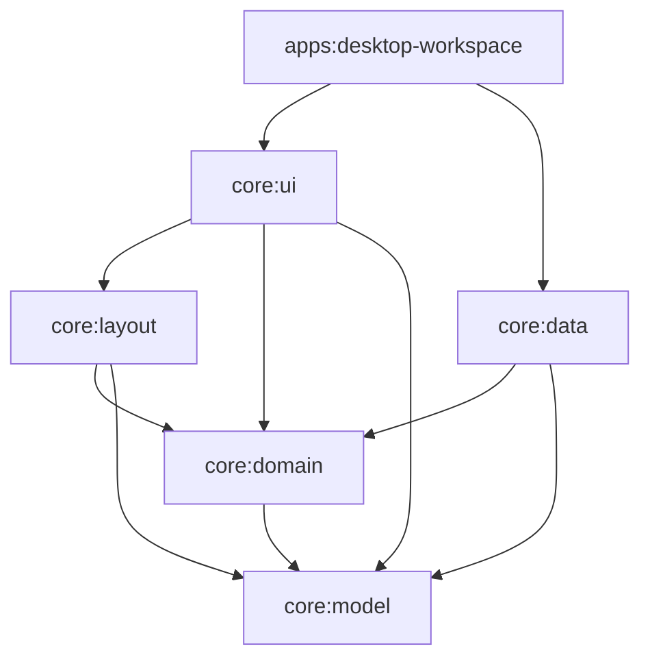

# ComposeDoc

[](https://github.com/shayann07/WYSIWYG-Text-Editor-Compose/actions/workflows/ci.yml)
[](LICENSE)

A multilingual WYSIWYG rich-text/document editor library for **Compose
Multiplatform**, under development. Shared editing semantics, native input,
attributed history, typography, page layout and recovery are the focus.

**Status:** the desktop implementation now builds as Gradle modules and passes the
local gates listed in the [migration checkpoint](docs/reports/composedoc-migration-progress.md).
It is not a published package or a claim of production qualification on every platform.

Urdu/Nastaliq and mixed RTL/LTR documents are demanding early workloads. The
library is language-neutral infrastructure for other applications too. The
owner's future full Urdu-first cloud document application is a separate product.

## Build and run

Prerequisites: JDK 21 (`JAVA_HOME`), Python 3.12 and Node 24. Gradle downloads
pinned build dependencies; Python typography probes additionally require the
packages recorded in the validation guides. Native Windows desktop checks need
an interactive desktop. Do not label CI headless checks as human/native input.

```powershell
python tooling/docs/validate_docs.py
node tooling/verification/v6.mjs
.\gradlew.bat check apiCheck
python tooling/verification/test_verification.py
python tooling/verification/verify.py --workspace-milestone
.\apps\desktop-workspace\write-urdu.cmd --workspace-sample
```

On Unix, use `./gradlew`. `python tooling/launch.py --app --workspace-sample`
builds and starts the sample shell. The sample opens as an unsaved copy. Existing
`.astra` formats are preserved; these are prototype interchange formats, not an
external stable standard. No Maven Central coordinates are published yet.

## Architecture



The domain engine owns the document, composition and attributed history.
Immutable `EditorUiState` flows out; `EditorIntent` commands flow inward. Data
implements domain ports. The workspace shell supplies concrete services;
reusable UI does not import its dialogs or persistence implementations.
`architectureCheck` checks the real Gradle dependency graph and Kotlin imports.
Spotless/Ktlint, Detekt and checked-in public API dumps form separate gates.

| Directory | Contents |
|---|---|
| `core/` | Model, domain, data, layout and reusable UI modules |
| `apps/` | Desktop example workspace |
| `build-logic/`, `gradle/` | Convention plugins, version catalogue and wrapper |
| `tooling/` | Verification, launch, documentation and governance automation |
| `tests/` | Harness, suites, external reviews and historical research |
| `docs/` | Plans, decisions, guides, reports and preserved specifications |
| `.github/` | CI, ownership, issue/PR policy and declarative rulesets |

## Capability and evidence

| Area | Current evidence / boundary |
|---|---|
| Desktop editing, selection, formatting and Undo/Redo | Implemented; existing regression gates pass on the migrated Gradle build |
| Raw UTF-16, composition and attributed history | Executable contract tests; synthetic composition does not qualify native candidate IMEs |
| Workspace, recovery, lists, links and images | Implemented with automated and separately recorded desktop evidence; some native dialog checks remain open |
| Urdu/Nastaliq and multilingual layout | Pinned-font fixtures and visual samples; expert typography qualification remains open |
| Pages, PDF and printing | Active page/output work; full native output fidelity remains unqualified |
| Android, iOS and Web native integration | Target platforms; not certified by Desktop or common-code builds |
| Accessibility and large documents | Explicit qualification gates remain open; prototype size limits still apply |

See [the writing guide](docs/guides/WRITING.md),
[the documentation index](docs/README.md), and
[the frozen V6 specification](docs/plans/v6/editor-v6-standalone.md).
Historical evidence remains byte-verifiable through a versioned relocation ledger.
The 48 historical V5/V5.1 and 33 sealed V6 file hashes must never change.

## Contributing and governance

AI-assisted code is permitted with full human accountability. **PR titles,
PR descriptions, issue bodies and review replies must be written by the human**,
who must understand and test every submitted line. Automated checks verify the
required form and attestations; they cannot prove authorship. Dependabot is
exempt from human-prose formatting, not owner review or CI. See
[CONTRIBUTING.md](CONTRIBUTING.md), [SECURITY.md](SECURITY.md), and
[CODE_OF_CONDUCT.md](CODE_OF_CONDUCT.md). Agent entry points are
[AGENTS.md](AGENTS.md), [CLAUDE.md](CLAUDE.md) and [llms.txt](llms.txt).

Only the owner is intended to have direct-main push bypass. Governance activation
is a separate, verified step after local gates and the authorized push; configuration
files alone do not mean that repository protection or CodeRabbit is active.

## License

Original reusable library, validation suites and sample applications in this
repository are licensed under [Apache License 2.0](LICENSE). [NOTICE](NOTICE)
records attribution and scope. Third-party fonts, Unicode data and references
retain their own licenses. The owner's future commercial/cloud document
application is a separate deliverable and is **not** licensed by this repository
merely because it consumes ComposeDoc. Existing Apache grants are not revoked by
that future application's separate licensing.
