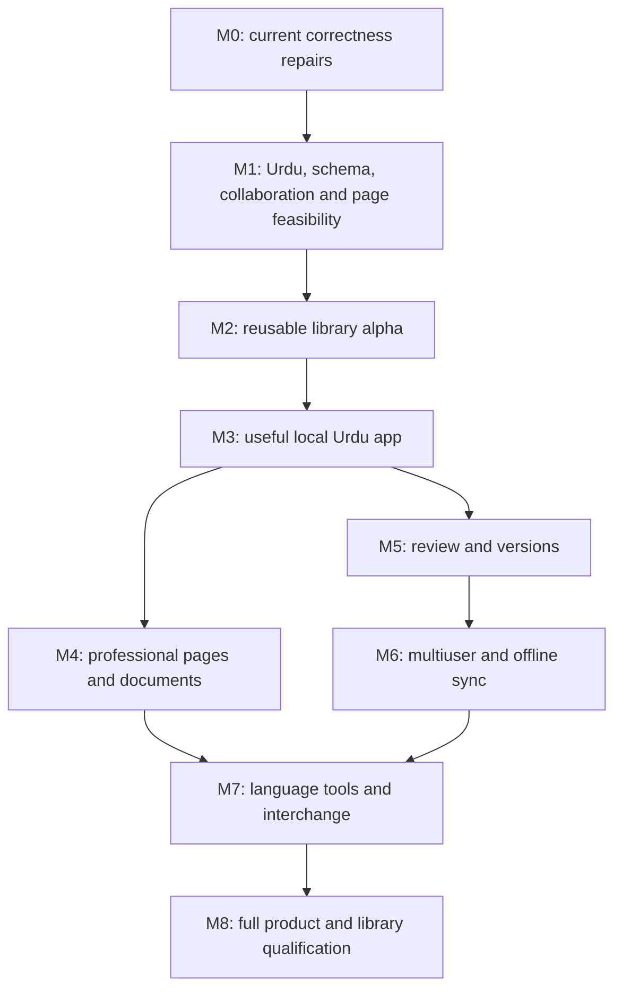

# Urdu-first document application and Compose editor library — v6.0.0

19 October 2026. **FINAL SPECIFICATION BASELINE — FROZEN WITH EXPLICIT OPEN QUALIFICATION GATES. NOT A PRODUCTION-READINESS CLAIM.**

## Reader contract and authority

This is the finalized reuse-first planning layer for an Urdu-first document application with Google Docs-level capabilities and a reusable open-source Compose Multiplatform WYSIWYG editor library. Urdu is primary; correctness of other languages is not negotiable. Android, iOS, Desktop and Web, continuous and page-based editing, and searchable/selectable print-quality output remain required. The current desktop harness is neither the final application nor a published multiplatform library.

The generated standalone file embeds this layer, a dated evidence ledger, the complete 46-feature product catalogue, roadmap, Urdu acceptance requirements and the prior detailed library contracts. No other file is necessary to understand the proposal. Links to code and evidence enable verification; this Markdown does not contain or replace executable evidence. A reviewer with only this file must not claim to have run its referenced tests.

**Precedence:** this v6 layer governs reuse, present status, qualification, sequencing and release decisions. The embedded inherited contracts are corrected for the accepted review decisions and remain the target local-editing semantics. Section 9.5 states the exact final policies; the generator patches conflicting inherited prose instead of relying only on precedence. Historical statements such as “current,” “frozen,” “not yet implemented,” or “production not authorized” describe their dated baseline, not today's repository or permission. Embedded old phase order is replaced by the v6 work order. No historical evidence is upgraded merely by inclusion. Full-product requirements override earlier slice exclusions; an unimplemented requirement stays open. Contradictions not covered by these rules must be recorded and resolved before the affected API freezes, not guessed by a coding agent.

**This request authorizes research and planning only.** It does not authorize new production code, dependency adoption, a fork, publication, a license choice, messages to other sessions or interruption of current qualification work. The next implementation prompt is a separate bounded assignment. No production changes are made by finalizing this specification; inspect the latest implementation handoff before continuing its qualification work.

Version numbers are separate namespaces: this is plan v6; the desktop prototype's `.astra` v6 is a private file format; neither means a library release 6.0. Both independent Argon reviews have been dispositioned and the owner has explicitly requested finalization. The finalized contract includes section 9.5 and the corrected embedded annex. A frozen plan can retain explicit experimental decisions and blocked platform gates; it cannot represent them as solved.

## 1. Chosen architecture and why it is retained

### 1.1 Decision

Retain one semantic document/session owner, a canonical attributed hierarchical document, native/DOM projections, and a shared layout-to-selection contract. **Change the implementation strategy to mandatory component reuse evaluation before substantial custom work.** Reuse typography/layout engines and platform facilities; prefer libraries over copied code, isolated adaptations over forks, and an existing whole editor only if a discriminating compatibility slice demonstrates a better fit. This is an engineering choice under incomplete evidence, not proof that our engine is superior or cheaper.

The product has four separable responsibilities:

1. A headless KMP semantic kernel owns accepted document state, transactions, targets, local history, composition overlay and resources.
2. Platform input, selection, accessibility and clipboard adapters translate proposals/queries through that owner. There is one active native flow per editor, not one native editor per paragraph.
3. Layout and output derive glyph/line/page geometry and semantic mappings. Native surfaces use Compose and qualified platform services; Web may use ProseMirror's DOM surface under the integration contract below. Canvas is a rendering choice, not an input/accessibility architecture by itself.
4. Application services own files/workspaces, accounts, sharing, collaboration transport, review workflows and language services. They cannot mutate the document behind the kernel.

Use existing Skia/Skiko/Compose and appropriate native backends for shaping/layout. No new Unicode shaper, bidi algorithm or PDF file-format implementation is selected. The abandoned bracket index and unqualified native Skia patch remain outside the baseline. Large paragraphs are a measured qualification problem; arbitrary paragraph chopping, style merging, raster-only PDF or a silent document cap are not substitutes for requirements.

### 1.2 Alternatives and reopening conditions

| Approach | Present decision | Reason and falsifiable reopening condition |
|---|---|---|
| Adopt ComposeTextEditor wholesale | Not selected; strongest native input/reference candidate | Its source is an editor-specific state/IME system. Test migration of our attributed history, structural projection and raw input contract before assigning it ownership. Source similarity alone does not prove incompatibility or suitability. |
| Adopt Compose Rich Editor wholesale | Not selected for full document owner; useful codecs/list/rich-text reference | Its BasicTextField/rich-paragraph path needs qualification against hierarchy, cross-paragraph composition and retained raw attribution. A common rich-input control may still be reused in application fields outside the document. |
| Adopt Cascade wholesale | Not selected for current native document surface | Its documented per-block TextFieldState and block-selection model differs from one cross-block native flow. Reopen if an adapter passes that exact flow contract with less owned integration code. |
| Adopt TextKit wholesale | Not selected for full in-place tables | The inspected table contract uses a popup editor and separate table history. This does not meet a single in-place paginated table/history authority without integration changes. |
| Run a browser editor in every platform WebView | Not selected | Would change the native Compose product requirement. Web surface reuse remains allowed on Web. |
| Hand-build all layers | Rejected | Reimplements solved shaping, platform, parsing, collaboration and output machinery without demonstrated value. |
| Fork a runtime immediately | Rejected as default | Fork cost includes binary packaging, platform support and update maintenance. A measured failure and equivalence corpus must justify it. |

A whole-editor pivot requires a written comparison on the same fixtures, including accepted semantics, input, real Urdu/mixed-script appearance, migration, feature loss, package/license footprint and maintenance. A hard requirement failure disqualifies a candidate as a replacement, not as a component donor. Do not average away a correctness failure using a weighted feature score. Do not claim estimated integration effort is measured until an adapter slice exists.

### 1.3 What the research actually established

Read current primary docs and pinned source on 19 October. Upstream test suites were **NOT RUN** in this research. Main-branch source, released packages and platform qualification are separate. Source and license metadata are recorded in the generated upstream ledger; an API rate limit prevented some additional metadata requests and is retained as an error, not bypassed with invented results.

ComposeTextEditor's current `6f0a433e42169ad547ca7a5497ca30f99feadf55` differs from the earlier inspected `3589818...` by a README dependency update to 3.1.1 only. That delta does not invalidate the previous source-fit analysis. Its shared input logic, Skiko request adapter, pointer-affinity tests and input-session design are concrete adaptation candidates. The adapter is tied to its own TextEditorState, so copying it unchanged is not a safe shortcut. [Source](https://github.com/Darkrock-Studios/ComposeTextEditor/blob/6f0a433e42169ad547ca7a5497ca30f99feadf55/docs/design/text-input-sessions.md).

Compose Rich Editor, Cascade and TextKit have useful existing implementations. Their capabilities disprove any claim that Compose has no rich editors. None of the inspected sources establishes all of this project's semantics, qualified platforms, Urdu typography, collaboration and print fidelity together. The exact-fit absence is bounded to the inspected candidates; it is not a claim about every editor on the market.

### 1.4 Mandatory reuse register

The dispositions are **CURRENT** (already used), **EVALUATE** (candidate, not approved), **ADAPT** (preferred donor subject to qualification), and **REFERENCE** (study behavior/tests, no runtime adoption). No row is an instruction to copy code without its license/notices and compatibility tests.

| ID | Subsystem / upstream | Disposition and selected boundary | Qualification before adoption |
|---|---|---|---|
| R01 | Compose/Skiko/Skia shaping, layout, UI primitives | CURRENT provisional backend; retain released artifacts | Exact fonts/version, glyph/cluster and selection equivalence, performance and each platform's input/AT; no inference from Desktop to iOS |
| R02 | Compose Foundation TrackedRange/ExpandPolicy/addStyle | REFERENCE or derived view utility; not canonical formatting/history | Verify exact overload/artifact; style-only composition and attributed Undo probes; hidden overlapping-span semantics must not leak into our semantic map |
| R03 | ComposeTextEditor input and pointer tests | ADAPT narrow platform adapter/fixtures | Port callbacks into our immutable InputProposal; eliminate foreign state/history ownership; raw ranges, partial commit, stale callbacks and geometry gates |
| R04 | Compose Rich Editor formatting/list/import paths | REFERENCE; EVALUATE codec utilities | Schema/UTF-16/attribute mapping, loss reports and import safety; no silent conversion of internal-grapheme attribution |
| R05 | Cascade schema extension/import warning patterns | REFERENCE; EVALUATE isolated codecs | No per-block host authority; preserve node IDs and cross-container input semantics |
| R06 | TextKit table workflows | REFERENCE only for baseline | No adoption of a separate popup/history as our document table owner |
| R07 | ProseMirror view/transform | EVALUATE direct Web dependency; ADAPT map tests conceptually for KMP | DOM IME ownership slice; composition-node protection; no second authoritative history; do not transplant scalar offsets as tree identities |
| R08 | ProseMirror tables TableMap | ADAPT cell-grid algorithm/tests behind our schema | Rowspan/colspan, duplicate coverage, cell identity and flow mapping, atomic merge/split/Undo; relative positions require translation |
| R09 | Lexical selection / DOM behavior | REFERENCE and differential scenarios | Test browser-specific behavior; do not copy its state machine into native platform input or assume its Yjs integration fits ours |
| R10 | Unicode official data; ICU boundary services | CURRENT versioned data/reference; EVALUATE cross-platform engine | Exact Unicode version, complete conformance plus tailored/raw UTF-16 policy; ICU availability and locale boundaries differ by target |
| R11 | Yjs / Yrs / Automerge | EVALUATE collaboration engines, never invent CRDT by default | C0 binding on native and Web, offset encoding, structural conflicts, local selective Undo, persistence, malformed UTF-16 and composition gates |
| R12 | PDFBox / PdfKmp / Skia PDF interfaces | EVALUATE output transport/backend | Consume accepted PagePlan/glyph mapping without independent reflow; logical text/selection/appearance and native packaging gates |
| R13 | KmPDF | REFERENCE; not selected for semantic PDF path | Inspected desktop path embeds page images, insufficient for searchable/selectable semantic export |
| R14 | KitePDF | EVALUATE later if it can satisfy the same glyph/semantic bridge | Source/API discovery is not output equivalence; no automatic selection over narrower backend |
| R15 | HarfBuzz utilities / cluster inspection | REFERENCE/tooling; shaping reused through qualified backend | Independently shaped output cannot be substituted unless it equals the actual editor line plan |

Concrete source entry points are embedded in the upstream annex. For a new reuse decision create an ADR with: requirement IDs; upstream commit and release artifact; files/API; license evidence; assumptions; adapter boundary; must-pass tests; retained/custom code; rejection reasons; measured integration effort; update strategy; rollback strategy. A release package, copied source and algorithm reimplementation are different provenance cases. Preserve applicable notices, record local modifications and track dependency/font terms; the project's own license remains undecided. This plan grants no licensing rights and selects no application license.

The first reuse task compares at most two candidate paths for the active bottleneck using one common witness suite. Stop after a complete discriminating slice or a documented hard mismatch. If both fail, keep the current path and record the concrete reason; do not search indefinitely. Reopen only for a relevant upstream change, new requirement or measured failure.

## 2. Core models, boundaries and algorithms

### 2.1 Target model versus implemented prototype

The production model remains the embedded detailed contract: DocumentRoot owns flows and resources; typed hierarchical nodes have stable IDs; text consists of raw UTF-16 units/pieces with canonical attributes; cell flows are separate from the table atom in the parent flow. Measured persistent B+ text/child sequences plus versioned identity/parent indexes are a **target design**, not the current Kotlin implementation. The desktop harness uses bounded array/snapshot structures and a private `.astra` codec. Do not rename it as the production persistent KMP kernel.

Required modules: `editor-contracts`, `editor-core`, `editor-unicode`, `editor-layout`, `editor-pagination`, `editor-input-{android,ios,desktop,web}`, `editor-accessibility`, `editor-clipboard`, `editor-persistence`, `editor-codecs`, `editor-review`, `editor-sync-contracts`, a Compose UI layer, and external sample applications. Names are proposed module boundaries, not published package coordinates. Keep JVM/AWT/OS dependencies out of common semantic code. A Web adapter can be JS interop without moving the native core into JavaScript.

```kotlin
// Contract notation, not compilable implementation or final ABI.
data class Basis(val documentId: DocumentId, val flowId: FlowId,
                 val documentRevision: Long, val sessionRevision: Long,
                 val epoch: Long, val generation: Long)
data class InputProposal(val basis: Basis, val stamp: AdapterStamp,
                         val target: NativeTarget, val operation: NativeOperation,
                         val postSelection: RawSelection?)
interface SemanticOwner {
    fun snapshot(): PublishedSnapshot
    fun dispatch(command: CapturedCommand): CommandResult
    fun accept(proposal: InputProposal): InputResult
    fun receipt(ticket: Ticket): CompactAcknowledgement?
}
interface LayoutBackend {
    fun layout(request: ImmutableLayoutRequest): LayoutSnapshot
    // Snapshot owns the exact font/resource/version key and semantic maps.
}
interface PlatformHost {
    fun publish(delta: AcceptedProjectionDelta)
    fun requestSettlement(request: SettlementRequest): SettlementAttempt
    // An attempt is not a successful fence. Result comes from qualified evidence.
}
```

Use the inherited finite command catalogue and closed primitive set. `Applied`, `NoChange`, `Deferred`, `Rejected`, duplicate acknowledgement and `Fault` are distinct. Commands capture targets and typing intent at admission, not whenever asynchronous work finishes. Expected rejection is an explicit outcome; implementation failure rolls back the atomic publication. No downstream library may mutate canonical state except by an accepted owner transaction.

### 2.2 Coordinate domains

Never represent every coordinate as an unqualified Int. Distinguish committed document points, visible/provisional points, per-flow UTF-16 native offsets, Unicode scalar indices, grapheme boundaries, glyph clusters, table-grid coordinates, page-fragment coordinates and device/screen pixels. Basis/revision and affinity accompany every ambiguous mapping. UTF-8, code-point and UTF-16 offsets require explicit adapters; this is particularly important for Rust CRDT interfaces and PDF text extraction.

A LayoutSnapshot contains canonical revision, visible session revision, block content versions, typography/font/resource identities, width, page profile and transforms. `hitTest(point)` returns a position plus bidi/wrap association and its key. `caret(position, affinity)` can have more than one valid visual edge; `selectionRects(range)` may return disjoint rectangles. Inverse mappings are relations at bidi seams, not an unconditional one-to-one identity. Reject or refresh stale geometry rather than reinterpret it as current.

Store model positions independently of page numbers. Page fragments identify a source flow/block/range plus continuation state. Reflow changes fragments, not canonical text or identity. List markers are derived decorations with their own measured gutter, not text units. An image is a typed atomic resource reference, not a naked U+FFFC inferred from text.

### 2.3 Production storage migration

Keep the simple implementation as a reference while introducing the persistent kernel in a separate module. For each command compare canonical semantic serialization, selection, maps, attributes, structure and outcomes. Token metadata is excluded from semantic revision equality where the inherited contract says so; structural IDs remain semantic. Validate current-root membership, detached nodes and cross-flow rejection. Move/split/merge must not rebuild all sibling indexes.

Production complexity includes depth, touched pieces, attributes, anchors and retained roots. O(1) root restoration does not make Undo notification/layout/resource cleanup O(1). Qualify locality with traversal/allocation counters and scale curves before advertising it. The prototype's 100,000-unit limit is not a permanent product limit; changing it requires memory/input/output qualification rather than removing a guard blindly.

### 2.4 Import/export and resource boundary

Prefer an existing parser/serializer, then translate a validated intermediate tree through one schema compiler. Parsing HTML/Markdown is not equivalent to faithful document conversion. Sanitize URLs, attributes, empty-block attributes and resource references; remap imported IDs; report unsupported content and refuse unsafe/unrepresentable imports atomically. Do not silently normalize Unicode. Preserve raw UTF-16 in the canonical format; scalar-only interchange replaces invalid units only with an explicit loss report. Keep no-op dry-run conversion available for review before adoption.

Images are document-owned immutable bytes/descriptors with media limits, decode off the UI thread and fallback diagnostics. Do not retain only a local filesystem path. Snapshot resources for export. Implement codec migration/read compatibility before changing the stored schema, and never rewrite a user's original merely by opening it.

## 3. Formal invariants and strict verification

The embedded I01–I17 and extended admission/anchor/cell invariants remain mandatory. The following v6 refinements are explicit release assertions:

| ID | Assertion | Discriminating verification |
|---|---|---|
| V6-I01 | A reused editor/CRDT/DOM component cannot bypass the semantic transaction owner | Mutation/notification spies and rejected-proposal traces |
| V6-I02 | Exact accepted input, raw attributes and structural identity survive required edit/history/persistence operations | Independent canonical tuples, not screenshot or text-only equality |
| V6-I03 | A candidate oracle is independent of the behavior it judges | Official versioned data, reviewed expected ranges, failure-against-old behavior and separate simple model |
| V6-I04 | Geometry and hit tests use the same visible revision and coordinate transforms | Stale-layout injection, bidi relations, expected visual points, zoom/scroll/page seams |
| V6-I05 | Marker side follows local direction; nesting placement is a separate policy | Both RTL-parent/LTR-child and reverse, not one mirrored formula as oracle |
| V6-I06 | Release claims are scoped to exact version/platform/input/font/DPI evidence | Machine-readable capability matrix with NOT RUN entries |
| V6-I07 | Refusal of noncancelable input retains a recoverable proposal; no false success | Late callback/capacity/invalid-structure recovery and lifecycle tests |
| V6-I08 | Collaborative Undo cannot restore a root that erases unrelated remote work | Two-peer local Undo/redo with concurrent text/format/move/delete |
| V6-I09 | Pagination/output preserve coverage and logical reading order | Source-range coverage, image/resource coverage, extraction and selection-box checks |
| V6-I10 | Failed validation leaves dialog/command state recoverable and content unchanged | Actual controls plus state/history assertions |

### 3.1 Unicode and multilingual verification contract

Retain the inherited Unicode 16.0.0 segmentation baseline until an explicit upgrade is tested. Current Unicode web pages may describe newer versions; never compare newer conformance data to the older algorithm without declaring the version mismatch. Renderer Unicode/font versions may differ; record them separately. Word navigation for Thai/CJK and dictionary behavior is not proven by grapheme conformance.

Fixtures must name the actual target substring and independent UTF-16 boundaries: Urdu/Arabic diacritics and joining, Persian ZWNJ, Hebrew niqqud, precomposed/decomposed Latin, Devanagari/Bengali conjuncts, Thai marks, Han/kana/Hangul, supplementary scalars, skin-tone ZWJ emoji, flags, variation selectors and bidi isolates. Test boundaries adjacent to hard/soft breaks, atoms and list items. Include inserting/removing joiners and marks that change cluster boundaries while retaining constituent attribution.

For each target perform Backspace, forward Delete, forward/backward selected replacement, formatting/link changes, copy/paste, Undo/Redo and Save/Open. Native ranges remain exact; application navigation/deletion follows its documented boundary policy. Independent official break fixtures and explicitly reviewed examples supply expected boundaries; the production segmenter's own stops must not be the only oracle. A case editing a space in a string containing emoji is not an emoji edit test.

### 3.2 Visual and geometry evidence

Numeric finiteness is a sanity check, not placement correctness. Define expected visual run ordering, first-line baselines, marker/text gaps, allowed caret-edge sets and selection-rectangle coverage from independently labeled fixtures. Use backend queries as diagnostic agreement, not sole proof against the same backend's bug. Click representative positions in the actual app and compare resulting logical ranges. Exercise horizontal/vertical movement, Shift selection, preferred x, mixed bidi seams, wraps, images, pages and list gutters. Compare forward/backward selection coverage and ensure scroll/zoom transformations are applied exactly once.

Use pairwise coverage for broad language/size/view combinations and exhaust high-risk boundaries. At least default, small and large sizes; all supported zooms; minimum/normal/maximized windows; Outline+Find together. Record OS DPI and actually tested variants. Match before/after capture content/font/zoom/window; disclose changed sidebar/page geometry. Inspect readable crops. No screenshots generated by AI count as product evidence.

### 3.3 Evidence levels and stop rules

Every result states: DOC/SOURCE INSPECTION, MODEL, EXECUTED UNIT, MOUNTED UI, LIVE NATIVE or HUMAN TYPOGRAPHY REVIEW; alongside PASS/FAIL/BLOCKED/NOT RUN and exact scope. Platform and release artifacts are separate dimensions. Test count is not coverage proof. A live pasted string is not keyboard/IME evidence; a synthetic composition callback is not an OS candidate window. Source branch README claims are not release-package behavior.

Runners fail on child-process failure, uncaught UI exceptions and assertions. Capture build/source/font/dependency identities once, validate before and after, and preserve failing traces. New regressions should fail the defective behavior where feasible. Fuzzing uses fixed seeds and shrinking. A failed environmental prerequisite blocks only the affected gate; do not fabricate passing native tests, weaken assertions or start unlimited exploratory work.

## 4. IME composition, selection and settlement

### 4.1 Ownership state machine

Keep connection epoch, input generation, session ordinal/token, marked range, attribution epoch, committed/visible roots, history preimage, settlement obligation and pending commands separate. Batch end, focus loss, unmark or time elapsed is not universally a native fence. One registered adapter normalizes each actual platform callback; internal stamps provide replay protection, not proof of OS provenance.

| State/event | Required transition and acceptance | What must not happen |
|---|---|---|
| Idle → mark or first preedit | Capture complete preimage before provisional splice; create immutable attribution baseline | Snapshot of dirty preedit as Undo-before state |
| Composing → candidate update | Reconcile against the same baseline using UTF-16 prefix/nonoverlapping suffix; preserve admitted tags | Seed from previous candidate and accumulate path-dependent styles |
| Retarget | Exact admitted range, new baseline against current committed content; preserve other islands | Clamp to protect old prefix or implicitly commit all islands |
| Partial commit | Accept the specified prefix policy from the inherited segment model; retain residual obligations | Drop trailing provisional islands or erase accepted prefix on cancel |
| Nonterminal unmark | Clear mark only; keep session/overlay/preimage and wait | Push history or declare terminal success |
| Qualified terminal event | Accept native result; drain queued commands atomically under LIFO action ledger | Publish intermediate formatting/Undo stages |
| Application abort | Discard unaccepted overlay; keep accepted partial effects; explicit command outcomes | Treat native empty replacement as rollback |
| Native removal | Apply exact replacement in named visible basis, then terminal acceptance | Restore initial document by guessing intent |
| Connection replacement/disposal | Finalize according to contract; cancel old commands; retire identity after publication | Apply old toolbar commands in new connection |
| Unproven/stale/noncancelable proposal | Reject when possible; otherwise preserve proposal and quarantine with recovery UX | Silently drop input or reinterpret against today's caret |

The segment algorithm, structural compiler, tagged provenance, partialCommit examples, action ledger, retention limits and cell rules are fully embedded in the contract annex. Cross-paragraph composition remains required within an admitted flow, including selected hierarchy transitions and removable objects where allowed. Cell boundaries are separate flows, not ordinary text separators; cross-cell editing uses explicit cell-selection commands. This distinction is not an exclusion of in-place rich tables.

### 4.2 Reuse constraints

Translate upstream input operations into our proposals, not upstream state mutations. Preserve atomic multi-splice code-point deletion, exact selections, commit/finish distinction and changed-range provenance. A library that clamps input, discards malformed UTF-16, flattens boundaries or owns its own Undo requires an adapter with demonstrated semantics; do not import those behaviors accidentally.

Maintain raw protocol selection separately from the drawable caret and semantic toolbar target. Programmatic echo suppression matches the exact expected update, not every same-offset event. Reentrant reads see only the last published state. Native reads may exclude the currently marked range while internal Dc has broader provisional obligations; use named coordinate conversions rather than assuming these are the same document.

### 4.3 Native qualification

Desktop starts with the current AWT/Compose host. The Japanese activation error `0x80004005` is a setup failure, not proof the IME or editor is impossible. One bounded manual activation/reference-control comparison is appropriate in the existing assigned test batch. Android requires real InputConnection, keyboard queries/batches/composition and TalkBack. iOS requires actual UITextInput marked/selected ranges, dictation/reconversion and VoiceOver on macOS/device infrastructure. Web requires real browser composition/candidate tests, not dispatchEvent equivalents. Available native tests cannot be replaced by fixtures; unavailable targets remain explicitly blocked.

## 5. Formatting, boundary attributes and derived UI

Keep canonical per-key attributes, not arbitrary overlapping sticky-span handles as the persisted model. Inherit, explicit value (including false) and Clear have distinct meanings. Typography is stored as semantic font references; backend font handles are derived. Preserve raw per-unit attribution even inside a merged grapheme. Rendering may use the inherited first-scalar effective style policy without rewriting stored constituents. Explicit range-format commands expand to complete graphemes within each block; raw native ranges do not.

Typing at unequal-run boundaries uses captured logical TypingSide; it does not union neighboring styles. Replacement seed comes from the first selected text in document order, independent of selection direction. Empty blocks retain versioned typing defaults. Links have identities distinct from URL strings; automatic typing inheritance requires the same ID on both sides. Exterior seams insert outside unless explicit intent says otherwise. Current-link edit/remove at a collapsed caret is strict-interior identity targeting; one-unit links or exact exterior seams require explicit selection/insertion UI, not a guessed neighboring link. Inline-code and whitespace/Enter boundaries follow the inherited rules.

The prototype's dominant raw-unit marker vote was demonstrated unstable during review. Final v6 adopts stable semantic item marker typography and shared sibling lanes under D05. This is a required implementation change with versioned persistence/migration and regression tests, not a claim that production code was changed in this planning task.

Numeric markers share the first line's alphabetic baseline; bullets use a separate optical-center rule. Measure sibling gutters, continuation columns and nesting. Root direction anchors nesting; each item's own resolved direction controls marker side, shaping and Start/End alignment. An opposite-direction child uses its own marker side within the shared parent-derived sibling lane, never a per-item intrinsic-width column (D05). Validate wraps and large mixed fonts; a screenshot of one English child is insufficient.

Outline navigation hit-tests actual row bounds; blank space does nothing. Current-section indication is distinct from keyboard selection. Labels use script-capable measured wrapping and accessible full text. Toolbar values must retain distinguishing heading/font/zoom information. Persistent validation dialogs preserve bad input and show actionable errors; cancellation and stale-target refusal cannot mutate content. These are part of usable editing, not optional polish after model tests pass.

## 6. Cross-platform integration and reuse contracts

### 6.1 Compose capability boundary

Current Android documentation exposes ExpandPolicy with tracked-range boundary growth and references TextFieldBuffer.addStyle. Foundation's release page and API pages can describe different introduction stages/overloads; the old output-only addStyle history must not be conflated with tracked persistent APIs. JetBrains publishes Compose Multiplatform 1.12.1; that alone does not prove every Android API/backend behaves identically. [ExpandPolicy](https://developer.android.com/reference/kotlin/androidx/compose/foundation/text/input/ExpandPolicy), [Foundation releases](https://developer.android.com/jetpack/androidx/releases/compose-foundation), [CMP release](https://github.com/JetBrains/compose-multiplatform/releases/tag/v1.12.1).

| Target | What is actually established in this repository | Missing qualification |
|---|---|---|
| Android | Official API/source availability; adapter design and donor source inspected | This plan's actual resolved Android artifact, runtime semantics, native input/AT and release matrix |
| Desktop Windows | Built against foundation-desktop/ui-desktop 1.12.1, Skiko 0.150.1, Kotlin 2.2.20; prior state probes and current prototype evidence | Full candidate IME, all fonts/DPI/AT, large documents, production kernel |
| iOS | CMP release and platform API documentation; design only in this review | Actual linking/runtime/UITextInput/VoiceOver and packaging |
| Web | Upstream/editor source and selected semantic-DOM architecture | ProseMirror-owner integration, real OS composition and browser/AT matrix |

Prior Desktop state probes observed attributed Undo loss and composition side effects in particular style operations; these are recorded version-specific failures, not a universal condemnation of Compose or a fresh rerun today. Existing utility APIs solve range tracking and rendering tasks; they do not establish our hierarchy, raw attribution history, session recovery or cross-platform qualification. Retain useful APIs, reject unjustified ownership assumptions.

### 6.2 Native adapter contract

Android InputConnection surrounding deletion validates both flanks and structural admission before publication; nested batch edit is not finish-composition. iOS input delegate notification ordering and geometry must be validated with real callbacks. AWT committed-text slicing uses endpoint association around the marked range; trailing(-1) can represent a valid TextHitInfo start boundary. Never reject every negative character index without checking insertion offset/affinity. Native selection and geometry queries use the published frame and correctly transformed screen coordinates. [Android contract](https://developer.android.com/reference/android/view/inputmethod/InputConnection), [Apple protocol](https://developer.apple.com/documentation/uikit/uitextinput), [AWT contract](https://docs.oracle.com/en/java/javase/23/docs/api/java.desktop/java/awt/im/InputMethodRequests.html).

Accessibility consumes canonical semantics and the same keyed geometry, including offscreen text, images, links, lists, tables and pages. A canvas requires explicit accessible editing/navigation integration. Synthetic AT method calls do not qualify actual screen readers. No accidental shadow text field becomes a second history owner.

### 6.3 Web reuse slice — preferred candidate ProseMirror

ProseMirror supplies mature DOM editing machinery and mapping APIs, but its state and composition lifecycle cannot simply be bolted onto the kernel. The selected spike uses its view/state as a derived browser projection. `dispatchTransaction` captures an immutable candidate and basis; the owner returns accepted text/structure/selection deltas. Disable independent ProseMirror history for canonical document Undo. Ordinary accepted app mutations update the projection once with feedback-loop suppression tied to receipts.

During browser composition the browser DOM is a temporary provisional view, not accepted canonical storage. Protect the composing Text leaf and wrapper chain from replace/reparent/split, even when edits are numerically outside the marked range. Noncancelable changes become provisional proposals or retained recovery records. Nonconflicting siblings can update only if ownership and selection survive. An asynchronous bridge must not acknowledge canonical acceptance early or repaint the protected subtree from an old snapshot. [ProseMirror reference](https://prosemirror.net/docs/ref/), [input source](https://github.com/ProseMirror/prosemirror-view/blob/ca4c78e9b56f1b164c0b3758b59d8748f11b7534/src/input.ts), [Input Events](https://www.w3.org/TR/input-events-2/).

Stop condition: if the adapter cannot preserve active DOM composition and exact acceptance semantics with supported extension points, fail the slice and compare the existing bespoke semantic-DOM adapter. Do not maintain two editable documents with eventually reconciled independent histories. Selecting ProseMirror today is a candidate decision, not a promise its bridge already works.

### 6.4 Collaboration and review

Evaluate Yjs/Yrs first as one family (JS Web with a potential native Rust boundary), Automerge as the alternate. This is not a selected production dependency or a proven KMP binding. Before adopting either, pin release artifact and native bindings, measure binary/FFI cost, and prove text-index encoding, unsupported raw UTF-16 policy, typed attributes, structural moves/deletes, IDs, resource ownership and local selective Undo. If raw ill-formed UTF-16 cannot be represented, either encode it reversibly under a documented schema or block adoption; do not silently replace it.

There must be a precise authority bridge: the replication engine owns convergent replicated state; the semantic owner validates/compiles local requests and publishes the canonical materialization atomically. Remote changes pass through that same materialization/validation boundary, not ordinary user-input rejection after acknowledging replicated acceptance. C0 must settle how invalid remote updates/schema versions are quarantined or rejected and how peers remain convergent. Projection cache is not another mutable authority. Root-snapshot local Undo stays local-only until replaced by a qualified per-origin operation mechanism.

Yjs UndoManager supports scoped/tracked-origin undo; that is a useful starting mechanism, not proof of our structural intent semantics. Test concurrent format, paragraph split, move, deletion, table edit, comment anchors and accepted/rejected suggestions. Presence is ephemeral; annotations/review are semantic records. Remote edits overlapping native composition need an explicit qualified policy (defer conflicting projection, settle with proven fence, or retained recovery); a revision increment alone is insufficient. [Yjs UndoManager](https://docs.yjs.dev/api/undo-manager), [Yrs](https://github.com/y-crdt/y-crdt), [Automerge](https://github.com/automerge/automerge).

### 6.5 Pagination and PDF

One immutable PagePlan carries source flow/ranges, line fragments, glyph runs or a qualified equivalent, clusters, reading order, fonts/resources, section/page settings, table continuation and repeated-header instances. Editing, preview and output must consume consistent geometry. Native paragraph shaping context survives page fragmentation. Headers/footers are canonical flows with repeated visual instances, not copied text per page.

PDFBox is a possible JVM writer; PdfKmp a possible wrapper/backend; Skia PDF and KitePDF are candidates only where glyph and semantic mappings can be preserved. A writer that independently wraps/reshapes text cannot certify preview fidelity. Raster pages alone fail searchable/selectable export. The existing vector-outline plus invisible-text experiment is rejected because reading order/diacritics/selection geometry failed despite visual similarity. Do not repeat that route without a concrete cluster-to-semantic mapping improvement. [PDFBox](https://pdfbox.apache.org/), [PdfKmp source](https://github.com/ConaMobileDev/PdfKmp/blob/9985a335c4db0c0ee93d1f1d73468ced4e41de08/pdfkmp/src/jvmMain/kotlin/com/conamobile/pdfkmp/render/JvmPdfCanvas.kt).

GP0 tests one continuing Urdu/English/Arabic paragraph, an image, a spanning rich table, editable boundary selection/composition and semantic PDF from the same profile. Require exact source coverage, stable reading order, logical extracted text, useful selection geometry, font/image retention and appearance under declared tolerances. PDF tagging, accessibility, actual platform printing and printer/profile differences need later GP2/GP3 qualification; a visually matching preview does not close them.

## 7. Transactions, history, recovery and retention

Keep one publication per accepted command or normalized native batch. The preimage includes document, composition, protocol bookkeeping, pending outcomes, history, resources, selection and anchors. Counter identity allocation is monotonic even on rollback; semantic/session revisions advance only under their declared rules. Observer failures cannot veto accepted content, and observer assertions must be checked outside callbacks.

Local history preserves complete attributed structural roots and before/after selection, typing intent, IDs and resources. Composition history starts before preedit and settles once if net semantics changed. Pending application actions drain FIFO after qualified terminal input; Undo resolves through the inherited settlement-local LIFO ledger, including explicit no-history/cancellation credits. Redo restores only actual undone groups. Do not replace this with a donor editor's text-only history or collaboration root restore.

Keep bounded compact receipts, coordinate bases and replay watermarks; they must not retain whole snapshots/history accidentally. Pending dependency bases are pinned before eviction and released in finally paths. Attribute/resource slabs, current roots, active S0, history, layout, caller-held snapshots and recovery artifacts each need explicit ownership accounting. Pool limits are not total heap guarantees. Backpressure never silently truncates native content.

**Implemented durability is narrower than the target.** Current Windows recovery writes committed-content copies roughly every two seconds plus scheduling/IO, with fallback and tested owned-process kills. Named documents change only on explicit Save. Provisional composition, retained drafts and quarantined callbacks remain memory-only unless explicitly exported; Undo/caret are not restored after process loss. Power-loss durability is not qualified.

The production target retains both committed content and unresolved provisional drafts with durable decisions, as in the inherited recovery protocol. Do not call this implemented merely because the old plan specifies it. Before claiming lossless input recovery, persist the draft/preimage/resources and quarantine obligations, make apply/discard durable, and test process kill at each write/flush/replace stage. Applying a draft validates its expected base and is one undoable command; newer edits require conflict resolution, not overwrite. Never replay stale native callbacks automatically after restart.

## 8. Implementation blueprint, reuse gates and acceptance

V6 changes sequence, not the product ambition. Earlier G0–G8 and product M0–M8 remain traceable, but use this dependency order for new assignments. A gate has no PASS until actual evidence exists. Partial evidence can permit independent work, not dependent release claims.

| Phase / gate | Deliverable | Acceptance and stop condition | Existing correspondence |
|---|---|---|---|
| V6-0 Review disposition | Both Argon reviews dispositioned; executable witnesses and corrected standalone | COMPLETE at specification level under the owner's finalization request; no production/platform gate passes | Planning only |
| V6-1 / Q0 | Targeted complex-cluster edit and visual geometry witnesses; repair genuine defects | Named target ranges, independent oracles, actual native walkthrough and regression preservation; exact native gaps remain explicit | Current assigned qualification; U0/U1/G3–G5 subsets |
| V6-2 / RU0 | Reuse ADRs and two-path adapter comparison for the active input/Web bottleneck | Same contract fixtures; donor provenance; no second authority/history; reject hard mismatches and record migration cost | G0 platform feasibility |
| V6-3 / S0+C0+GP0 | Bounded schema, collaboration and page/output vertical slices | Typed cells/sections/review IDs; convergent two-peer composition/Undo test; semantic output witness. Resolve dependencies before stable API/schema | Existing M1 gates remain open |
| V6-4 / K0 | Extract headless KMP kernel and persistent storage behind contracts | External sample consumes public API; differential full semantics; 100k operations/20 seeds where inherited gate requires; locality/retention counters; supported target compiles | G1–G3, GL alpha |
| V6-5 / N0 | Native Android/iOS/Desktop and Web surface adapters | Real IME/caret/AT/clipboard lifecycle per claimed platform, disposal/reentry/provenance and offline font tests | G4–G6, U1–U3 |
| V6-6 / D0 | Durable document/draft/resource package and migration | Crash matrix, tail corruption, atomic decisions, no lost unresolved draft, honest save state | G7, F27/F36/F46 |
| V6-7 / P0 | Professional page/table/output implementation | GP0 design adopted; sections, spanning tables, margins, headers/footers, overflow; semantic PDF/print fixtures | GP1–GP3, U4, M4 |
| V6-8 / A0 | Useful local Urdu application and qualified library alpha | Public API-based app, external consumer, Urdu UI/accessibility, packaging/license/notices; feature/platform matrix | M2/M3, GL |
| V6-9 / C1+R0 | Collaboration/review/version services | C0-backed replication, per-user Undo, offline conflict/permission/review gates | M5/M6 |
| V6-10 / L0 | Language services, office codecs, extensions and stable release | Corpus-based Urdu quality, declared DOCX/ODT profiles, performance/AT/output/platform gates; selected license and update policy | M7/M8, G8/U5 |

Phases denote dependencies, not an instruction to build all work serially or keep the user waiting for a full product. The useful current desktop app remains usable while gates are investigated. Native feasibility must not wait until after months of storage construction. S0/C0/GP0 can use tiny disposable adapters and reference structures; they do not require a completed production B+ implementation. Collaboration/pagination failure blocks the dependent freeze/release, not unrelated local bug fixes.

### 8.1 Concrete next assignments after review

1. Reconcile the already-issued Q0 assignment with its actual report. Do not reissue completed work or interrupt a running task.
2. If Q0 exposes native input/selection defects, run RU0 against the pinned ComposeTextEditor adapter/test donors and current host. Keep semantic cases identical. If not, prioritize Web ownership or Android feasibility, whichever has the earliest untested hard dependency.
3. Execute S0/C0/GP0 before claiming stable production schema/API. Each returns a decision record and minimal runnable witness, not an open-ended research essay. At most two concrete candidate backends per gate before escalating a failed hard requirement.
4. Extract only interfaces supported by those outcomes. Do not publish package coordinates/license as an assumption or bake `.astra` prototype versions into public API.

### 8.2 Performance and regression budgets

Carry the inherited product targets as targets, not measured achievements. Establish named hardware/device/build/font conditions and workloads: small notes; 100k-unit single paragraph; 1M-unit multi-block document; deep hierarchy; many styles/anchors/resources; RTL mixed lists/tables; repeated composition; long history. Measure p50/p95/p99 input-to-paint, owner transaction, native query, layout, memory/retained roots, startup, import/export and checkpoint latency. Warm/cold runs and UI-thread versus background work are separate. No JS model timing is a native editor benchmark. A 100k cap or average paragraph workload cannot hide the pathological single-paragraph case.

Before optimizing, retain a failing trace and a comparable baseline on the same workload. Reuse a qualified faster backend if it preserves outputs; otherwise block the claimed envelope and record the tradeoff for the owner. Layout-only changes must not manufacture document revisions/history or consume accepted text.

## 9. Adversarial self-review, open decisions and freeze criteria

### 9.1 Present evidence snapshot

As of this draft the last examined completed batch is `batch-20261019-141905-30540`, manifest SHA-256 `eef9c31b11e8cca6d8d92114f9828e14953e32a7286b0c10bf8420ee263a079b`. It records 16 passing integrated stages, 17 focused groups (including 12 script fixtures), 108 integrated layout rows plus 108 additional rows, and 12 owned-process interruption cases. These are reported/examined bounded results, not 216 independent proofs or all-language qualification. A read-only native evidence audit was independently rerun successfully before this planning request; the full suite and native walkthrough were not rerun for plan generation.

The latest repair fixes list markers, existing-link editing/removal, persistent image validation, outline hit/current/readability and toolbar sizing. Before/after native captures show improvement. Native final-build spotcheck records Remove/Undo and blank-outline no-jump. Real Urdu/Arabic key traces are on an earlier repair build with an explicit class-equivalence bridge; other mixed input was pasted. Japanese activation was blocked; candidate lifecycle remains NOT RUN. Only 125% Windows scale is documented. Screenshots do not establish exact persisted text; payload audits do not establish typography.

Independent review found the multilingual operation loop edits `stops[1]..stops[2]` only, which is a SPACE in the Unicode stress specimen; its geometry loop largely checks finite coordinates/positive height. Therefore strong complex-cluster editing and hit-test claims remain open. Q0 addresses these specific weaknesses. Do not advertise its results before execution. The new plan does not erase successful bounded tests; it limits their interpretation.

### 9.2 Critical uncertainties and experiments

| Risk | Status / decision required | Minimum settling experiment | Blocks |
|---|---|---|---|
| Complex-cluster editing and geometry | OPEN coverage gaps | Q0 targeted boundary and visual relation tests | Multilingual editing qualification |
| Native provenance/settlement | Desktop partial; others unqualified | Installed candidate IME plus reference control, real platform callbacks/reentry/late arrivals | Platform input release |
| Reuse integration saves effort | Hypothesis, not measured | RU0 slice comparing adapter/maintenance surface on same tests | Dependency/whole-editor replacement |
| Web owner + composing DOM | OPEN | Real candidate lifecycle with owner accept/reject, protected node and async stress | Web release |
| Collaboration engine/encoding/Undo | OPEN | Yjs/Yrs or Automerge two-peer structural and raw-unit trace | Stable sync/schema/API |
| Sections, table spans, suggestions | OPEN S0/R0 design | Single serialized example + command/Undo/merge/import witness | Production schema freeze |
| Glyph-to-semantic PDF bridge | Prior candidates rejected | Same-plan Urdu mixed text/image/table, visual + extraction + selection | GP0/print claims |
| Large-paragraph and retained-root cost | Unqualified | Full pipeline timings and retained heap on declared hardware | Performance claims |
| Durable provisional/quarantine input | Not implemented by checkpoint copies | Kill/recover/apply/discard with exact base/resources | Lossless crash recovery claims |
| Stable marker policy migration | D05 specified; production still uses old vote until next repair | Stored marker style, sibling lanes, exact codec/Undo migration and multilingual visual tests | Marker behavior qualification |
| Font fallback/emoji/word boundaries | Partly tested; sequence appearance open | Cluster-aware fallback and dictionary/word fixtures per backend | Language-quality claims |
| Licenses, redistribution and updates | Project license undecided | Selected artifact/file-level inventory and notices, owner license decision | Publication |

### 9.3 Weaknesses of this v6 proposal

The reuse plan can still underestimate adapter work: DOM/CRDT/native models encode different identity and lifecycle assumptions. The elaborate input contract can overfit synthetic traces without real IMEs. A full inherited contract appendix is precise but may retain obsolete assumptions; reviewers must flag contradictions rather than rely on a blanket precedence sentence. Source-only comparison does not prove our current core is the cheaper route. A measured B+ design is not a finished implementation. Public API stability before C0/S0/GP0 would be premature. Current shared renderer-based geometry checks cannot independently prove the renderer correct. Expert Urdu and other-script review remains necessary.

Do not resolve those risks by asserting “perfect plan.” Freeze only a clear, reviewable specification with named gates and controlled change rules. Blocking contradictions for the next authorized slice must be fixed before its work starts. Open future product semantics require a decision gate before dependent implementation; they do not authorize agents to invent silent policy.

### 9.4 Argon disposition and finalization protocol

For each review finding record ID, exact section, minimal counterexample, affected invariant, severity, evidence level, proposed remedy and acceptance test. Classify CONFIRMED DEFECT, VALID REQUIREMENT GAP, ALREADY COVERED, POLICY CHOICE, UNSUPPORTED CLAIM or EXPERIMENT REQUIRED. Reproduce genuine executable claims when tools/environment exist; otherwise leave them unverified. Resolve conflicts using the owner's requirements and observed evidence, not model reputation.

The owner requested finalization after both reviews. Final `v6.0.0` records the corrected specification, finding dispositions, executed witnesses and explicitly open implementation gates. No Git tag/push/publication is implied. A separate next-session prompt names the bounded qualification/marker repair milestone. Further material changes require a versioned amendment; the submitted review.1 snapshot remains preserved.

### 9.5 Final review dispositions — normative v6 decisions

19 October 2026. Both Argon reviews were assessed independently. Their shared verdict of revisions required was useful; neither source inspection nor agreement between models proves the architecture universally sound or all alternatives unsuitable. Detailed per-finding disposition and runnable witnesses are retained in `docs/reports/v6-final-review-disposition-20261019.md` and `reviews/v6-finalization-20261019/`. This section and the corrected Annex B are the final contracts, not a request to apply reviewer text verbatim.

#### D01 — Zero partial commitment and cancellation policy

`partialCommit(0)` accepts no units, including earlier unmarked islands or bridge units. It does not cut segments, advance the committed cover, reset the marked interval to zero, accept a cell-clearing prelude, rebuild attribution baseline, or create document history. The marked interval stays `[oldM0,oldM1)` in the same overlay. An explicitly supplied valid post-selection is applied; otherwise selection remains unchanged. It is an accepted session event and invalidates outstanding settlement evidence. This is distinct from a terminal zero-text callback, whose platform-normalized lifecycle must be explicit.

The frozen reference implementation actually committed an earlier `AB` island on the review's zero-count trace. A separate validation reference now corrects the zero case at the owner/kernel boundary without editing the frozen model or production Kotlin. The positive-count segment algorithm is unchanged. Cancellation after the corrected zero-count trace returns the exact original document; a positive count still accepts the prescribed preceding overlay prefix.

**Chosen abort policy:** explicit application `abortProvisional` cancels every pending `CompositionTarget` format with `CompositionCancelled`, even if partial text survives. Surviving accepted text remains in Dc unformatted by that cancelled command. Unrelated explicit-range commands retain their ordinary mapping/outcome rules. On terminal acceptance instead of abort, `CompositionTarget` resolves to surviving session islands/accepted portions; an empty target yields `TargetDeleted`. Focus-loss/lifecycle-specific cancellation reasons remain distinct. This selects the already-tested cancellation policy and fixes contradictory “surviving text always remains the target” prose; it does not adopt the other valid product choice of applying toolbar formatting despite explicit abort.

The settlement ledger stays FIFO execution with LIFO Undo slots. A cancelled/no-op history-producing attempted action contributes `CommandWithoutHistory`, even when an earlier queued Undo removed its target. A later queued Undo consumes that attempted action before touching older history. Leftover ephemeral slots are discarded at the end of drainage; they never leak into the next ordinary Undo or Redo. Do not add a queue look-ahead rule, reorder Undo barriers or skip credits to make the review's alternate expectation pass.

Witness: `Hello ` → preedit `ab` → partial `a` → queue Undo, Bold, Undo → abort yields `Hello `, not the empty document. Bold is cancelled; the second queued Undo consumes its credit. The next independent Undo removes `Hello `. Under terminal acceptance, the first Undo removes the accepted composition; Bold then finds its identity target deleted and receives the same one-use credit. Both are intentional, not stack corruption.

#### D02 — Accepted-prefix protection is not permanent immutability

I08 protects accepted content from **discarding an unaccepted residual overlay**. It does not prevent a later explicitly admitted replacement/retarget and positive partial commit from superseding that content. The rollback basis for reconversion is current Dc. Keep exact normalized native-range admission; do not silently clamp, forbid all same-session reconversion or invent a 1:1 old-unit/new-unit mapping for unequal text lengths.

Witness: `abcd` → replace `bc` provisionally with `XYZ` → partial 2 gives Dc=`aXYd`; retarget visible `[1,4)` and preedit `PQ`. Aborting now gives `aXYd`. If partial 1 of `PQ` is accepted first, it consumes the replacement's whole `XY` footprint, giving Dc=`aPd` **before abort**. Aborting Q leaves `aPd`; one session Undo restores `abcd`. Y disappeared through the accepted replacement, not cancellation. This behavior is the existing whole-footprint policy, now stated without the overbroad I08 wording.

#### D03 — Table grid identity, span closure and anchor relocation

Merged/split cells are required F15 functionality gated by S0; they are not excluded from product scope. Nested tables remain an explicit product decision. A canonical cell owns one FlowId exactly once; repeated coverage slots in a derived grid are not duplicate flow declarations.

`TableGridMap` is keyed by table structural revision, row/column order and span properties, not lengths of text inside cells. Each cell stores a stable CellId, FlowId, origin row/column, positive rowspan/colspan and versioned properties. Fill all covered slots with that CellId. Reject overlap, holes, bounds errors and duplicate canonical CellId/FlowId ownership. A bounded dense grid is acceptable in the witness implementation; production admission limits or a sparse representation must be explicit. Cell text edits do not invalidate structural coverage, but may invalidate layout dimensions.

For an initial half-open rectangular selection, repeatedly union the full spans of every cell intersecting the rectangle until unchanged. The rectangle grows monotonically within finite table bounds, so closure terminates. Enumerate distinct cells in origin row-major order after closure. The primary is the cell covering the closed rectangle's top-left slot; selection direction remains separately recorded. Apply primary replacement once through its full-flow target; stage secondary-cell clears once per other distinct CellId. `partialCommit(0)` accepts none of those clears; positive acceptance follows the inherited cell-prelude rule. Cancel/Undo restore exact cells, text, attributes, IDs and selection.

`mergeCells` requires a span-closed rectangle. Preserve the top-left CellId/FlowId; append **all** blocks from other distinct cells in row-major origin order without coalescing text or dropping empty anchored blocks. Relocate node/text anchors to the surviving FlowId before retiring absorbed containers. Preserve moved NodeIds and resource references. Anchors targeting a retired container itself become orphaned; they do not silently retarget to unrelated text. Record inverse topology, properties, block placement and anchor changes atomically. The surviving cell's properties win unless the command explicitly supplies a patch.

`splitCell` creates fresh cells/flows for the former span slots; retain content and identity in the original top-left cell and initialize other cells with empty paragraphs. Do not infer how to redistribute prose. Undo restores the merged cell exactly. TSV/plain-grid paste that intersects merged cells rejects `SpanConflict` unless an explicitly supported source/destination span topology maps every target uniquely; it must not clear first and then discover the conflict. Add merge/split and span-aware paste to the command catalogue only through S0's versioned schema/API change.

For annotations, node/text anchors follow surviving moved identity; a deleted FlowId matters only if the anchor's target has not moved out before retirement. Container-bound anchors and anchors whose target was actually removed become `Orphaned` with a bounded excerpt and last-known container identity. Their UI fallback caret is not a new semantic attachment. Explicit Undo may restore the original anchor subject to handle-generation rules. Existing atom-side Before/After rules remain; no automatic whole-ancestor snapshot chain is added to every anchor.

#### D04 — Web/replication frontier and Undo ports

Do not let a ProseMirror timeout, internal `view.composing` flag change, idle duration or one microtask by itself create a canonical commit/fence. The inspected historical source and verified npm `prosemirror-view@1.42.6` artifact contain timer-based housekeeping. The integration must distinguish this from owner settlement and preserve active browser composition through qualified event ordering. A browser `compositionend` can be followed by input/reconversion; the exact fence is a per-browser qualification result. If supported hooks cannot preserve the contract, reject that integration path rather than patch timers blindly or claim a live candidate test from synthetic events.

**Conservative C0 candidate:** while local native composition or settlement is active, stage the whole incoming **document** remote stream before applying it to the authoritative local replica. Do not selectively apply supposedly disjoint binary packets without proving their causal/application-unit dependencies. Keep separate Received/DurablyReceived/Applied frontiers. Receipt of transport bytes is not canonical acceptance or acknowledgement of semantic application. Local accepted partial edits use the current local replica frontier and emit their own stable operation identities; provisional text is not replicated.

After qualified local settlement and queued local command drainage, replay staged causally ready application units into a private replica/materialization, validate complete schema/application units, then publish the coherent state and projection through the owner. Unknown dependencies stay pending; corrupt/unsupported packets fail explicitly without making peers pretend convergence. A remote deletion conflicting with local accepted work needs the C0-selected deterministic conflict rule and retained conflict evidence, not implicit resurrection. Native input cannot use old visual offsets as if they referred to the new frontier. Resume through a qualified host update/fence.

Default staging admission: 256 application units and 8 MiB encoded payload within the aggregate pending budget. Apply backpressure or durably spool within the separate recovery quota before exceeding it. Do not silently drop packets or manufacture settlement on a timer. Prolonged composing sessions can delay remote visibility; expose that status. This deliberate conservative policy is a candidate for the first C0/Web witness, not a demonstrated browser/CRDT implementation. Optimization to disjoint remote application requires its own causal/projection proof and tests.

The common history ledger dispatches through `UndoExecutor`: `LocalRootUndo` restores local root bundles; `CollaborativeUndo` applies a qualified group-scoped semantic inverse to the **current** replicated state. Never pass a collaborative slot into root restoration. Use explicit HistoryGroupId boundaries and tracked origins; default wall-clock capture grouping is not the contract. A single infinite timeout also does not establish correct grouping across interleaved local commands/remote origins; the adapter must close groups explicitly and test session reuse, redo and remote interruptions.

Actual Yjs 13.6.33 witnesses reproduced (a) isolated-surrogate loss through Y.Text transport and (b) hiding a peer's insertion when naive Undo deletes the newly created right paragraph container. The second witness does not prove permanent physical deletion from CRDT tombstones. Neither behavior is an approved integration.

The first C0 representation candidate uses typed per-flow sequence records with numeric UTF-16 code units `0..65535`, separate boundary/atom namespaces and stable IDs, consistent with the existing numeric-unit experiment. All 65,536 code-unit values round-trip in the bounded JS transport witness. Scalar-only strings may be used for metadata only under explicit validation or reversible encoding. Avoid dynamically switching between a string and surrogate embed representation as pairs split/rejoin unless identity and mapping are proven. Rust/Yrs and Automerge FFI remain NOT RUN; numeric records do not establish their bindings, memory cost or structural convergence.

A flat boundary token permits a simple split inverse to remove the boundary while retaining peer units; the executed witness demonstrates only that case. Hierarchical moves, concurrent splits/deletes, removed containers, suggestions, tables and orphan anchors remain C0/S0 conflict tests. Do not declare that Y.UndoManager now works “out of the box” for the full schema. Prefer the existing candidate/typed-identity/owner-admission experiments as starting evidence; do not rebuild them merely because this review named CRDTs.

#### D05 — Stable marker styling and sibling geometry

Replace the provisional majority-vote policy. Each list item has semantic `markerTypography` (family reference and size) seeded when it becomes a list item from its first paragraph's effective insertion/block style; when importing a legacy item, derive it once from the first non-whitespace/non-control text cluster's effective style, or empty-block seed/default if no text exists. Preserve that seed through ordinary body typing, inline formatting and continuation-paragraph edits. A dedicated semantic marker-style patch or an explicitly documented list-style operation changes it, with Undo. The schema/codec must persist it before claiming stability across Save/Open; old formats migrate non-destructively and must not be overwritten just by opening.

Do not replace the old UTF-16 majority with a grapheme majority; that still flips when a later character changes the vote. A font or fallback style must be selected deterministically; no first-character outlier is resampled on each keystroke. List conversion/split inherits the source item marker style; pasted complete items carry their sanitized marker style; creating a new nested item seeds/inherits under the same explicit list command.

Siblings sharing a list container/depth use a common content lane derived from the parent lane and level indent, not each item's intrinsic text width. Reserve measured start/end gutters for local LTR/RTL markers respectively; all same-direction siblings align to the same edge. Opposite-direction text still uses its own leading marker side. Use the full remaining shared lane for the initial policy; proximity of a short opposite-direction child to its parent is not achieved by shrinking only that item. If a future UI supports a narrower shared column, its width is a stable list-level property, not a vote over current text lengths.

The number gutter can grow when numbering gains digits or explicit marker style changes; that is legitimate group reflow. Body glyph changes may change first-line metrics, and markers must track the new baseline. The requirement is stable marker **style and shared horizontal lane** under unrelated body edits, not an impossible promise that all vertical positions never move. Test short/long same-direction siblings under an opposite-direction parent, wraps, continuation text, empty items, font changes and all supported zooms. Optical quality remains live/human qualification.

#### D06 — Input normalization and Unicode/geometry oracles

Preserve strict validated ranges at the semantic owner boundary. Platform APIs may mandate normalization before that boundary: Android `setComposingRegion` clips indices to content bounds, ignores start/end ordering, preserves selection and treats an empty resulting mark as finish-preserving-text. Android surrounding deletion also clips oversized requested counts; code-point deletion across malformed surrogate pairs must make no edit. Record raw arguments, the exact host-normalization rule/version and normalized proposal against the same published basis. Validate connection/provenance independently; an out-of-bounds number alone is not evidence of a stale callback. Do not transfer Android clipping into generic core retargeting or silently alter a structurally admitted range.

ComposeTextEditor is a donor for request/session scaffolding and fixtures, not mutation/history/normalization bodies without review. Replace eager `getAllPlainText` reads with correctly indexed slice/lazy projection access. Materialization cost is proportional to actual requested payload plus indexing; an explicit whole-text request can cost O(N). A fixed ±4096 window is not universally safe and must not silently recenter native offsets. For true host limits return documented clipping/origin metadata or a qualified failure path.

Independent Unicode 16 expected boundaries and collapsed-caret deletion tests remain required. `java.text.BreakIterator` is not interchangeable with a pinned ICU4J/UAX oracle merely because names resemble one another. Record ICU/JDK/Unicode versions and tailorings. Word segmentation, scalar deletion, graphemes and shaping clusters have different contracts.

Reject universal `hitTest(caret.center)==(offset,affinity)` assertions. Zero-width controls, coincident bidi edges and ligature caret policies can produce several allowed positions. Use independently specified allowed relations, directional movement traces, ink/run coverage and visual probes. A backend against itself is diagnostic agreement only. ICU bidi levels and standalone HarfBuzz glyph traces are useful independent diagnostics only with matching Unicode/font/features/script/language/context; neither alone computes the editor's line breaks, layout transforms or native caret policy. Zero-area controls/empty selections need explicit exceptions rather than unconditional non-empty rectangle assertions.

#### D07 — PDF bridge and deployment evidence

The inspected PdfKmp string drawing path is not approved to render shaped PagePlan text: it independently processes a String and does not accept the editor's exact positioned glyph/cluster result. It remains a packaging/non-text primitive reference unless a new qualified glyph-run API is provided. PDFBox is a JVM candidate, not an iOS/Web runtime. Do not infer availability of Skia's PDF/text-blob APIs on every Skiko target from the native C++ engine.

GP0 must prove a `ShapedExportRun` boundary carrying font/variation identity, glyph IDs, two-dimensional positions, source ranges, cluster membership, logical reading order and valid-Unicode export text with conversion diagnostics. Candidate writers must preserve the actual editor line plan; independent reshaping requires equivalence evidence. `/ToUnicode`, `/ActualText`, font subsetting/CID mapping and content order are mechanisms to evaluate, not proof of correct extraction/selection or PDF/UA. Do not mandate CIDFontType2 for every font technology or assume a high-level `showText` overload accepts arbitrary GIDs. TrueType, CFF, variable/color-font and subset-GID remapping capabilities must be enumerated per backend.

Test appearance, source/field/paragraph reading order, selectable text geometry and resources separately in at least two relevant extractors/viewers. The existing 0.25pt geometry threshold can be retained as a declared experimental target for the pinned fixture; it is not a universal backend capability. Nonzero selection boxes are insufficient. An invisible layer or ActualText post-pass cannot be declared a solution without passing the previously failed mixed-script/diacritic cases. Unsupported PDF APIs or target packaging block that candidate; no invented API or raster-only fallback closes the gate.

#### D08 — Recovery capacity and durable ownership

Retain the production requirement for separate durable unfinished drafts; reject the suggestion that provisional data is never persisted. On restart the active native overlay is null, Dc opens as accepted state, and any durably captured unfinished Dv/preimage is offered as a separate draft. No stale OS session or callback is replayed. Current prototype checkpoint copies remain committed-only and do not yet implement this target.

Default recovery policy for the first implementation: 4 MiB resident draft/quarantine **metadata and decoded-preview cache**, 16 unresolved draft records and 64 MiB of **accounted retained disk payload** per document. Count unique base checkpoint/slab/resource payload pinned solely by drafts, not merely delta files. Current document, active composition and in-flight capture have their own separately accounted budgets; this row is not a total-heap proof. Configurable larger quotas require an explicit profile.

Persist immutable bounded deltas with base revision/content hash, referenced resources, raw proposal and ownership/provenance; pin every prerequisite before cleanup. Never prune a base while any unresolved draft needs it. Page/stream inspection instead of loading all drafts. At capacity, refuse new cancellable operations, apply backpressure and offer export/explicit discard or an approved quota change. Do not FIFO-evict unresolved data or move it into an unaccounted “archive.” Failed apply/discard persistence leaves the draft available.

For noncancelable host input, pre-reserve the declared capture envelope when possible and suspend further admission when limits/disk failure threaten it. If capture cannot preserve all supplied data, emit `RecoveryCaptureFailed`, keep available data and stop automatic editing; do not report success or promise unconditional losslessness against unbounded input/storage failure. Qualification must establish the supported input/resource envelope and test exhaustion before a lossless-recovery claim. The bounded quota witness validates accounting/refusal, not physical durability or all failure modes.

#### D09 — Upstream identity and toolchain correction

ProseMirror's GitHub view repository is archived and points to `https://code.haverbeke.berlin/prosemirror/prosemirror-view/`. The old SHA remains a historical source pin. The npm `prosemirror-view@1.42.6` source artifact was fetched and its SHA-512 integrity verified in this review; it was inspected, not installed/executed or adopted. Direct access to the new forge returned 403. Resolve a current release/source pair during Web adoption instead of treating the archive head as current development.

Pinned source version catalogs show Compose Rich Editor Kotlin 2.4.10, Cascade Kotlin 2.3.21 and KitePDF Kotlin 2.4.21, compared with this prototype's Kotlin 2.2.20. This demonstrates a toolchain difference, not a universal proof every binary immediately fails. RU0 must resolve/build the exact artifact/target/compiler/Compose combination or use an explicitly tested pinned-source adaptation. Do not globally upgrade the working project solely from a README or compare dependency main to an unrelated release tag.

The reviewed candidates are `yuroyami/KitePDF` (Apache-2.0 text inspected), `ConaMobileDev/PdfKmp` (Apache-2.0), and `big-jared/kmpdf` (MIT). Claims about `humawork/KitePDF` or `extract-Optional/kmpdf` do not describe these pins. KitePDF NOTICE was retrieved and must enter any adoption inventory. No permissive-only project license has been selected, and LGPL is not automatically incompatible by name; actual distribution/legal review is separate. Yrs metadata and file licenses must be evaluated for the exact chosen release, not another commit. Rate-limited release metadata stays unknown; do not populate fields from unverified reviewer assertions.

#### D10 — Freeze scope and next task

This final v6.0.0 freezes the requirements, chosen local semantics, reuse boundaries and named acceptance gates under the owner's request to finalize. It does **not** freeze a production collaboration/schema/PDF API, certify a complete editor, adopt dependencies, or publish a tag. D01–D09 resolve the review's actionable specification gaps; Q0/RU0/S0/C0/GP0 and platform/durability/performance gates remain explicitly open. A material later discovery requires a versioned amendment, not silent edits to a released/frozen contract.

The next assignment remains a useful bounded desktop qualification/repair batch: named complex-cluster edits, valid bidi geometry relations, production repro of the zero-count witness, and the stable marker/sibling policy with lossless codec migration if needed. Inspect the actual latest handoff first; do not repeat completed work. Do not jump to a new CRDT/table/PDF architecture experiment before this specific user-visible batch is settled. Existing C0 numeric-unit, history-session, typed-identity and owner-admission witnesses should be reused when C0 resumes; their existence does not pass C0.


## Primary reference notes

The upstream annex pins source inspected in this turn. Broader primary references: [Unicode segmentation](https://unicode.org/reports/tr29/), [Unicode bidi](https://unicode.org/reports/tr9/), [ICU boundary analysis](https://unicode-org.github.io/icu/userguide/boundaryanalysis/), [HarfBuzz manual](https://harfbuzz.github.io/), [Skia modules](https://skia.org/docs/user/modules/), [Lexical editor state](https://lexicaljs.org/docs/concepts/editor-state). These establish component responsibilities and available mechanisms; they do not certify this integration. The initial research did not execute upstream binaries/tests. Final disposition additionally executed bounded witnesses against the existing pinned Yjs 13.6.33 package; no upstream full suite, native platform or PDF pipeline was qualified.


---

# Annex U — upstream source inspection ledger

Collected 19 October 2026. Source inspection only: upstream tests and release binaries NOT RUN. Full source/license snapshots and SHA-256 records are retained locally in `research/v6-reuse-20261019/ledger.json`. No dependency or source code was adopted by this collection. A release label below is metadata, not proof that its contents equal the inspected branch.

| Project | Branch revision inspected | Release metadata | License evidence |
|---|---|---|---|
| [Darkrock-Studios/ComposeTextEditor](https://github.com/Darkrock-Studios/ComposeTextEditor) | `6f0a433e42169ad547ca7a5497ca30f99feadf55` | v3.1.1 | MIT text inspected; [text inspected](https://github.com/Darkrock-Studios/ComposeTextEditor/blob/6f0a433e42169ad547ca7a5497ca30f99feadf55/LICENSE) |
| [MohamedRejeb/compose-rich-editor](https://github.com/MohamedRejeb/compose-rich-editor) | `b972d50f046615fcc96bc9bbac44e6e15eabdea7` | v1.2.0 | Apache-2.0 text inspected; [text inspected](https://github.com/MohamedRejeb/compose-rich-editor/blob/b972d50f046615fcc96bc9bbac44e6e15eabdea7/LICENSE) |
| [linreal/cascade-editor](https://github.com/linreal/cascade-editor) | `29c4d4835aca9b6391fecd28b58cb5213d7a5d1d` | v1.9.3 | MIT text inspected; [text inspected](https://github.com/linreal/cascade-editor/blob/29c4d4835aca9b6391fecd28b58cb5213d7a5d1d/LICENSE) |
| [jjrodcast/TextKit](https://github.com/jjrodcast/TextKit) | `8163e757a379add25c8d2f7f1f89b30673cef3aa` | 1.0.0-rc02 | MIT text inspected; [text inspected](https://raw.githubusercontent.com/jjrodcast/TextKit/8163e757a379add25c8d2f7f1f89b30673cef3aa/LICENSE.md) |
| [ProseMirror/prosemirror-view](https://github.com/ProseMirror/prosemirror-view) | `ca4c78e9b56f1b164c0b3758b59d8748f11b7534` | not retrieved | MIT; [text inspected](https://github.com/ProseMirror/prosemirror-view/blob/ca4c78e9b56f1b164c0b3758b59d8748f11b7534/LICENSE) |
| [ProseMirror/prosemirror-transform](https://github.com/ProseMirror/prosemirror-transform) | `662b7a937bafde19b7e2a83241dbc8888e257c89` | not retrieved | MIT; [text inspected](https://github.com/ProseMirror/prosemirror-transform/blob/662b7a937bafde19b7e2a83241dbc8888e257c89/LICENSE) |
| [ProseMirror/prosemirror-tables](https://github.com/ProseMirror/prosemirror-tables) | `eb522f25959a1e4515a4ff5ce7e3a939f19c55e9` | v1.8.5 | MIT; [text inspected](https://github.com/ProseMirror/prosemirror-tables/blob/eb522f25959a1e4515a4ff5ce7e3a939f19c55e9/LICENSE) |
| [facebook/lexical](https://github.com/facebook/lexical) | `3ac4eb86e55b85672b9a49fe74b13ee07f379031` | v0.52.0 | MIT text inspected; [text inspected](https://github.com/facebook/lexical/blob/3ac4eb86e55b85672b9a49fe74b13ee07f379031/LICENSE) |
| [yjs/yjs](https://github.com/yjs/yjs) | `47a49409e480752068c1aeb91f6fc1a6ea071a95` | v13.6.33 | MIT text inspected; API metadata NOASSERTION |
| [y-crdt/y-crdt](https://github.com/y-crdt/y-crdt) | `ac339600c712642e556895426113c3f9c117de39` | not retrieved | MIT text inspected; API metadata NOASSERTION |
| [automerge/automerge](https://github.com/automerge/automerge) | `f4b14f0f05c6d39cbf648788a1bed108947792e4` | not retrieved | metadata unavailable; [text inspected](https://github.com/automerge/automerge/blob/f4b14f0f05c6d39cbf648788a1bed108947792e4/LICENSE) |
| [ConaMobileDev/PdfKmp](https://github.com/ConaMobileDev/PdfKmp) | `9985a335c4db0c0ee93d1f1d73468ced4e41de08` | not retrieved | Apache-2.0 text inspected; [text inspected](https://github.com/ConaMobileDev/PdfKmp/blob/9985a335c4db0c0ee93d1f1d73468ced4e41de08/LICENSE) |
| [big-jared/kmpdf](https://github.com/big-jared/kmpdf) | `c78cc86b264b8cb5f9ed4e2630f43c68bf72b1b0` | not retrieved | MIT text inspected; [text inspected](https://github.com/big-jared/kmpdf/blob/c78cc86b264b8cb5f9ed4e2630f43c68bf72b1b0/LICENSE) |
| [yuroyami/KitePDF](https://github.com/yuroyami/KitePDF) | `d177c784e50e3f58e0220b6476c55c566ba7f678` | not retrieved | Apache-2.0 text inspected; [text inspected](https://github.com/yuroyami/KitePDF/blob/d177c784e50e3f58e0220b6476c55c566ba7f678/LICENSE) |
| unicode-org/icu | Metadata unavailable (API rate limit); official docs only | not retrieved | not pinned in this review |
| harfbuzz/harfbuzz | Metadata unavailable (API rate limit); official docs only | not retrieved | not pinned in this review |
| JetBrains/compose-multiplatform | Metadata unavailable (API rate limit); official docs only | not retrieved | not pinned in this review |

## Specific source entry points

These are inspection/adaptation entry points, not a list of approved production dependencies. License review must include copied files, embedded code, notices, transitive binaries and fonts, not just repository metadata.

### Darkrock-Studios/ComposeTextEditor
- [docs/design/text-input-sessions.md](https://github.com/Darkrock-Studios/ComposeTextEditor/blob/6f0a433e42169ad547ca7a5497ca30f99feadf55/docs/design/text-input-sessions.md) — SHA-256 `7361cb483f10f3d38323b5f9552825f110e50e1476d1cb8f6ec8f46845718d15`.
- [ComposeTextEditor/src/commonMain/kotlin/com/darkrockstudios/texteditor/input/ImeEditLogic.kt](https://github.com/Darkrock-Studios/ComposeTextEditor/blob/6f0a433e42169ad547ca7a5497ca30f99feadf55/ComposeTextEditor/src/commonMain/kotlin/com/darkrockstudios/texteditor/input/ImeEditLogic.kt) — SHA-256 `19afde58f5bd30acf6dbae68c10ac764574c3cc2c196727f5c6e9f84caae297f`.
- [ComposeTextEditor/src/skikoMain/kotlin/com/darkrockstudios/texteditor/input/SkikoTextEditorInputMethodRequest.kt](https://github.com/Darkrock-Studios/ComposeTextEditor/blob/6f0a433e42169ad547ca7a5497ca30f99feadf55/ComposeTextEditor/src/skikoMain/kotlin/com/darkrockstudios/texteditor/input/SkikoTextEditorInputMethodRequest.kt) — SHA-256 `c375d17d9609219e11dc67491fd02d59972c97b54030af7fe3d34b6c3376ca4a`.
- [ComposeTextEditor/src/desktopTest/kotlin/selection/PointerAffinityTest.kt](https://github.com/Darkrock-Studios/ComposeTextEditor/blob/6f0a433e42169ad547ca7a5497ca30f99feadf55/ComposeTextEditor/src/desktopTest/kotlin/selection/PointerAffinityTest.kt) — SHA-256 `f435bba192c5c354b8ecf4eae3ecec414d74042ff7b73ec0a1b0ab701a885efc`.

### MohamedRejeb/compose-rich-editor
- [richeditor-compose/src/commonMain/kotlin/com/mohamedrejeb/richeditor/ui/BasicRichTextEditor.kt](https://github.com/MohamedRejeb/compose-rich-editor/blob/b972d50f046615fcc96bc9bbac44e6e15eabdea7/richeditor-compose/src/commonMain/kotlin/com/mohamedrejeb/richeditor/ui/BasicRichTextEditor.kt) — SHA-256 `1076a92a03dbac575d52f6e9486c79ad29c23a354c8e4fae966c8eb2e9f21d31`.
- [richeditor-compose/src/commonMain/kotlin/com/mohamedrejeb/richeditor/paragraph/RichParagraph.kt](https://github.com/MohamedRejeb/compose-rich-editor/blob/b972d50f046615fcc96bc9bbac44e6e15eabdea7/richeditor-compose/src/commonMain/kotlin/com/mohamedrejeb/richeditor/paragraph/RichParagraph.kt) — SHA-256 `3ee148f911435688f5cacf8511034bb901981bf883fe8cefa8549d8fe6da19a2`.

### linreal/cascade-editor
- [docs/BlockSelectionOverview.md](https://github.com/linreal/cascade-editor/blob/29c4d4835aca9b6391fecd28b58cb5213d7a5d1d/docs/BlockSelectionOverview.md) — SHA-256 `bd947eaa30287e31fa194e2e2c6f3d5922fa3d0855c0c8094094e1bdf991994e`.
- [editor/src/commonMain/kotlin/io/github/linreal/cascade/editor/ui/renderers/TextBlockField.kt](https://github.com/linreal/cascade-editor/blob/29c4d4835aca9b6391fecd28b58cb5213d7a5d1d/editor/src/commonMain/kotlin/io/github/linreal/cascade/editor/ui/renderers/TextBlockField.kt) — SHA-256 `3e3b188ed22a0cb24b58767c29ad20be47eba3c1e53482e3f5160c76a359bcfb`.

### jjrodcast/TextKit
- [docs/table/README.md](https://github.com/jjrodcast/TextKit/blob/8163e757a379add25c8d2f7f1f89b30673cef3aa/docs/table/README.md) — SHA-256 `e08a1fe435eda8108bf7cb911c704ca10b71df326be735002664cdc784bead84`.

### ProseMirror/prosemirror-view
- [src/input.ts](https://github.com/ProseMirror/prosemirror-view/blob/ca4c78e9b56f1b164c0b3758b59d8748f11b7534/src/input.ts) — SHA-256 `33751f88e1361059693a7aabba9f0e062c732f2881fa8f512d9face48995d25c`.
- [src/domcoords.ts](https://github.com/ProseMirror/prosemirror-view/blob/ca4c78e9b56f1b164c0b3758b59d8748f11b7534/src/domcoords.ts) — SHA-256 `67b2a1dc40f8b8428ec75ec832aa9afbf9447363a588917f8200db720637cb5e`.

### ProseMirror/prosemirror-transform
- [src/map.ts](https://github.com/ProseMirror/prosemirror-transform/blob/662b7a937bafde19b7e2a83241dbc8888e257c89/src/map.ts) — SHA-256 `2e59df00bf5e2444774a15c3e50ce55dc318161cd59b4cad287f4179d8f12fda`.

### ProseMirror/prosemirror-tables
- [src/tablemap.ts](https://github.com/ProseMirror/prosemirror-tables/blob/eb522f25959a1e4515a4ff5ce7e3a939f19c55e9/src/tablemap.ts) — SHA-256 `31504a7d98b0bd07d907693b3586ee63b4305cc4f6bf3cd9eaf7df6b529ae9d0`.

### facebook/lexical
- [packages/lexical/src/LexicalSelection.ts](https://github.com/facebook/lexical/blob/3ac4eb86e55b85672b9a49fe74b13ee07f379031/packages/lexical/src/LexicalSelection.ts) — SHA-256 `3e828cb8ef9f12eb071dab06065e37ec7a1daaedb521b520ce9d5cf563c8e805`.

### yjs/yjs
- [src/utils/UndoManager.js](https://github.com/yjs/yjs/blob/47a49409e480752068c1aeb91f6fc1a6ea071a95/src/utils/UndoManager.js) — SHA-256 `03aa18a4902b4c07c5b8563137e9fc5ca1ab47952798694735225b3f11ef9dea`.

### ConaMobileDev/PdfKmp
- [pdfkmp/src/jvmMain/kotlin/com/conamobile/pdfkmp/render/JvmPdfCanvas.kt](https://github.com/ConaMobileDev/PdfKmp/blob/9985a335c4db0c0ee93d1f1d73468ced4e41de08/pdfkmp/src/jvmMain/kotlin/com/conamobile/pdfkmp/render/JvmPdfCanvas.kt) — SHA-256 `6d5b219c01a6b375acf1336a69bfd37a2f18da1042739ed9962696df56d08de2`.

### big-jared/kmpdf
- [kmpdf/src/jvmMain/kotlin/io/github/bigboyapps/kmpdf/KmPdfGenerator.jvm.kt](https://github.com/big-jared/kmpdf/blob/c78cc86b264b8cb5f9ed4e2630f43c68bf72b1b0/kmpdf/src/jvmMain/kotlin/io/github/bigboyapps/kmpdf/KmPdfGenerator.jvm.kt) — SHA-256 `46584fd88a7d96861492a4f77dabbb51347c18943c60e88d131b44e877f2b9ab`.

## Retrieval limitations

Some API requests reached an unauthenticated rate limit. Previously captured commit IDs were used for raw source retrieval for Automerge/PdfKmp/KmPDF/KitePDF, with errors retained in the machine ledger. TextKit license was retrieved as LICENSE.md after LICENSE returned 404. ICU, HarfBuzz and JetBrains runtime source heads were not freshly pinned through that API; official docs and the project’s actual dependency manifest provide the narrower evidence. No credentials were used or requested.


## Finalization supplement — 19 October 2026

The GitHub ProseMirror view repository is archived; current forge: https://code.haverbeke.berlin/prosemirror/prosemirror-view/ (direct fetch returned 403). npm prosemirror-view 1.42.6 metadata/source tarball were retrieved and SHA-512 integrity checked in reviews/v6-finalization-20261019/upstream/pm-artifact.json; source inspected, not executed/adopted. The old SHA above is historical. Pinned source version catalogs confirm Kotlin 2.4.10 for Compose Rich Editor, 2.3.21 for Cascade and 2.4.21 for yuroyami/KitePDF; exact artifact compatibility remains a build gate, not an inferred universal ABI failure. KitePDF NOTICE was retrieved. Release lookups for Automerge/KitePDF were rate-limited, so reviewer-supplied release labels are not promoted to verified data. The exact PdfKmp and yuroyami/KitePDF license files are Apache-2.0; similarly named repositories cited by the second review are different projects. Evidence and URLs are preserved in reviews/v6-finalization-20261019/upstream/ledger.json.


---

# Annex B — complete inherited product and semantic contracts, corrected for v6

This annex incorporates the detailed v5.2 roadmap, F01–F46 catalogue, Urdu acceptance and library specification, with the explicit D01–D03 contract corrections applied by planning/v6_contract_corrections.py. Frozen v5/v5.1 and preserved v5.2 originals remain unchanged. This is a target contract with dated evidence, not a fresh implementation report. Section references within this annex refer to its own library sections. The final v6 layer and D01–D10 govern current policy and supersede older phase order/status. Open S0/C0/GP0 implementation gates still block their dependent API/schema adoption. Historical release assertions are not automatically current.

# Product roadmap

# Urdu document product roadmap v1.0

17 October 2026. Owner-requested replan. Status: PLANNED; no implementation or platform gate is newly passed. Main mission: an Urdu-first document application with Google Docs–level capabilities, powered by a reusable open-source Compose Multiplatform WYSIWYG editor library.

## 1. Decision and authority

Continue the existing editor foundation and verified repairs. Do not restart the engine or fork an entire competing editor merely because this roadmap broadens the application. Reuse established shaping, export, infrastructure and appropriately licensed components. The library and application are distinct products; the desktop prototype is a validation harness.

This roadmap owns product sequencing. `FEATURE-CATALOG.md` owns the traceable feature inventory. `URDU-ACCEPTANCE.md` owns Urdu quality gates. `v5.2-integration-amendment.md` owns new library/application integration constraints. `plan-v5.2.md` and `editor-v5.2-standalone.md` consolidate the library plan. If an old scope exclusion conflicts with the new application ambition, distinguish an earlier library milestone from the final product; do not silently delete the feature.

Original v5.0.0 and v5.1 artifacts remain historical, hash-verifiable baselines. v5.2 preserves their applicable local-editing contracts but adds early design gates for collaborative history, review, page semantics and document packaging. It does not declare those unsolved algorithms complete. Current Antigravity recovery/lifecycle work continues untouched.

## 2. Scope and defaults

The complete product includes professional Urdu authoring, rich documents, paged/pageless editing, printable output, organization and offline work, collaboration/sharing, comments and suggested edits, named versions/restore, interchange, accessibility and extensions. Appendix-like capabilities such as citations, equations, footnotes, drawings/charts, document tabs, dictation and integration chips are tracked in the catalogue rather than forgotten.

Planning defaults: Urdu-first UI and templates, mixed-script content allowed, native Compose surfaces for Android/iOS/Desktop, the existing semantic-DOM Web design subject to qualification, local editing available without an account, cloud synchronization an application service, and separate optional library modules. The first reproducible integration environment is Windows Desktop because it already exists; Android qualification is the next device lane, with iOS/Web feasibility checked early rather than postponed until release.

Platform-specific staged releases are permitted and must be labeled. There is no approved reduction to Desktop-only or English-first scope. Exact UI design, app name, business model, hosting/data-region policy, service providers, project license and package coordinates are decisions not made by this replan.

“Every Google Docs feature” is the product ambition, not an exhaustive verified claim about a changing service. The catalogue provides a dated initial inventory, including provider-dependent features. Missing capabilities discovered later must be added and sequenced, not treated as out of scope by omission. Workflow equivalence is the target; copying Google's UI, trademarks, services or proprietary implementation is not required.

## 3. Product boundaries

| Layer | Responsibilities | Boundary |
|---|---|---|
| Reusable core/session | Canonical content, identity, structural commands, anchors, IME overlay, selection, transactions, local history, extension contracts | No account, database vendor, network stack or application chrome |
| Platform surfaces/adapters | Compose/DOM integration, pointer/keyboard/touch, native input, clipboard and editable accessibility | No independent document history |
| Layout/output modules | Typography profiles, continuous/paged geometry, export/print adapters, document-to-fragment maps | No mutation merely to reflow or print |
| Optional review/sync integration | Typed authored changes, annotation/review projections, replication/history interfaces | No second editable authority and no presumed remote-undo correctness |
| Urdu services | Qualified fonts/layout presets, language tools, dictionaries and diagnostic suggestions | Automatic analysis never silently rewrites canonical Urdu text |
| Application/workspace | Library consumers, accounts, folders/search, tabs, sharing, collaboration transport, comment threads, versions, notifications, providers | Uses public commands, receipts and resource interfaces |
| Examples and tests | Minimal external consumers and native qualification apps | No feature exists only inside the demo shell |

The open-source commitment applies to the library. The application can use a separately chosen distribution/license model. Release requires explicit license and dependency/font rights review; this roadmap grants no new license.

## 4. What changes now

- Retain the current transaction owner, native input/committed-overlay separation, Unicode and formatting rules, stable IDs and exact local history tests.
- Add an early collaboration/review experiment before stable API and persistent format commitments. Local root-snapshot Undo must not later be reused unchanged for collaborative Undo.
- Design document sections/tabs, rich cell identity, page settings, footnote references and review anchors before treating the current flat prototype or `.astra` format as the production schema.
- Keep pagination a required module; prove a single editable page-plan/PDF slice before expanding it.
- Use Urdu fixtures in every applicable phase. A Latin-only demonstration does not close a gate.
- Design application workspace, persistence and service boundaries now; implement them in dependency order rather than mixing backend code into input repair.

## 5. Milestones and acceptance gates

Each milestone produces runnable artifacts, exact commands, revision/font/resource identities and a feature-ID disposition. A passing plan review is not a passing implementation gate. Dates are not estimated before the capability experiments reveal the cost.



This diagram shows principal dependencies, not a prohibition on independent work. For example, basic templates can ship at M3 and advanced language services can develop once their command contracts exist; shared Urdu/native tests remain mandatory throughout.

| Milestone | Deliverables | Dependencies and exit criteria |
|---|---|---|
| M0 — Stabilize current foundation | Complete current host replacement/watchdog/lifecycle work; preserve partial-commit and attributed history regressions; record native qualification separately | Existing prototype. All deterministic regressions pass; no known silent data loss in covered paths. Native-unrun status remains explicit. No redesign or unrelated feature work. |
| M1 — Resolve integration risks | C0 collaboration/review experiment; GP0 editable pagination/output feasibility; U0 Urdu corpus/font profile; minimal Android/iOS/Web input/AT spikes; schema decision records | M0's stable contracts, not a finished application. Resolve choices that constrain core interfaces. No public 1.0 API/schema freeze until C0 and schema decisions are accepted; no paged release before GP0. Missing hardware blocks that platform's qualification, not independent model work. |
| M2 — Extract reusable library alpha | KMP modules, minimal external consumers, production schema/persistence migration scaffold, persistent storage and maps, qualified desktop continuous surface | M0 + accepted M1 schema/API decisions. G1–G4 and relevant G0/G5 work; U1/U2 fixtures. Core code has no sample-app dependence. Publish only explicitly labeled capabilities after license decision. |
| M3 — Useful local Urdu application | Workspace CRUD/search/trash, local autosave/recovery, formatting, structure, images/links, rich clipboard, find/replace, word count, outline, keyboard/touch/accessibility UX | M2. Exact save/reopen/Undo and crash-recovery tests, external consumer build, Urdu usability review. An actual writer can create and recover a substantial document. Cloud not required. |
| M4 — Professional document/page editing | Rich cells and rectangular selection; page/section settings, headers/footers, page numbers, keep/widow rules, footnote/citation/equation model integration, PDF/print | M1 GP0 + relevant M2/M3 structure/layout. GP1–GP3 and U3/U4. Page preview/output agree for pinned profile; no hidden truncation or raster-only substitution for semantic PDF. Merged/split cells require their model gate before inclusion. |
| M5 — Review and persistent versions | Comment threads, replies/resolve/reopen, anchored changes, suggestions including structure/format, review views, named versions, compare and restore | M1 C0 contracts + M3 persistence. R0: accept/reject is exact and authorized; anchors survive or explicitly orphan; snapshots and resources restore without losing current work. Test on Urdu and paged documents. |
| M6 — Multiuser and offline synchronization | Accounts/auth, server-enforced sharing roles, presence, simultaneous editing, offline queue/reconnect, review synchronization, per-user Undo | C0 selected algorithm and M5 semantics. C1: convergent delivery corpus, permission/revocation checks, reconnect/crash/duplicate handling, concurrent structure and composition tests; no lost peer edits. No general “cloud saved” label before durable acknowledgement. |
| M7 — Language and interoperability breadth | Qualified Urdu spelling/grammar assistance, dictionary controls, explicit normalization/transliteration tools, dictation, DOCX/ODT and supported-format interchange, templates and tracked advanced catalogue work | Relevant M3–M6 contracts. U5/I0: original text preservation, licensed datasets, reported conversion losses, DOCX review/structure fixtures, provider failures handled. Advanced feature development may overlap earlier milestones once dependencies pass. |
| M8 — Full product qualification and library 1.0 | Complete catalogue disposition, target/platform matrix, security/AT/performance/durability runs, docs/packages/samples, installer/release process | GL, applicable G0–G8, GP0–GP3, U0–U5, C0/C1, R0 and I0. Any missing required feature is disclosed; a partial release cannot be called full parity. Provider/open decisions require owner disposition, never automatic deletion. |

No release may silently loosen raw input fidelity, Urdu correctness or history guarantees to hit a schedule. Mature features can ship incrementally without advertising completion of later milestones.

## 6. Critical path and bounded experiments

### C0 — Collaboration and review before API freeze

Create a standalone experiment with two replicas and one authoritative document schema, not a second production editor. Compare a compatible existing replication engine with a server-ordered operation approach only as needed to choose one; do not invent a new distributed algorithm for novelty. Pick the winner using executable compatibility, portability, licensing and complexity evidence, and record its exact dependency/version. Algorithm/provider selection is OPEN until this experiment concludes.

Use fixed, independently specified traces: concurrent Urdu insert/delete; same-boundary insert ordering; opposite edits around a structural split/join; move versus delete; formatting versus replacement; comment anchor deletion; competing suggestion accept/reject; offline edit after access revocation; user A Undo preserving B's contribution; duplicate/reordered delivery; reconnect after snapshot compaction; remote changes before/inside/after a local composing island. Include multi-paragraph cells and a header/footer flow. Run 20 deterministic seeds with at least 100,000 total generated valid operations plus named traces; count alone is not proof.

Acceptance: replicas converge in canonical content/attributes/structure/IDs and review state; schema is valid after every publication; local Undo does not restore an old whole-document root over peer changes; unauthorized changes do not become accepted server state; cancellation/partial commitment never loses accepted text. Record exact semantics for every conflict, not “last write wins” without field/ordering definitions. If no candidate passes, keep the library experimental and reopen only the affected interfaces.

### GP0 — One Urdu page/output vertical slice

Use at least three pages containing mixed Urdu/English, a long Nastaliq paragraph, diacritics, an image, a rich table continuing across pages and a header/page-number field. Demonstrate typing, selection and synthetic plus available native composition around a page boundary, then generate searchable PDF using the same page plan. Pin fonts/resources and inspect extracted text and geometry. Include a font/resource arrival and a paragraph reflow. Choose the export/shaping integration from this evidence, not a library feature list. A rejected backend does not authorize removing page editing.

### S0 — Schema compatibility before storage/API stabilization

Specify and validate mappings for body/section/tab flows, header/footer variants, footnote references, rectangular/merged cells, persistent annotation/review anchors and opaque supported extension payloads. The old local schema remains the baseline until an explicit versioned migration is selected. `.astra` v1–v3 are prototype formats, not a promise that production content will be limited to their model. Test old-load/new-save, rejected unsupported migrations and resource retention before advertising interchange.

## 7. Immediate next work, in order

1. Antigravity finishes its current mounted-host replacement/failure-path task. Codex audits the resulting diffs and exact regressions. Do not interrupt that work to implement this whole roadmap.
2. Prepare U0 fixtures/font manifest and the S0/C0 experiment inputs in isolated validation modules; no production API commitment yet.
3. Execute C0 and the bounded GP0 slice with named failure/stop conditions. These are the next architectural decisions, not another open-ended plan debate.
4. Extract the qualified library core and an external consumer (M2). Port existing regressions before changing storage.
5. Deliver the local Urdu app milestone (M3), then integrate the remaining milestones along the dependency graph.

The old prototype's flat storage is acceptable evidence scaffolding, not permission to promise million-unit capacity. Existing G8 thresholds remain targets; application latency and cloud acknowledgement measurements must be reported separately.

## 8. Decisions still open, with deadlines

| Decision | Default/constraint | Must settle before |
|---|---|---|
| Library license and package identity | Open-source, embeddable; preserve third-party notices; no application-license inference | First public package release |
| Urdu font profiles | Licensed reproducible primary Nastaliq and fallback fonts; no guessed embedding permission | U0 / GP0 |
| Replication and collaborative Undo algorithm | Established reusable engine preferred if compatible; single authority/projection boundary required | C0 / public API freeze |
| Review representation | First-class authored operations and retained deleted content, not decorative colors | R0 implementation; experimental representation in C0 |
| Schema migrations including merged cells | Stable IDs and explicit versioning; existing cell flows preserved | S0 / production persistence freeze |
| PDF and print backend | Shared qualified page plan and searchable text; no hidden independent repagination | GP0 |
| Hosting, authentication, storage and data region | Vendor-neutral service interfaces, local work supported; no assumed account/provider | M6 implementation/deployment |
| Urdu linguistic datasets/services | Evaluation and redistribution rights required; optional user-invoked external processing | U5 / M7 |
| Proprietary ecosystem equivalents and AI providers | Tracked in catalogue; optional integrations must not be core editing dependencies | Their feature design gates / parity claims |

## 9. Evidence and governance

Use `FEATURE-CATALOG.md` IDs in issues/commits/reports. Status vocabulary: PLANNED, IMPLEMENTED_UNQUALIFIED, QUALIFIED_ON_TARGET, BLOCKED_EXPERIMENT, OWNER_DECISION. Record target/version for qualification; never one global PASS for four platforms.

The prior v5 tests, current desktop tests and reuse research remain evidence with their original scope. This replan does not rerun or upgrade their claims. New milestones are NOT RUN. Maintain a current change log rather than rewriting historical failures. A product scope change is allowed only by the owner; an implementation alternative may be selected by agents when it preserves the accepted outcomes and is documented/tested.

The feature catalogue draws on current official Google help for pages, tabs, offline work, suggestions, versions, citations, chips and accessibility. Those are reference workflows, not a requirement to copy Google-specific services or an assertion of an exhaustive comparison. Review the catalogue at each product release.


---

# Feature catalogue

# Urdu document application feature catalogue v1.0

17 October 2026. Companion to `PRODUCT-ROADMAP.md`. This is the initial traceable inventory for the owner's Google Docs–level Urdu application, not a claim of exhaustive competitor parity or implementation. Every row remains part of the product roadmap unless the owner explicitly changes it.

All rows start **PLANNED at full-product scope**. Some desktop basics exist, but that does not qualify the complete feature across platforms. Record implementation/qualification per target in later reports; do not infer PASS from this table. Milestones M0–M8 are defined in the roadmap. “Design gate” means details must be decided, not that the feature is silently excluded.

## Editing and Urdu authoring

| ID | Capability | Primary owner / milestone | Minimum acceptance evidence |
|---|---|---|---|
| F01 | Typing, caret, keyboard/touch/mouse selection, selection across blocks | Library / M2–M3 | Exact native input, bidirectional selections, grapheme navigation/deletion and history on each target |
| F02 | Fonts/sizes, bold/italic/underline/strike, color/highlight, superscript/subscript, clear/paint formatting | Library + UI / M3 | Boundary typing, mixed styles, grapheme attribution, import and Undo fixtures |
| F03 | Paragraph styles, headings, alignment, spacing, indents, tabs/tab stops and RTL controls | Library / M3–M4 | Persisted semantic properties, style inheritance, ruler/keyboard commands, Nastaliq geometry |
| F04 | Bullets, numbering/restarts, checklists, nested lists and quotes, code blocks | Library / M3 | Multi-paragraph/nested ownership, split/join/indent/outdent, exact Undo |
| F05 | Cut/copy/paste, rich clipboard, plain paste, drag/drop | Library adapters / M3 | Format/resource preservation; async paste targets original selection or cancels explicitly |
| F06 | Per-user Undo/Redo and grouped edits | Library / M2; collaborative extension M6 | Local exact restoration; selective collaborative Undo preserves peers |
| F07 | Find/replace, selection-limited search, word/character counts | Library services + UI / M3 | Canonical-offset maps for optional Urdu-equivalence search; replacements are explicit undoable edits |
| F08 | Nastaliq presets, fallback fonts, Urdu/Arabic joining and diacritics | Typography + Urdu services / M1–M4 | U0–U4, licensed/pinned fonts and human-reviewed Urdu fixtures |
| F09 | Mixed Urdu/English/numbers/URLs, bidi isolates and invisible-character inspection | Library + UI / M2–M3 | No automatic text normalization; reversible visual movement and predictable logical selection |
| F10 | Urdu spelling, grammar/style diagnostics, custom dictionary, ignore/replace/autocorrect preferences | Urdu services / M7 | U5 benchmark corpus, false-positive reporting, explicit opt-in correction policy |
| F11 | Urdu keyboard aids, character palette, explicit normalization/transliteration and punctuation tools | Urdu services + UI / M7 | Previewed conversion report and single undoable command; no silent letter substitution |
| F12 | Voice typing/editing and optional read-aloud | Application providers / M7 | Urdu provider quality/latency evaluation, explicit microphone action and permission, correct text/command routing |

## Structure and professional documents

| ID | Capability | Primary owner / milestone | Minimum acceptance evidence |
|---|---|---|---|
| F13 | Images, positioning, wrap modes, cropping, captions and alt text | Library + UI / M3–M4 | Stable resources/anchors, no text loss on layout changes, print/AT fixtures |
| F14 | Tables: rich cells, rectangular selection, row/column operations, widths, headers, cell styles, TSV paste | Library / M4 | Cell-flow isolation, row continuation, RTL order, history and accessible navigation |
| F15 | Merge/split cells and table formatting/sorting | Library extension / M4 after S0 | Explicit span/grid model, reversible content placement, no duplicate cells or data loss; supersedes early-library deferral at application scope |
| F16 | Links, bookmarks, outline/navigation and generated table of contents | Library + UI / M3–M4 | Identity-safe targets, updateable derived fields, accessible activation, export |
| F17 | Document tabs/subtabs and cross-tab navigation | Application package + library flows / M3–M4 after S0 | Stable section identity, tab reorder/delete/restore, current/all-tab export and permissions |
| F18 | Continuous and paged mode, zoom, rulers and layout guides | Library surface / M4 | Switching presentation preserves document/history; page gaps are not text |
| F19 | Page size/orientation/margins, section/page breaks and columns | Library pagination / M4 | Persisted section properties, deterministic reflow, break mapping and Undo; multi-column behavior requires GP0 extension fixtures |
| F20 | Headers/footers, first-page/odd-even variants, page numbers, watermarks | Library pagination + UI / M4 | Canonical editable flows versus repeated visual instances; page-count convergence and output fidelity |
| F21 | Keep/widow/orphan rules, table/image continuation, page overflow diagnostics | Library pagination / M4 | Terminating constraints, exact content coverage, no hidden shrink/truncation |
| F22 | Footnotes, endnotes, citations and bibliography | Library references + application tools / M4–M7 | Stable references, pagination cycles bounded, Urdu/bilingual labels, editable sources and export |
| F23 | Equations, special characters and mathematical objects | Library extension + UI / M7 | Structured payload/accessible description, edit/render/export identity, mixed RTL/math fixtures |
| F24 | Drawings, diagrams, charts and linked data objects | Library embeds + application integrations / M7 | Defined update/version rules, offline fallback, accessible text, immutable export resource snapshot |
| F25 | Templates, reusable content blocks and formatting presets | Application / M3 basic; M7 advanced | Clone with fresh document identities; retain intended styles/resources; Urdu templates |

## Workspace, review and collaboration

| ID | Capability | Primary owner / milestone | Minimum acceptance evidence |
|---|---|---|---|
| F26 | Create/open/rename/duplicate/organize/search/star/trash/restore documents | Application workspace / M3 | Durable metadata/content association, atomic deletion/restore, recovery and migration |
| F27 | Local autosave, crash recovery and offline editing | Library persistence + application storage / M3 | Crash at write boundaries, recover committed state plus unfinished draft, honest save indicators |
| F28 | Accounts and cross-device cloud synchronization | Application / M6 | Durable idempotent operations, offline reconnect, error/retry and account separation |
| F29 | Sharing roles, invitations, link access, ownership and access requests | Application service / M6 | Server-enforced permissions and revocation; a mention alone never grants access |
| F30 | Simultaneous edits, presence/cursors and collaborator navigation | Replication integration + application / M6 | C0/C1 convergence and native composition tests, presence outside document history |
| F31 | Comment threads, replies, mentions, resolve/reopen and notifications | Review module + application / M5–M6 | Anchors survive moves or explicitly orphan; no silent retarget to unrelated text |
| F32 | Suggested insert/delete/replace/format/structural edits; accept/reject, bulk review | Review module / M5–M6 | Authored retained content, deterministic overlap/conflict outcomes, correct views and Undo |
| F33 | Persistent version history, named versions, attribution, compare and restore | Application history + engine restore / M5–M6 | Immutable revision/resource manifests; restore creates new revision, not destructive history rewind |
| F34 | Collaboration chat, reactions, assigned tasks and review notifications | Application / M6–M7 | Permission-aware delivery, retained versus ephemeral data policy, offline handling |
| F35 | Share/export snapshots, publish/read-only views, download/print controls | Application + output / M6–M7 | Explicit snapshot/access policy; documented limits of controls once a user already has data |

## Interchange, accessibility and ecosystem

| ID | Capability | Primary owner / milestone | Minimum acceptance evidence |
|---|---|---|---|
| F36 | Canonical format and loss-aware HTML/Markdown/plain-text import/export | Library codecs / M3–M7 | Round-trip supported schema, raw UTF-16 preservation internally, explicit unsupported-feature report |
| F37 | DOCX and ODT import/export; office-document round-trip | Codec integration / M7 | Declared supported profile, tracked-change/comment/table/Urdu fixtures; never promise arbitrary losslessness |
| F38 | Searchable/selectable PDF and platform printing matching paged preview | Library output / M4 | GP2 and U4, text extraction, pinned fonts, page geometry and real print-path tests |
| F39 | Screen readers, keyboard-only workflows, braille/platform support, magnification and high contrast | Library adapters + application / M2–M8 | Real AT reading/editing, review changes, tables/pages/offscreen targets on declared combinations |
| F40 | RTL/localized app chrome, menus/shortcuts, responsive mobile/tablet/desktop UX | Application / M3–M8 | Urdu-language usability review, focus order, no shortcut/input-layout collisions |
| F41 | Smart chips, mentions, dropdowns, dates, linked documents and building blocks | Extension APIs + application / M7 | Typed payloads, identity, fallback rendering/export and permission-aware resolution |
| F42 | Calendar/email/meeting/task/storage integrations | Application providers / M7–M8 design gate | Provider feasibility, authentication/scopes and user-controlled actions; Google-specific services are not assumed available |
| F43 | AI-assisted writing, summarization, translation and assistance | Optional application providers / M7–M8 design gate | Urdu quality evaluation, explicit invocation/data policy, suggestions rather than hidden rewrites; provider choice OPEN |
| F44 | Extension/plugin APIs, automation and external app integration | Library public APIs + application / M7–M8 | Stable command/receipt boundaries, capability checks, migration and failure containment |
| F45 | Installable open-source library, docs, samples, contribution and release process | Library distribution / M2 alpha; M8 stable | GL, license selected, external sample builds on each claimed platform, package/API compatibility |
| F46 | Backups, storage quotas, resource deduplication and operational diagnostics | Application + storage / M3–M8 | Durability/retention tests and actionable failures; telemetry/content capture policy explicit |

## Scope resolution rules

Rows F15, F17, F19, F22 and F37 require semantics beyond the earlier library slice; S0 and the v5.2 amendment make these intentional planning additions. Nested tables and multiple simultaneous local carets are not silently approved by this inventory: determine whether they are needed for the owner's concrete workflows/reference parity and record the owner's disposition before claiming full scope closure. This does not remove rich multi-paragraph cells or collaborative remote cursors.

AI/provider-dependent features remain visible targets with unresolved feasibility, cost and privacy choices. Core document editing must not require an AI account or network. Service-specific equivalents need explicit product decisions; agents cannot claim “every feature” while leaving these rows unresolved.

Each implementation task must name feature IDs, target platforms, acceptance fixtures and scope boundaries. No row is marked QUALIFIED merely because one low-level unit test passes. New feature discoveries append IDs; old IDs are not reused for unrelated work.

## Reference workflows checked on 17 October 2026

These official pages inform the catalogue, not an exhaustive product audit. Account/region/platform availability can differ.

- Google documents both paged and pageless modes: [page setup](https://support.google.com/docs/answer/11528737?hl=en).
- Tabs/subtabs, organization and current/all-tab printing are documented: [document tabs](https://support.google.com/docs/answer/15499791?hl=en-GB).
- Offline creation/editing and availability controls: [offline work](https://support.google.com/docs/answer/6388102?hl=en).
- Proposed edits and accept/reject workflows: [suggestions](https://support.google.com/docs/answer/6033474?hl=en).
- Change/version inspection: [version history](https://support.google.com/docs/answer/190843?hl=en).
- Source-backed citations/bibliography: [citations](https://support.google.com/docs/answer/10090962?hl=en).
- Typed people/file/date/event/place references and related blocks: [smart chips](https://support.google.com/docs/answer/10710316?hl=en).
- Speech input/editing: [voice typing](https://support.google.com/docs/answer/4492226?hl=en).
- Structured reading/editing and table/review navigation: [screen-reader workflows](https://support.google.com/docs/answer/1632201?hl=en).
- Document comparison: [compare documents](https://support.google.com/docs/answer/18512262?hl=en-GB).

Our Urdu requirements are owner-driven additions to these reference workflows, not claims that the reference product already qualifies Urdu/Nastaliq quality.


---

# Urdu acceptance

# Urdu quality and acceptance plan v1.0

17 October 2026. Required throughout `PRODUCT-ROADMAP.md`; status NOT RUN for these complete gates. The existing desktop RTL fixtures are useful partial evidence, not qualification of this plan. Every test artifact records exact font bytes/version/license, backend/runtime, platform, input layout/IME, device scale, width/page profile and source revision.

## 1. Principles

Urdu is a primary product language. A right-aligned text box is insufficient. Preserve user text exactly under the canonical Unicode/input contract. Language-specific search equivalence, punctuation preferences or transliteration are derived/explicit operations, never silent storage normalization.

The application default writing profile is Urdu/RTL with a qualified Nastaliq font; users may set LTR/mixed paragraphs and explicit font/direction overrides. The reusable library is locale-neutral and accepts the profile from its consumer. Until a different versioned policy is qualified, neutral-only/empty-paragraph inheritance follows the current library contract; application defaults seed the root rather than rewriting existing paragraphs.

Font selection remains OPEN at U0. Evaluate at least two redistributable candidates plus a defined fallback. Pin actual font bytes, shaping features and embedding/subsetting rights. Do not assume an installed commercial Urdu font can be shipped or embedded. Naskh/fallback support cannot substitute for qualified Nastaliq in the Urdu application.

## 2. Corpus and oracles

Create fixtures with IDs UTXT-001 onward under a dedicated validation corpus. Each fixture contains raw code units, semantic attributes/structure, purpose, expected content outcomes and typography review status. Use licensed/self-authored passages; record provenance. Include at least 200 deterministic fixtures across the categories below, plus generated interaction traces. That count is a coverage floor, not proof of completeness.

| Category | Examples or required variations | Acceptance |
|---|---|---|
| Common Urdu prose | `یہ ایک اردو دستاویز ہے۔` / `پاکستان میں تعلیم اور تحقیق` | Joining and intended glyph forms reviewed by a proficient Urdu reader; no clipping at line/page edges |
| Urdu letter distinctions | U+06A9 vs U+0643; U+06CC vs U+064A; U+06D2; U+06BA; U+06BE; U+06C1 | Canonical units preserved through edits, saves and round trips; any equivalence is opt-in search/tool policy |
| Marks and joining controls | `مُحَمَّد`, stacked marks, ZWJ/ZWNJ, combining insertion/deletion, leading isolated marks | User grapheme commands and exact native ranges remain distinct; hidden attribution survives merge/split |
| Mixed scripts/numbers | `قیمت ۱۲۳ روپے — English 123 — ١٢٣`, dates, email/URLs and parentheses | Expected logical text and separate visual caret-edge fixtures; consistent copied text |
| Bidi controls | LRI/RLI/FSI/PDI, nested/unmatched isolates and directional marks | Qualified pinned Unicode behavior; no inferred text rewriting or isolate-blind paragraph direction |
| Nastaliq geometry | Tall/descending combinations, multiple font sizes, bold/italic substitutions and fallback runs | Ink not clipped or overlapped unintentionally; line metrics/selection rectangles account for actual font |
| Spacing/justification | Spaces, NBSP, tabs, punctuation, hard/soft breaks, short last lines | Plain aligned text first; advanced Urdu justification only through qualified shaping/layout rules, not injected Tatweel in canonical text |
| Structure | Lists/quotes/headings, multiple paragraphs per cell, footnotes, headers, page boundaries | Exact commands/identity/history plus correct RTL markers and cell navigation |
| Input | Windows Urdu, available Android/iOS Urdu keyboards, paste, dead keys, voice-provider input, other composing IMEs | Real host traces per supported combination; no dropped/duplicated accepted input |
| Layout mutation | Resize/zoom, font load, image load, scrolling, pagination and review overlays | Stable logical anchor and current geometry; no caret jumps to an unrelated position |

Use independent expected editing results and pinned Unicode fixtures. A second renderer is a differential diagnostic, not automatically the correct Urdu typography oracle. Human review is required for linguistic/typographic judgments; AI-generated screenshots or strings alone cannot approve them. Automated text/range/geometry checks complement human evaluation.

## 3. Gates

| Gate | Deliverable | Exit requirement |
|---|---|---|
| U0 — Profile and corpus | Font/resource manifest, Urdu defaults, corpus categories, reviewer checklist | Reproducible licensed fixtures/fonts; canonical code-unit checks; candidate/fallback differences documented |
| U1 — Input and editing | Native traces and headless regression pairs | Caret/selection, deletion, composition, format boundaries and partial commits preserve exact text/attributes/history on each claimed host |
| U2 — Typography and interaction | Fixed-font screenshots, geometry assertions and Urdu review | No known joining/diacritic clipping defect in corpus; mixed-script caret and hit testing validated, including ligatures and wraps |
| U3 — Structure and review | Tables/lists/annotations/suggestions and multiuser Urdu traces | Logical ownership/order preserved; accepted/rejected revisions correct; remote edits do not corrupt local composition |
| U4 — Pages and output | Shared page-plan/PDF/print corpus | Same page count and line breaks for qualified profile; geometry target <=0.25 pt; searchable/extractable logical text or explicit documented conversion; real print-path checks |
| U5 — Language services | Gold spelling/grammar/transliteration/dictation evaluation sets | Publish precision/recall or task-appropriate error measures and thresholds chosen before release; proficient Urdu review; corrections explicit and undoable |

No U gate is global across operating systems. Distinguish keyboard locale mapping from complex composition, and synthetic AWT/browser callbacks from actual OS input. Urdu keyboard smoke tests do not qualify Japanese or vice versa; the general library still needs its broader native corpus.

## 4. Required interaction traces

1. Type Urdu at bold/plain/link boundaries; backspace and forward-delete; Undo/Redo; save/reopen and verify raw attribution.
2. Select from an Urdu paragraph into an English paragraph, replace through native composition, partially commit and cancel; verify structure and accepted prefix.
3. Insert/remove joining controls between differently styled constituents; preserve their original attributes until explicitly formatted.
4. Move visually across an Urdu/Latin boundary and a soft wrap; mouse/touch selection must agree with the chosen caret edge, not a fabricated one-to-one glyph mapping.
5. Format or Undo while composing; accept terminal input synchronously, delayed, duplicated and after a qualified context replacement. Unqualified stale provenance must remain a reported limitation.
6. Reflow a Nastaliq paragraph across a page boundary while a comment/suggestion and caret are present; canonical positions and authorship remain unchanged.
7. Two replicas edit Urdu in one rich table cell; one inserts a note and the other deletes its anchor. Converge with an explicit orphan/conflict result and preserve peer work through local Undo.
8. Export current/all sections with headers, page numbers, footnotes and an unfinished local preedit. Committed output versus explicitly requested draft output is unambiguous.

## 5. Urdu services contract

Diagnostics hold anchored ranges and captured revision/locale/profile; they do not create formatting or history changes. A correction is an explicit command against its captured target and rejects if the target is no longer applicable. A stale checker result must not replace the user's later selection.

Search may offer exact matching and a named Urdu-equivalence profile. The search index stores a reversible map to canonical offsets; replace previews exactly which original units will change. Dictionary updates, digit preferences and punctuation defaults cannot mutate old documents implicitly. Suggestions/transliteration preserve the original until accepted. Document-language and UI-language settings are separate.

No production dictionary, grammar model, speech/AI provider or advanced justification algorithm is selected here. These are implementation choices with U5 qualification and licensing/privacy constraints, not excuses to postpone Urdu input/layout quality.


---

# Complete library plan

# Open-source Compose Multiplatform WYSIWYG editor library — plan v5.2.0
Revision: 5.2.0, 17 October 2026. Status: owner-requested product integration replan, PLANNED and UNQUALIFIED. Retains applicable v5.0/v5.1 local contracts; adds Urdu-first acceptance and explicit collaboration/review/schema design gates. No new production gate passes and no implementation changes are implied.

This supersedes v5.1.0 as the current library planning baseline through sections 10 and 11. PRODUCT-ROADMAP.md owns overall product sequencing; FEATURE-CATALOG.md and URDU-ACCEPTANCE.md define product acceptance. Section 11 governs new integration constraints; unresolved algorithms must be settled at their named gates before public API/schema freeze. The original v5.0.0 files and published tag remain immutable historical evidence. plan-v4.md and older standalone documents remain immutable historical evidence. The owner has withdrawn the novelty requirement. This is an engineering plan using established techniques, not a breakthrough claim. Earlier plans and research remain evidence, not competing specifications. MUST means an acceptance requirement; a proposal or unrun test is never evidence that a requirement passes.

**Product mission:** the owner's Urdu-first Google Docs–level application, powered by an open-source embeddable WYSIWYG rich-text/document editor library for Compose Multiplatform. The desktop prototype is a validation harness/example consumer, not the final product. Section 10 defines paged output; section 11 defines application/review/collaboration boundaries. This library plan is one part of the product roadmap, not the whole app specification.

## 1. Chosen architecture and reasons

Build a headless Kotlin document engine with one transaction owner, independent attributed history, and platform adapters. Render native surfaces with Compose text layout/drawing on Android, iOS and Desktop. Use a semantic DOM surface with ProseMirror input/view machinery on Web, synchronously governed by the Kotlin engine. No native WebViews, custom bidi index or new shaper is required by the local editor baseline. Collaboration's replication/merge algorithm is an explicit C0 decision under section 11; it is neither assumed solved nor prohibited by the earlier local-only design.

The editor engine factors document state into in-memory committed storage $D_c$ (governed by the hierarchical node schema and persistent B+ tree) and a piecewise segment-mapped provisional overlay $\mathcal{O}$ during active composition. Visible text and attributes $D_v$ are the deterministic projection $\Pi(D_c, \mathcal{O})$. Native buffers, ProseMirror state, layout and accessibility are downstream projections. Immutable old snapshots are history/recovery data, not competing editable documents.

The core does not depend on `TextFieldState`, `TrackedRange`, `ExpandPolicy`, Compose style objects, DOM nodes or ProseMirror positions. Compose's tracked styles remain useful for ordinary fields and as comparison fixtures. They do not own this editor's persistent styles, bookmarks, undo or composition lifecycle.

### 1.1 Fixed product scope

- Continuous and page-based WYSIWYG rich documents: paragraphs, headings, quotes, nested lists, code blocks, unmerged rectangular tables, inline/block atoms, images and links.
- One local editing session and one active native input connection per editor. Multiple editor instances remain independent.
- Cross-block selection, directional selections, explicit cell selections, rich clipboard, crash recovery and editable accessibility.
- Shared document/command semantics. Continuous native display may differ in rasterization, line breaks and input conventions. Paged preview, PDF and print must satisfy section 10's common-page-plan fidelity contract; portable paged profiles pin typography/resources. Hardware rasterization is not promised pixel-identical.
- Standard capacity fixture: 1,000,000 UTF-16 units across 10,000 text blocks. Large single paragraphs are a separate qualification workload, not covered by block virtualization.
- Required: page-based editing, page settings, explicit page breaks, headers/footers/page numbering, PDF export and print-perfect page geometry under the qualified profile (section 10).
- Deferred from the initial local-library milestone, not from the product: collaboration/review/version-history integration and merged/split-cell support, now governed by section 11 and the feature catalogue. Nested tables and multiple simultaneous local carets remain explicit product decisions. Previous-process Undo is separate from required persistent version history. Toolbar formatting still waits for qualified composition settlement.
- Initial IME replacement of a selected range supports cross-paragraph and cross-container text, removable selected inline/block objects, and whole tables in one flow. It is one provisional gesture and one undo group. Later unselected reconversion/expansion has stricter structural admission. Cells remain separate flows; protected objects and unrepresentable object-seam proposals have explicit handling (§4.3).

Native canvas gives rendering control without reimplementing shaping. DOM on Web reuses browser input and accessibility behavior. Independent core/history fixes the verified deficiencies without requiring four independent semantic editors. The tradeoff is substantial bridge work; shipping any platform is conditional on its input and accessibility gates.

### 1.2 What changed from v1

| Gap or unsafe assumption | Required correction |
|---|---|
| Flat live-document buffer conflated provisional replacements with original text | Adopt separated committed storage $D_c$ + segment-mapped provisional overlay $\mathcal{O}$ (Candidate B architecture from run-20261014-05); visible text is projected; original units map directly to $D_c$; rollbacks restore exact committed state without surplus variables (§4). |
| Grapheme merging overwrote constituent formatting | Retain raw attribution; derive cluster presentation. Only explicit formatting commands change attributes (§5). |
| Candidate formatting depended on each preceding temporary string | Reconcile within an attribution epoch against its immutable baseline; define partial-commit reset behavior (§4). |
| Compose undo/saving treated as possible rich-document authority | Engine-owned attributed/structural history and canonical persistence (§7). |
| Formatting could disrupt composition | Queue document/style commands until a verified settlement boundary. IME decoration is separate (§4). |
| All native offsets treated as caret or code-point positions | Typed units; exact protocol ranges; separate drawable caret; atomic code-point deletion preflight (§3, §6). |
| Ordinary attributed runs confused with overlapping span semantics | Adopt explicit property-only formatting. Do not claim compatibility with arbitrary retained Compose span handles (§5). |
| Plaintext native rewrites could imply structural identity | Tagged projection and constrained native admission; structure comes from explicit semantic commands (§6). |
| End notifications or elapsed time implied completion | Platform-specific completion evidence; no timer-generated commit (§4). |
| Incremental bidi experiments implied production speed | Exclude them. Measure whole pipeline and retain full paragraph correctness (§8). |
| Versions and Unicode releases assumed current/stable | Freeze verified manifests. Historical probe versions are evidence only (§8). |

### 1.3 Evidence boundaries

The repository contains executed headless Desktop 1.12.1 probes, reduced-model tests and a clean Windows native-layout benchmark. It does not establish functioning device IMEs, four-platform accessibility or a production editor. Detailed evidence appears in §9.

The measured 12,289-unit adversarial paragraph took approximately 218 ms for Compose intrinsics, versus 0.22 ms for a separate native bidi constructor. These measurements have different scopes and cannot establish the exact bidi share. Skia retained-record bookkeeping is a plausible defect candidate; its native patch has not passed validation. Neither it nor a claimed fix is a prerequisite assumed solved by this plan.

## 2. Core data models, interfaces and algorithms

### 2.1 Modules and ownership

| Module | Owns | Must not depend on |
|---|---|---|
| `editor-contracts` | IDs, positions, commands, receipts, errors, capability manifest | Platform UI/runtime classes |
| `editor-core` | Schema, text storage, attributes, reducer, maps, registered anchors | Compose, DOM, native input |
| `editor-unicode` | Pinned grapheme/word data, UTF-16 helpers | Host segmentation as sole oracle |
| `editor-session` | Selection, typing intent, input state machine, history | Native adapter internals |
| `editor-persistence` | Canonical serialization, journal, migrations | Physical tree-node representation |
| `editor-layout-compose` | Paragraph cache, block-height index, immutable geometry frames | Document mutation |
| `editor-review`, `editor-sync-contracts` | Experimental authored-change/review/replication interfaces (section 11; C0/R0) | Independent mutable document, account/provider SDKs in core |
| `editor-pagination` | Page profiles, fragment maps and immutable page plans (section 10) | Document mutation or independent history |
| `editor-export-pdf`, `editor-print-*` | PDF and platform print output from qualified page plans | Independent repagination of the document |
| `editor-surface-compose` | Drawing, pointer navigation, menus, scroll | Direct text mutation |
| `editor-input-android/ios/desktop` | Host API translation and connection lifecycle | Persistent style ownership |
| `editor-web` | ProseMirror projection, indexed position translation, DOM input | Independent undo/history |
| `editor-accessibility-*` | Reading order, editable actions and geometry | A separate editable document |
| `editor-reference`, `editor-tests`, `editor-benchmarks` | Independent simple models, traces, measurements | Production algorithms reused as expected answers |

All authoritative edits run synchronously on an explicit owner dispatcher: Android/UI, iOS/main, Desktop/event-dispatch, Web/main. Background jobs operate on immutable snapshots and publish only through revision-checked receipts. Thread ownership assertions are enabled in debug/test builds.

### 2.2 Schema and identities

`Document` contains a body `Flow`, resources, schema version and extension registry. A flow contains blocks. Paragraph/heading contains inline text and atoms. Code block contains literal text. Quote contains blocks. List contains nonempty list items; each item contains one or more blocks and may begin with a nested list, quote or object after an edit. This deliberate schema choice avoids inserting unrequested paragraph separators during normalization (§4.3). Each table cell has an independent flow. A table is atomic in its parent flow. Every flow has at least one legal editable text block after structural normalization.

IDs are opaque 128-bit values serialized as hex strings. Splits retain the left ID and allocate the right ID; joins retain the left ID; moves retain IDs; copying allocates fresh IDs; undo restores original IDs. ID allocation is injected into commands so deterministic replay never depends on a new random value.

A `FlowId` distinguishes cell text from its surrounding document. Flattening text inside quotes/lists retains ancestry metadata. Cell flows are never implicitly joined.

```kotlin
data class DocumentRevision(val value: Long)
data class SessionRevision(val value: Long)
typealias Revision = DocumentRevision
data class InputStamp(val epoch: Long, val inputGeneration: Long,
    val sequence: Long, val sessionOrdinal: Long?,
    val adapterSessionToken: AdapterSessionToken?)
data class Utf16Offset(val value: Int)
data class CodePointCount(val value: Int)
enum class Association { Before, After }
enum class TypingSide { Left, Right }
enum class LineAffinity { Upstream, Downstream }
enum class BidiAffinity { Primary, Secondary }

sealed interface DocPoint {
    data class Text(val flow: FlowId, val block: NodeId, val offset: Utf16Offset) : DocPoint
    data class Gap(val flow: FlowId, val parent: NodeId, val childIndex: Int) : DocPoint
}
data class PositionRef(val revision: Revision, val point: DocPoint, val association: Association)
sealed interface Selection {
    data class TextRange(val anchor: PositionRef, val focus: PositionRef,
        val lineAffinity: LineAffinity, val bidiAffinity: BidiAffinity) : Selection
    data class Node(val node: NodeId) : Selection
    data class Cells(val table: NodeId, val anchor: NodeId, val focus: NodeId) : Selection
    data class Blocks(val first: NodeId, val last: NodeId, val backwards: Boolean) : Selection
}
```

Normative distinction between `DocumentRevision` and `SessionRevision`:
- `DocumentRevision` monotonically advances if and only if semantic document content (text), attributes, tree structure, or resources change. A no-op edit, selection movement, typing intent change, or preedit update with identical text and attributes MUST NOT advance `DocumentRevision`.
- `SessionRevision` advances exactly once per successfully executed and published external request, including selection-only, typing-intent-only, and accepted net-no-op requests. The transaction owner assigns `beforeSessionRevision + 1`; reducer helpers and logical history operations cannot increment it independently. Deferred transport acknowledgements, duplicate-delivery responses, and rejected/rolled-back requests do not publish a new session revision. A deferred request advances it when execution succeeds. Every successful execution receipt contains both document and session revisions.

Cross-flow ranges must become a cell/block selection. Direction belongs to anchor/focus and is not lost by sorting endpoints for editing. Registered anchors carry association and deletion status; raw offsets are never durable bookmarks. Revision and ID transfer to JS uses strings or exact integer types, never an imprecise `Number` conversion.

### 2.3 Canonical text and attributes

Use a persistent measured B+ tree per text block: maximum branch fanout 32, target immutable text-slab storage 1,024–4,096 UTF-16 units; index leaves contain up to 32 piece descriptors independent of slab length, split/merge occupancy 16–32 for non-root branches. Pieces reference immutable slabs with attribute-run metadata. A physical split avoids cutting a valid surrogate pair where possible; logical operations still retain native UTF-16 semantics. Aggregate UTF-16 lengths; validate arithmetic before overflow. Flow projection length is limited to `Int.MAX_VALUE - 1` for adapters; oversize import is rejected explicitly, never truncated.

Attributes are interned canonical maps from semantic keys to values. No overlapping persistent formatting span stack. `Inherit`, `Value(v)` and `Clear` are distinct patch operations. For booleans, `Value(false)` suppresses inherited true; `Clear` restores inheritance. Explicit absence for links/code is a defined value when needed. Store semantic font references, dimensions, colors, links, language and supported direction overrides. Compose/browser objects are derived.

Attribution is associated with retained UTF-16 text units/runs. It can exist inside a currently merged grapheme. Do not erase it during insertion, deletion, normalization, import, layout or save. An explicit range-format command expands its target to complete graphemes and intentionally edits all their units (§5).

The canonical buffer accepts arbitrary UTF-16, including isolated surrogates received through native protocols. This is a deliberate correction to v1's automatic settlement sanitization: accepted input is not silently rewritten. Record an invalid-UTF-16 diagnostic; render each isolated unit as one replacement-glyph unit in a derived view, preserving offsets. Canonical storage and recovery preserve raw units. Valid-Unicode exports replace isolated units with U+FFFD and return an explicit conversion report. Never apply NFC/NFKC while editing.

This lossless policy avoids claiming that native UTF-16 deletion cannot create malformed text. Imports and user-visible navigation have separate validation rules; native code-point commands use their stricter preflight contract.

### 2.4 Primitives and public reducer contract

Closed primitive set: `SpliceInline`, `PatchInlineAttributes`, `SplitTextBlock`, `JoinTextBlocks`, `SpliceChildren`, `MoveNodes`, `PatchNodeAttributes`, `PatchResources`. Each validates preconditions and returns a new root, forward/inverse operation, position map, changed IDs and invalidations. Removed slices/subtrees retain text, attributes and IDs. No platform mutation reaches storage directly.

```kotlin
interface EditorEngine {
    fun snapshot(): EditorSnapshot
    fun dispatch(command: CommandEnvelope): CommandResult
    fun acceptInput(callback: InputCallback): InputResult
    fun registerAnchor(position: PositionRef): AnchorHandle
}
// Envelope: expected revision, origin, command, captured target/typing intent,
// optional registered anchors for an explicitly rebasable async command.
// Result: Applied(receipt), NoChange, Deferred(ticket), Rejected(code).
// InputResult: Accepted(receipt), Deferred(ticket), Rejected(reason), Duplicate(previousReceipt),
// DuplicateReceiptExpired, Fault(recoveryRecord). Rejection reasons include stale identity and unsupported input.
```

`EditorSnapshot` contains document root, current revision, selection, typing intent, raw input state and composition metadata. Layout is referenced by its own key, never implicitly declared current. A receipt includes before/after revisions, maps, changed nodes, projection delta, selection, history group, invalidation category and native acknowledgement requirements.

Storage bounds are defined in §4.8 and explicitly include hierarchy depth, touched pieces, attributes and anchors. No flat block-count logarithm covers arbitrarily nested containers. The array/tree-copy validation models do not establish production bounds or memory use.

### 2.5 Mapping algorithms

For insertion of length m at a: positions below a stay; above a shift by m; equal a stays for Before and shifts for After.

For replacement `[a,b)`, `a < b`, with m units: below a stays; a maps to a; interior positions map to a/`a+m` by association and return `deleted=true`; b maps to `a+m`; later positions shift by `m-(b-a)`. Maps compose in operation order. Endpoints carry separate `contentDeleted` diagnostics when their adjacent referenced content disappears.

Split at k maps right-side offsets to the new block minus k; exactly k follows association. Join maps the right block to `oldLeftLength + offset`. Move preserves internal points by node identity. Deleted nodes map to a precomputed surviving landing point; never leave a point in a removed flow.

Selection mapping is explicit: if both endpoints are consumed by one replacement, collapse to its designated landing point. Otherwise map them, restore the original selection direction, and validate scope/type. Undo restores recorded selections, not an attempted inversion of a lossy map. Registered-anchor restoration uses recorded anchor deltas when that handle has not been explicitly relocated since the history entry; otherwise use the normal inverse-operation map. Document annotations are part of the restored document.

### 2.6 Structural command compilation

- Enter splits paragraph; heading-end creates paragraph; heading-middle creates same-level heading. Shift+Enter inserts soft LF. Code-block Enter inserts literal LF.
- Nonempty list Enter splits item, moving trailing nested blocks with the tail item. Empty list item lifts one level, or becomes a paragraph at outermost level. Empty quote paragraph exits one quote level.
- Backspace at the leading gap/first text position of a list item lifts before joining; it does not assume child zero is a paragraph. Ordinary same-parent compatible text blocks join, preserving left block properties. Paragraph/heading are compatible; code/non-code are not implicitly joined.
- `DeleteSelection`: use the structural compiler in §4.3. Selected text endpoints may join across parents or code/prose classes with left block identity/type/properties winning. Direct sibling list items merge trailing children; other surviving ancestry and global leaf order remain unchanged. Selected removable objects can be consumed; locked content cannot. Table-cell selection uses the separate rule below.
- `ReplaceSelection` executes that deletion then inserts at its landing point in the same transaction. Reversed and forward ranges produce the same document. Textual paste LF creates blocks only under the paste policy; opaque native LF inside a text block is a soft break, not an inferred Enter command.
- Table cells do not merge implicitly. Delete cell selection clears cells and ensures one paragraph per cell. Typing replaces selection in the top-left cell after clearing. Tab advances cells; Tab at the last cell appends a row; Shift+Tab at the first exits before the table. Empty cells and boundary destinations are explicit.
- Post-command normalization prunes empty containers, preserves the editable landing block, and follows §4.3. List items may begin with any block; do not synthesize a paragraph that changes the admitted native projection. Termination follows decreasing empty-container count and bounded tail moves.

Rich-paste slices carry open ancestor depth and schema-typed nodes. The first implementation accepts fully closed block slices and inline slices. Partially open HTML structures are converted to closed supported blocks by the importer with a report. Do not leave slice-fitting semantics for adapters to invent.

## 3. Formal invariants and verification strategies

| ID | Required invariant | Primary verification |
|---|---|---|
| I01 | Only the owner reducer changes document semantics. | Mutation visibility/API tests; owner-thread assertions. |
| I02 | A callback publishes either one coherent snapshot or nothing. Failed transactions publish no document/history change or native text synchronization. Public and reentrant protocol reads observe only the last published snapshot. Working-state access is private to the reducer. Notification completion/rollback is explicit and never exposes abandoned staging. | Exception injection at every reducer stage. |
| I03 | Unique IDs, valid schema, acyclic ancestry and a legal caret destination in every flow. | Independent tree validator after randomized structural edits. |
| I04 | Positions resolve at their revision; stale commands reject unless explicitly rebasable. | Exhaustive small maps; split/join/move/delete traces. |
| I05 | Native UTF-16 operations preserve exact accepted units; code-point commands never use unit counts accidentally. | Surrogate boundary matrix and malformed-range preflight. |
| I06 | Grapheme/layout changes never modify stored attribution. | WOMAN/ZWJ/LAPTOP round trip; combining marks; save/load. |
| I07 | Within one attribution epoch, identical final candidate text gives identical attributes independent of intermediate candidates. | Generated candidate detours against a separate reference. |
| I08 | Partial commit freezes accepted content/attributes against residual cancellation; a later explicitly admitted and accepted replacement may supersede that content. Cancellation alone never deletes its current accepted incarnation. | Partial-commit and changed-mark-range traces. |
| I09 | Each adapter callback is accepted once by its stamp; lifecycle end alone never inserts event text. | Duplicate delivery and varied event-order traces. |
| I10 | A closed connection epoch cannot mutate a newer connection. | Late callback injection across blur/restart/disposal. |
| I11 | Geometry is returned only with its actual document/layout/font/viewport key. | Delayed work, scroll, zoom, font arrival and edit races. |
| I12 | Undo/redo restore exact content, structural IDs, raw attribution and recorded selection. | Canonical serialization before/after, including composition. |
| I13 | Input text projection and accepted native proposal agree within the declared admission scope. | Check after every callback, not only on blur. |
| I14 | Durable acknowledgement follows durable storage; truncated/corrupt journal tails never become edits. | Crash injection and checksummed recovery tests. |
| I15 | A normal local edit never flattens or serializes the whole document. | Traversal/allocation counters and scaling tests. |
| I16 | Formatting-only and net-no-op commands do not manufacture text replacements or input restarts. | Notification spies and active-input fixtures. |
| I17 | Platform rendering and accessibility act on the same semantic document revision. | AT edit/read-back and offscreen navigation tests. |

Use a simple reference reducer with ordinary strings/run lists/trees; it must not call production maps or candidate-reconciliation code. Exhaustively check short cases and run deterministic fuzzing with saved seeds and shrinking. Run at least 100,000 operations per core suite across 20 seeds in qualification; nightly runs broaden counts. Counts are coverage targets, not proofs.

v5 pins Unicode 16.0.0 data and hashes for segmentation; see section 4.12.4. Do not retain v1's unverified Unicode 18.0 release assertion. Run its official grapheme-break and word-break data. Segmentation crosses piece boundaries and scans until state and unchanged suffix converge; no fixed lookaround bound. Treat isolated UTF-16 units as individual replacement-class navigation items without modifying storage.

UI user commands snap/expand to legal grapheme stops; protocol selections remain exact native ranges. The drawable caret may be projected to a legal glyph edge while preserving raw input selection. Programmatic native selection echoes must not overwrite the logical selection merely because drawing used a nearby legal edge. Bidi visual movement uses layout caret stops, not offset ±1.

Safety model checking covers two epochs, at least three callbacks, nested batch notifications, pending external commands, partial commit, failure, disposal and reentrant queries. Liveness is conditional on actual adapter completion; elapsed time is never a proof of native settlement.

## 4. Input, structural composition, settlement and history contracts

Revision 4.12.0 replaces the previous section 4 in full. It incorporates useful ideas from both external review rounds and the existing executable coordinator, but does not import their contradictory prose or claim that synthetic adapter tokens prove native provenance. The algorithms below are normative. Reference-model boundaries and experiments are stated in §9.

### 4.1 One executor, publication and immutable requests

Every public mutation (native input, application command, selection, Undo/Redo, focus change, connection replacement and disposal) enters one owner-thread request executor. Capture immutable data, never caller-owned closures. Public reads and will-change notifications see the last published snapshot, never a working tree. Input, structural compilation, history operations and preexisting settlement-command drainage stage in a private transaction. Publish one coherent version bundle and receipt, then notify did-change observers. A thrown internal failure restores the complete working preimage, outcomes, receipts and history; externally received reentrant requests remain queued for later execution. Deterministic command rejection is an outcome, not an exception.

The bundle includes canonical document, measured hierarchy and text indexes, attribute roots, overlay, history/session state, anchor maps, selection and typing intent. DocumentRevision increments once iff the FINAL visible semantic document changes (text, attributes, structure or resources). SessionRevision increments once per successful external publication, including metadata-only and no-op publications. Rejection, duplicate receipt and deferred transport acknowledgement increment neither. Receipt installation precedes did-change notification so a duplicate received there cannot execute twice. Validate connection/generation/session identity before consulting duplicate receipts.

Process at most 64 external queued requests per owner turn; schedule a macrotask continuation whenever work remains. Do not wait for further user input. Reentrant requests use the same validation pipeline as immediate requests. Distinguish the external request queue from the session's pending application-command queue.

An explicit range is validated as exactly two present safe-integer endpoints within its named basis before sorting or mapping. Sparse arrays, extra endpoints, nonintegers, NaN and infinities reject without coercion. It carries its published basis revision, exact content identities and boundary associations. Map those identities to execution time, require contiguous native replacement content, reject lost/fragmented content rather than take its convex hull, and validate native selection in the proposed post-edit coordinate space. Captured application tracked ranges may resolve into surviving disjoint intervals. Requests never combine published revision numbers with staged identities.

An input result is `Accepted(receipt) | Deferred(ticket) | Rejected(reason) | Duplicate(receipt) | DuplicateReceiptExpired | Fault(recoveryRecord)`. Deferred means transport acceptance only; every ticket later receives exactly one terminal outcome. Rejections include stale epoch/generation/session, failed dependency, invalid range/selection, lost/fragmented target, protected/read-only content and unsupported structural projection.

### 4.2 Provenance, admission reservations and target descriptors

`InputStamp = (connectionEpoch, inputGeneration, sequence, sessionOrdinal?, adapterSessionToken?)`. A composition supplies a positive monotonic session ordinal and its opaque token; direct noncomposing input supplies neither. Reservations are keyed by epoch/generation/ordinal and verify the token. Detailed retired reservations can be released under §4.10 without permitting session reuse. The adapter, not arbitrary application payload, establishes verified provenance. A stamp assigned at adapter receipt proves ordering after receipt; it does NOT prove when an unstamped OS callback originated.

There are three immutable target descriptors:

1. `ExplicitBasisRange(basis, ids, boundaryAnchors)`: map the exact requested range as in §4.1.
2. `Continuation(epoch, generation, sessionToken, initiatingTicket)`: for an identified composition, resolve at execution to its current marked interval; if nonterminally unmarked, use that session's tracked unmarked extent. Never fall back to the global caret. Reject terminated/failed/mismatched sessions.
3. `NewAtBasisSelection(basis, selectionIdentities, selectionGeneration)`: for genuinely new input, use the published captured selection. A later explicit relocation invalidates it unless an explicitly identified dependency/basis permits remapping. It is not a continuation merely because another composition happens to be active when it executes.

The admission registry records `((epoch,generation,sessionOrdinal) -> token, engineSessionId, initiatingTicket, Reserved/Active/Failed/Terminated)` before an initiating request executes. This is transport bookkeeping, not publication of a working document. Reentrant callbacks with the same verified token can depend on that reservation. Any failed initiating request marks the reservation Failed and its dependent continuations reject; none silently become fresh replacements. Live/dependent reservations are pinned; retired session identity is remembered by a monotonic ordinal high-water mark under §4.10 rather than an unbounded tombstone set. The reservation state and request identity are immutable to callers.

FIFO abort/relocation barriers take effect when executed, not by retroactively changing the generation of earlier admitted requests. A new request naming `AfterTicket(t)` may use the successful published receipt of t as its basis only if its adapter protocol explicitly defines those coordinates. Failure of t rejects the dependent request. It cannot read a future selection from the ordinary snapshot. If an intervening edit occurred after t, use t's retained basis and identity mapping, never an assumed current integer offset.

Worked trace: published `hello world`, selection [0,5). Requests A:`preedit(n)`, A:`preedit(ni)`, abort A, selection [11,11), late stamped A:`commit(你)`, then new input `!` with a qualified new-generation fence and an explicit selection-ticket basis. FIFO execution produces `hello world!`; the late A callback rejects. Earlier A preedits execute before the barrier. Without the explicit selection-ticket basis, the last request cannot pretend [11,11) was published at initial capture.

**Host qualification is mandatory.** For each platform/keyboard, document the callback lifecycle and the boundary that separates pre-abort from post-abort input. An adapter-generated counter alone is insufficient for a callback first delivered after a reset. Until a separation mechanism is qualified, do not force abort-and-continue as an assumed capability: use verified natural settlement, or preserve ambiguous raw input/preimages in recovery and stop automatic admission. Never guess that an ambiguous commit is old and discard it, or guess that it is new and insert it at a relocated caret. G0/G5 must exercise this distinction on real hosts. Normal native finish/unmark is not automatically application cancellation.

### 4.3 Tagged provenance and a single structural compiler

Each flow has one canonical hierarchy and a measured native UTF-16 projection. Text leaves project their raw text/inline atoms; block objects (including a whole table in its parent flow) project one U+FFFC; consecutive leaf blocks are separated by one tagged LF. Table cell contents belong to distinct flows. Literal LF and U+FFFC remain distinguishable from structural units by metadata.

Unit variants:

```text
TextUnit(id, raw16, rawAttributes, originSession)
InlineAtomUnit(id, nodeId, atomKind, payload, rawAttributes, originSession) -> U+FFFC
BlockObjectUnit(id, nodeId, immutableSubtreeOrResource, originSession) -> U+FFFC
BoundaryUnit(id, rightLeafId, immutableProvenanceVersion) -> LF
```

Provenance versions retain leaf headers, parent paths, container properties, resources and stable IDs. A BoundaryUnit is NOT an executable instruction to close/open containers. Deleting an earlier boundary cannot leave an imperative unmatched close. Production stores persistent references to provenance, not a full copied ancestor list per character.

Initial replacement of an explicit noncollapsed user selection in one flow admits removable selected atoms, whole selected tables, list/quote transitions and code/prose endpoints. Selected structure is provisional until commitment; it is never deleted as a separate preparatory history group. Locked/read-only content remains protected. `Selection.Cells` is a distinct semantic command: clear selected cells, then insert in the top-left cell; cells never silently merge. Later reconversion/expansion without an explicit selected-structure gesture may extend only within the primary landing head's current parent and compatible join class (Paragraph/Heading = prose; CodeBlock = code). Initially selected foreign-owner blocks and structural unit identities remain explicitly admitted, but selecting part of a foreign container does not authorize all of its unselected contents. Check both endpoint owners, even for a disjoint target wholly inside another block, and every newly crossed boundary. Same parent alone does not establish prose/code compatibility. No previously unselected object or container transition is acquired implicitly. The adapter must distinguish initial selection from arbitrary reconversion rather than setting a caller-trusted boolean.

The selected structural replacement compiler uses the following rules, shared by DeleteSelection, ReplaceSelection and IME overlay materialization:

1. Resolve the interval against its immutable tagged provenance. Retained units keep exact identities and properties. Newly synthesized candidate units are TextUnits. Retained boundary units define result block heads; removing a boundary joins into the preceding surviving head. The first block is represented by a versioned head record, including an empty landing block when all content is removed. A deleted object head plus its consumed trailing boundary cannot absorb a surviving right leaf; apply the explicit head-resolution rule in section 4.12.3.
2. For an explicitly selected text-to-text replacement, the left head's ID/type/properties win even across code/prose or different containers. Preserve right suffix text/attributes. This is a deliberate change from the old same-parent/join-class rejection. Unselected native expansion keeps the stricter domain rules above.
3. Retained block heads retain original ancestry except for the explicit sibling-item moves below. Process joins in original leaf order while maintaining CURRENT working parent relationships; recompute/update the parent index after every move. Provenance supplies identities/content, not stale ownership. Never resurrect an emptied item by using its original parent as the destination of a later join. Remove consumed leaf heads and prune containers with no remaining children bottom-up. Do not lift unselected descendants out of surviving ancestors or reorder them to repair a guessed grammar.
4. A narrow ordinary list-join rule applies when the surviving left head and a consumed right head are CURRENTLY direct children of distinct sibling ListItems under the same current List. Move the right item's surviving trailing children into the left item in original order and remove the empty right item. All content between the two selected endpoints has already been consumed; no surviving intervening sibling can be jumped over. Do not apply this rule to ancestor/descendant items or across different lists.
5. Otherwise leave all surviving trailing blocks in their original containers. Equal-item, ancestor-item, descendant-item, unrelated-list, list-to-outside, outside-to-list and quote cases all follow this same rule; no exhaustive list of special movement cases is needed. Global preorder of unselected leaf content is invariant. Moving direct-sibling tails under rule 4 preserves that order.
6. The schema deliberately permits `ListItem ::= Block+`, including an item whose first surviving child is a quote, object or nested list. Empty items are removed; a flow always retains a legal editable landing text block. A headless item does not gain a synthetic paragraph merely to repair grammar. List marker layout and insertion-gap accessibility must handle this schema. Explicit Enter at the item's leading gap creates a paragraph; Tab/indent/outdent operates on the item, not an assumed first text child. This is a product/schema choice, not an optimization.
7. A group containing a retained block object must remain that object's leaf, with its original payload. A raw edit that deletes only a block-object seam while preserving an object in a text group has no exact legal projection and rejects `UnsupportedStructuralProjection` before publication. Semantic Backspace/Delete at an object boundary selects/deletes the object or leaves its block boundary according to the explicit node-selection command; it must not send an invalid scalar text deletion. Selecting and typing over the object itself, including surrounding paragraphs, IS supported. A host that insists on unrepresentable seam rewrites for ordinary supported actions must fail qualification or obtain a specified alternative adapter mapping; this is a visible remaining integration risk, not permission to drop typed input.
8. Validate unique IDs, schema, preserved unselected order and `project(resultTree) == exact admitted candidate text` before publication. Reject atomically on failure. A model may reconstruct whole trees for clarity; production changes only affected persistent paths. Normalization is terminating: delete empty containers and move each surviving sibling tail at most once. No rule recursively invents repair nodes.

Two endpoint conversions are explicit: replacing only a block object's content while retaining its surrounding boundaries (or with no later leaf merged) converts that selected leaf to a Paragraph at the same NodeId, removing the object payload from the current version (history still pins it). Node identity is stable across this explicit type conversion, as with a heading-to-paragraph conversion. An unmatched literal U+FFFC does not retain the old object. If a selected join's left head is CodeBlock but the surviving inline content includes an InlineAtom, convert that head to Paragraph at the same ID and reset its block properties to paragraph defaults rather than lose the unselected atom or put it in an invalid code block. Ordinary text-only code joins retain code type/properties. Both conversions are structural history changes, restored exactly on cancel/Undo. Retained boundary IDs are provenance identities; a view map relates each retained boundary to its resulting head record rather than assuming the head's type/payload is immutable forever.

Examples: joining an outside paragraph into a list item removes only the consumed text head; a surviving nested list and trailing paragraph remain in that item. Joining an outer item's paragraph with a nested item's paragraph leaves that nested item's trailing TAIL before the next nested item's C. Joining inside-list text to a following outside paragraph keeps the left block in its list and removes the consumed outside head. Removing the opening boundary of a quote can prune the quote; a later boundary retains the next leaf's provenance, not a dangling “close quote” instruction.

### 4.4 Composition overlay, attribution epochs and partial commitment

Committed tagged storage is Dc. The provisional overlay contains ordered `Segment(dcStart, dcEnd, units, origin)` records spanning a CONTIGUOUS cover [sc,ec) in Dc; empty-footprint insertions are allowed. Adjacent segment endpoints meet. Bridge disjoint targets with retained-original units from Dc. The visible tape is `Dc[0:sc] + concat(segment.units) + Dc[ec:]`; the structural compiler derives its visible tree. Dc retains original rollback state until an effect is accepted. History pins S0, the complete before-session root bundle and selection, before the first provisional mutation.

The marked interval [m0,m1) is relative to the overlay's visible units and may cover only one island. Other islands remain provisional. Retarget alone does not commit them. Unmarking and history-session lifetime are separate. Attribution epoch E pins the exact baseSegments, baseWindow, flattened baseline B and insertion seed. A partial commit or explicit retarget starts a new epoch; an ordinary candidate update does not.

Reconcile a new candidate C with B using maximal equal UTF-16 prefix p and nonoverlapping equal suffix s. Slice the BASE segment descriptors for the matched parts and copy complete unit records, including atom/boundary tags, IDs and attributes. Collapse only the unmatched base middle into a replacement segment and synthesize its new TextUnits using the epoch seed. Segments outside baseWindow survive unchanged. Do not use the previous temporary candidate as the next baseline. Empty middle is an insertion at the split boundary, not an inclusive end-index lookup. An unchanged whole candidate takes the exact baseline descriptors. Thus `A + atom + B -> X -> A + atom + B` restores the atom within an epoch.

An unmatched LF is a soft break; an unmatched U+FFFC is literal text, not a new object. Simultaneously changing both ends of `ab\ncd` to `Xb\ncY` makes the entire middle new, including its LF. That deterministic structural interpretation is a documented policy, not recovered native intent. Do not infer boundary identity from newline counts. Product usability and host reconversion traces must qualify this policy.

Segment splitting at visible interior j:

- Retained original: split Dc footprint one-for-one, retaining unit IDs and independent rollback obligations. Atomic one-unit retained segments need no interior split.
- Replacement [d0,d1) with units U: left part owns [d0,d1) and U[:j]; right part owns [d1,d1) and U[j:]. Keep replacement lineage for diagnostics. Splitting again never duplicates an old footprint. A zero-visible-length owner remains as a deletion segment while its effect is provisional.
- Replacing a subrange preserves descriptors outside that range and joins only the touched footprints. Do not reset all matched prefix/suffix descriptors to one replacement footprint. The half-open split operations, not `baseSegmentsAt(end).dcEnd`, determine exact middle boundaries.

`partialCommit(k)` requires an active marked interval and 0 <= k <= m1-m0. k=0 is an accepted metadata event with no content acceptance. For k>0, cut at q=m0+k. **Selected policy:** freeze the entire overlay prefix before q, including earlier provisional islands to its left. This may accept more than the current marked prefix; that behavior is explicit and adapter partial-commit normalization must honor it. It differs from retarget alone, which accepts nothing. Later islands to the RIGHT remain provisional.

Walk segments in order. Transfer fully passed segments into Dc; when cutting inside a retained segment, retain the unconsumed original footprint. When cutting a replacement segment, accepting a positive prefix consumes its entire old footprint; the residual units become an insertion at the accepted boundary. Shift later segment Dc offsets by the exact accepted splice delta. A zero-unit deletion at the cut remains provisional if visible session units remain after the cut; it is accepted if the cut passed it, or at equality only when no visible session units remain after it. Preserve trailing segments even when the current marked candidate becomes empty.

For k=0, the overlay, committed cover, attribution baseline and marked interval `[oldM0,oldM1)` are unchanged; only an explicit valid selection/session event and settlement-evidence invalidation apply. No preceding island or cell-clearing prelude is accepted. For k>0 only, the new marked interval is `[0, (oldM1-oldM0)-k)`, NOT based on the whole overlay length. A full marked commit can leave an empty marked interval plus later provisional islands. Keep the session and pending commands. Partial commit invalidates outstanding settlement evidence; only a positive count creates a new attribution baseline for the residual interval. It creates no standalone history entry.

T5: `abcd`, replace bc with XYZ, retarget YZd, replace it with PQ => visible `aXPQ`. Partial commit P freezes preceding X too, giving committed `aXP` and provisional Q. Cancel leaves `aXP`; one session Undo restores `abcd`. In backward disjoint retargeting, start with CD at [6,8), then AB at [1,3): partial commit A leaves B and later CD provisional; cancel gives `0A3456789`. Committing all AB before cancellation still rolls back later CD.

Semantic formatting islands are tracked separately from overlay footprint and frozen prefix. Unchanged bridge text is never formatted merely because prefix commitment traversed it. Explicit retarget over previously committed text creates a new rollback obligation against CURRENT Dc, not the old S0 content.

### 4.5 Lifecycle table and exact cancellation/removal policy

| Event | Admitted behavior | History / queued work |
|---|---|---|
| start/mark-existing in Idle | Pin S0, create retained baseline and marked interval, enter Composing. | No history entry. |
| preedit with identified session | Reconcile against immutable epoch; update exact native selection; enter/return to Composing. | Keep pending commands; invalidate evidence. |
| implicit first preedit | Same initialization before provisional deletion. | Same one session group. |
| retarget/expansion | Exact admitted interval; preserve all islands, bridge committed gaps, new attribution epoch. | No implicit commit/history. |
| partialCommit | Apply §4.4, keep session; lifecycle label may remain AwaitingSettlement if a candidate still exists. | No final history; invalidate evidence. |
| unmark(nonterminal) | Clear mark but RETAIN overlay and tracked unmarked extent; enter AwaitingSettlement. | Do not flush Dc or push history. Duplicate unmark rejects without mutation. |
| preedit after nonterminal unmark | Resolve identified session's tracked extent, reconcile/update, restore active mark. | Keep S0 and commands; old token obsolete. |
| commit / terminal unmark / verified completeSettlement | Accept remaining visible effects and clear overlay; final native stage precedes command drainage. | One Composition group iff full semantic result differs from S0; drain §4.6 atomically. |
| abortProvisional (application cancel) | Discard remaining overlay. Preserve accepted partial effects in Dc. | Group net accepted change iff nonempty; cancel composition-targeted commands, retain unrelated ones; §4.6 Undo credit applies. |
| nativeRemoval(range,text) | Exact replacement in the VISIBLE tape, then accept surviving visible effects and terminate. It is NOT rollback. | One net session group if active; ordinary edit group if Idle; normal terminal drainage. No ad hoc surplus restoration. |
| openNewConnection | Preserve/accept visible content, finalize net session group, terminate old identity. | Cancel all old pending commands with StaleEpoch; then bump epoch/reset receipt state. Do not silently apply old toolbar commands. |
| dispose | Preserve/accept visible content and net history; close connection. | Cancel pending commands with Disposed; no future admission. |
| focus loss | Execute the adapter's explicitly requested PreserveVisible or AbortProvisional policy; never guess from platform name. | Cancel composition-targeted toolbar requests with FocusLost; explicit unrelated requests may drain under normal mapping. |
| invalid/stale input or evidence | No state publication. | Explicit rejected outcome; no hidden fallback command queue. |

`nativeRemoval` example: abcd -> preedit XY over b -> expand to aXYc -> remove [1,3) in visible aXYcd => acd, not abcd and not d. Undo restores abcd. Native committed-text query coordinates exclude only the current marked range from the visible native projection; they are not necessarily the same as internal Dc storage while nonterminally unmarked.

A normalized native terminal callback supplying selection must have that exact selection validated against the resulting native-stage document and applied before history capture or command drainage, even if no replacement text was supplied. This includes commit-without-text, terminal unmark and completion; invalid selection rejects the whole transaction. Explicit-range selection is mapped once through the proposed post-edit basis, including nativeRemoval replacement text. A native cancel's supplied selection is likewise post-cancellation. Without an explicit native selection, cancellation with no accepted semantic delta restores pre-session selection/direction. After accepted partial effects, collapse to the accepted prefix end within the resulting flow. Preserve current valid selection when already unmarked and there is no residual candidate. History retains exact before/after selection and structural/anchor records for Undo/Redo.

### 4.6 Settlement evidence and a LIFO action ledger for Undo

Formatting, paste and Undo requested during composition remain pending until a qualified completion boundary. Do not mutate composing text on a timeout. A two-second watchdog may report waiting status, not fabricate success. Evidence contains epoch, generation, session, token, relevant revision and source adapter identity. Any intervening preedit, retarget or partial commit invalidates it. Reject completion while a marked candidate remains active or evidence mismatches. A synchronous adapter shortcut requires evidence from its registered capability path, not a caller-supplied true flag.

The terminal native operation and already-pending application commands form ONE atomic publication. History has independently undoable groups in order, not one undifferentiated native-plus-format group. Record the accepted native portion separately from final application effects in the receipt. A known rejected command records an outcome and continues; an unexpected internal failure rolls back the entire publication. Reentrant external requests execute in later transactions.

Use a settlement-local **LIFO action ledger**, avoiding admission-time guesses about future stack depth. This is a semantic change from both “always pop history after cancel” and mutable slot-promotion counters:

1. Queue each Undo as UndoNext; do not reject NothingToUndo at admission based on a stack that settlement can change. Record whether any queued Undo observed a semantically dirty visible or partially committed session at its admission. Compare complete document semantics, not text alone.
2. At terminal execution, first derive the final accepted composition result. Seed the ledger with IDs of actual prior history entries, oldest first. If the session creates a net Composition group, push that actual ID. Otherwise, if an Undo observed dirty session state, push ONE ephemeral `CompositionAlreadyReverted` slot. This slot protects earlier history when cancellation or a return-to-baseline already eliminated the visible action.
3. Drain application commands FIFO. Every admitted history-producing command contributes either its actual new history ID or one ephemeral `CommandWithoutHistory` slot if cancelled/rejected/no-op, including when a preceding queued Undo removed its target. This is an intentional attempted-action policy; unused credits are discarded after this drainage and never survive into a later ordinary Undo. This intentionally lets the following Undo consume that pending attempted action rather than unexpectedly undo older content. Typing-intent-only/selection-only commands do not contribute history slots.
4. An Undo pops the ledger's top slot. An ephemeral slot yields Applied/NoChange with its reason and changes neither durable history nor redo. An actual slot MUST equal the current durable undo-stack top ID; assert this before popping and restoring the full before-root bundle. An empty ledger yields NothingToUndo at execution. Never extract an interior snapshot entry.
5. Actual Undo pushes its exact group to Redo. Cancellation credits create no redoable phonetic preedit. A subsequent new semantic command clears Redo normally. Ephemeral slots are discarded after drainage; they are not saved, budgeted as history or exposed as redo entries.

This naturally handles a clean mark-existing session, queued Undo and a changed terminal commit WITHOUT an intervening preedit: the actual Composition group exists before drainage and is popped first. Multiple Undos consume distinct ledger entries. A cancelled pending Format consumes one action slot; the next Undo can remove a surviving partial-commit Composition group; the next reaches prior history. No reserved history ID is assumed to remain top.

For the trace `Hello ` -> preedit ab -> partial a -> queue Bold, Undo, Undo, Undo -> cancel: Bold cancels, first Undo consumes its ephemeral slot, second undoes accepted a, third undoes prior Hello. Redo contains the two actually undone groups, never the cancelled b or cancelled Bold. Validate this and arbitrary interleavings with root continuity and exact-once outcomes.

Connection replacement/disposal cancellation is lifecycle cancellation, not ordinary settlement drainage: cancel every old pending ticket, including Undo, with its explicit lifecycle reason. It does not synthesize ledger actions in a new session.

### 4.7 Selection, formatting targets and structural history

Raw native selection is an exact validated UTF-16 selection in its named post-edit basis; drawable caret geometry is separate. Preserve direction and affinity. Pointer drag pins its logical anchor, native selection echoes suppress only the exact expected update, and vertical navigation retains preferred x until explicit relocation. Toolbar focus alone does not reset typing intent.

On terminal acceptance, composition formatting targets the semantic constituent islands plus accepted session portions, never the convex hull and never untouched bridged text. Explicit application abort cancels pending CompositionTarget formatting with CompositionCancelled even when partially accepted text survives; unrelated explicit-range commands retain their ordinary mapping rules. Outward grapheme closure occurs per text block. A retained structural BoundaryUnit never receives an inline attribute patch. A deleted target gets an explicit cancelled result. An empty settled composition target cancels the composition-format action with TargetDeleted and one CommandWithoutHistory ledger credit; it does not change typing intent. Accepted surviving session text remains the target on terminal acceptance, but does not override explicit abort/lifecycle cancellation. Only an explicitly collapsed caret-format request is typing-intent-only. Unrelated explicit tracked ranges map surviving token intervals and drain on composition cancellation rather than become trapped.

History stores complete root bundles, resources, raw attributes, structural IDs, selection/typing state and anchor deltas. Undo and Redo restore the full bundle, never reconstruct a hierarchy from plain strings. Recorded anchors are restored only when their generation has not been explicitly relocated since the group; otherwise apply the inverse-operation map. Revision counters remain monotonic.

Emptying a text head captures its pre-deletion effective typing seed into versioned emptyBlockAttributes. This is part of provisional structure: cancel restores the old attributes and Undo restores the old head record. Root retention includes admission bases, active composition, history, layout and pending targets; do not reclaim on the assumption that only Undo holds old roots.

### 4.8 Persistent indexes, hierarchy and honest bounds

The production locator uses an immutable measured B+ text sequence, persistent version-wide TokenMap and ParentMap, and measured B+ child sequences for EVERY hierarchy container. The previous versioned-index validation remains evidence for its flat sequence subset, not a completed nested implementation.

Pieces `(bufferId,start,length,baseTokenId)` retain unit identity through splits. TokenMap is an interval-predecessor index from token identity to `(pieceRange,leafIdentity,indexInLeaf)`, never a cached absolute root path. ParentMap links text/child-sequence nodes through container ownership to the flow/document root for this version. Bundle all roots atomically. Global maps eliminate per-block map union, but global ownership is a requirement, not an inferred property of the old flat prototype.

Path-copy touched leaves/branches. Rebuild token entries only for copied text leaves; update parent entries for the bounded children of copied ancestors; remove obsolete entries only from the new version. Splitting/moving blocks preserves identity intervals. Undo root assignment is O(1); target repair, publication, resource accounting and reclamation are additional work.

Let P be text pieces, N all indexed nodes, B bounded fanout, hT text-tree height, and h1..hd the child-sequence heights along d ancestor containers. With AVL map lookup, a token rank has bound `O(B * (hT + sum(hi) + d) * log N)`. Depth is not hidden inside a flat block count. Single local edits include corresponding copied paths and inserted units/attribute/anchor work. Large/deep ranges account for every touched piece, node and required source slice. No unconditional O(log N) claim covers arbitrary depth.

Selected baseline deletion/migration touching K pieces retains its explicit `O(K B log² P)` text-index maintenance bound plus hierarchical work above. A seam-only persistent concat/split optimization may reuse interior leaves and touch O(B) seam token entries and O(B*(hLeft+hRight)) parent entries, PLUS hierarchy paths and global map costs. Keep it unqualified until executed against the nested bundle. Never convert this asymptotic expression into an operation count or milliseconds without measurement.

Each container's child locator points to a bounded-fanout sequence leaf, not a flat sibling index requiring all later siblings to shift. No hard document-depth cap is introduced in this revision; traversal must be iterative and budgeted, with depth counted in measurement. Resource admission limits must be explicit product decisions, never silent input truncation.


### 4.9 Integrated executable owner contract (revision 4.13.0)

The separate admission, structural and Undo reference contracts are now lowered into one executable owner, originally run-17 and now extended in `validation/codex/run-20261016-20/document-model.mjs`. `dispatch(immutableRequest)` is the only edit admission path used by its integrated tests. `snapshot()` exposes a deeply immutable published version; `receipt(ticket)` exposes transport outcomes. `flush()` and an injected owner scheduler drive queued execution and bounded continuation. Native requests use synthetic qualified-adapter stamps in this model. No test-generated stamp proves a real OS callback's provenance.

**One authority, private structural working state.** The structural segment/tree reducer is a private worker under the outer owner. Its legacy history is never consulted as authoritative history, and its intermediate internal snapshots are never passed to external observers. Application formatting and Undo enter the owner's action ledger rather than the worker's old command handlers. History entries retain actual attributed structural before/after roots and selections, not string stand-ins or caller-supplied transform closures. This integration closes the previous run-16 separation for the operations and traces enumerated below.

**Request capture and execution.** At capture, freeze payloads and bind explicit ranges to the published basis. Key wire receipts by `(epoch,generation,sequence)` and session reservations by `(epoch,generation,sessionOrdinal)` with matching opaque token. Repeating a pending wire request returns its original deferred ticket; repeating an executed identical request returns its recorded outcome. A reused wire sequence with different payload rejects SequenceCollision. Stale epoch/generation rejection precedes cache lookup. Once executed, successful native sequences must advance within the connection/generation. Failed requests retain a rejection receipt; retrying a repaired payload needs a fresh sequence, not mutation of the old request.

An omitted-range continuation binds to the reserved/active session and resolves its current marked or tracked-unmarked extent at execution. An explicit range maps exact published identities; fragmented ranges reject. Native post-edit selection accompanying that replacement maps through a synthetic proposed-post-edit identity space, so inserting earlier text does not reinterpret a later callback's selection in the wrong frame. `AfterTicket` uses the compact coordinate basis associated with the accepted publication and pinned under §4.10; failure of the dependency rejects. Application relocation increments both selection generation and input generation at execution and requires a qualified host fence before later native input; abort is its own FIFO barrier. Earlier queued callbacks are never retroactively assigned the new generation.

**One range-admission policy for every callback.** A repeated start/mark-existing callback in an identified active session retargets to its exact admitted interval; it cannot acknowledge a new range while retaining the old one. A preedit, commit or native removal whose explicit range differs from the active/tracked interval must pass the same structural-retarget classifier as a named retarget event before invoking the structural worker. Otherwise a private worker's implicit retarget could bypass protected-object/container rules. This preflight uses the pre-edit range; the callback's native post-edit selection is validated separately in its post-edit space, not passed as a pre-retarget selection. Final review reproduced both failures before repairing this shared path.

Pin the exact structural unit identities admitted by the initial selected-range gesture in the session preimage. A later retarget may retain or narrow over those already-admitted atoms/boundaries; it must reject acquiring a previously unselected protected object/container transition. Do not reject every atom indiscriminately: that incorrectly blocks reconversion of an object already included in the user's selection. These permissions are identity-based, do not authorize a new object with the same projected U+FFFC, and roll back with the session state. A fresh session establishes its own set.

**Full transaction preimage.** Before staging, retain the structural worker and its complete state, published snapshot, active composition and S0, registry statuses, epoch/generation, host-fence state, history/redo, pending commands/outcomes, selection generation, native sequence ledger, and rollback-sensitive history/fence counters. Ticket/session identity allocation is monotonic; externally admitted request identities are not recycled on rollback.

On failure restore that complete preimage. Keep independently admitted reentrant requests in the external queue, including new reservations created during the failed turn. A failed initiating session reservation becomes Failed, and its continuations reject InitiatingSessionFailed. If an already-active session's terminal attempt fails, its prior active state and pending commands survive, and a valid reentrant continuation can execute afterward. Do not accidentally restore the document while keeping staged formatting history or command outcomes.

**Atomic settlement pipeline.** First apply the exact terminal native candidate to working structural state. Then derive current semantic composition target identities (constituent islands and accepted portions, excluding bridge text). Accept or cancel provisional effects according to §4.5, materialize the resulting canonical tree and seed the LIFO action ledger. Drain queued formatting and Undo against that tree. The final before/after semantic comparison assigns at most one DocumentRevision increment and exactly one successful SessionRevision increment. Publish only after the entire batch succeeds; receipt installation precedes did-change observers. Observers never see the intermediate native candidate, temporary Bold result or intermediate Undo root as a separately accepted publication.

Redo during active composition rejects SettlementRequired without mutation; it is not silently queued or used to terminate composition. It can be retried after qualified settlement, with cancellation preserving an existing redo branch when no new semantic edit survived.

Application observers are notifications, not input validators. Exceptions in will-change/did-change observers are isolated and may be diagnosed; they do not veto an otherwise valid edit or roll back an accepted publication. This fixes the actual observer-veto defect found during integration. Tests inspect observations outside callbacks so swallowed observer assertions cannot accidentally produce a passing test.

**Structural provenance after settlement.** Rebase the private structural worker on the resulting accepted canonical hierarchy after settlement, formatting and history restoration. Its next session must not reconstruct a joined list from the original pre-join container tree. Retained text/atom identities remain stable. A new session gets an owner-wide unique engineSessionId derived from its admission identity; new provisional unit IDs use that namespace. Recreating a private worker must not reset identity allocation and create duplicate token IDs in an existing document. Undo restores the historical canonical root; subsequent editing begins from that restored version.

**Semantic equality.** Compare canonical document semantics: structural IDs, types, properties, resources and raw text/attributes. Internal text-token IDs, session-origin tags and map-key insertion order are not visible semantic changes. Canonicalize unordered property keys. Token identity still controls range mapping and must be unique in the visible tape, but metadata-only identity changes must not invent a DocumentRevision or history group. Structural node/object IDs remain semantic and cannot be ignored.

**Cancellation and history.** Every Undo passes through the same owner, including Undos queued while composition is active. A cancelled formatting request contributes its one-use action slot; an aborted dirty composition contributes its one-use composition credit if no accepted group survives. Partial commits that survive cancellation create a real Composition group, which the next applicable Undo can remove. The current durable stack-top ID must equal the action slot before restoration. Redo contains only actually undone groups. New semantic formatting after an Undo clears Redo normally. Selection-only publications do not create document history. Connection turnover finalizes accepted visible structure once, cancels every old pending command, and advances identity only on successful publication.

**Executed integrated surface.** The current model exercises normalized start/preedit, exact retarget, partial commit, nonterminal unmark/resumption, terminal commit, evidence-checked completion, native cancellation/removal, application abort, explicit selection, noncollapsed/semantic-island formatting, Undo/Redo, connection replacement/disposal paths, duplicate admission, and reentrant scheduling. All fixtures in the integrated test file enter through `dispatch`; they do not separately call the old string admission or string history model and compare disconnected outputs.

Run-19 extends this owner to a whole document with one active native flow, the finite command catalog, registered anchors, typing intent, clipboard leases and table-cell coordination (§4.11). Its storage is still full-copy arrays/trees, and run-20 grapheme fixtures use hashed Unicode 16 tables; word movement remains runtime-based. Full Unicode conformance, production persistent storage, native adapters, accessibility, browser DOM, arbitrary HTML import and durable journal remain unqualified. Catalog coverage is not exhaustive interaction proof and does not pass G3 or authorize implementation.

**Required public-boundary regression traces.** Keep queued cross-list composition with original-selection capture; failed initiator plus dependent callbacks; partial commit/cancel with formatting and multiple Undos; clean mark-existing plus changed terminal commit without intermediate preedit; failed terminal drainage with retry; reentrant continuation after rollback; exact native removal; explicit after-ticket bases across abort/relocation; stale and fragmented proposals; unchanged candidate revision behavior; nonterminal unmark with obsolete completion evidence; old duplicate after epoch turnover; repeated sessions with unique tokens and rebased ancestry; grapheme-joining format/Undo; selected-atom detours; one-publication settlement; turnover rollback; observer failure isolation; and queue continuation beyond the per-turn budget.


### 4.10 Bounded protocol retention and dependency lifetime (revision 4.14.0)

History eviction alone is insufficient: a completed receipt containing an old EditorSnapshot could keep that snapshot's whole history alive. Completed protocol records therefore MUST NOT own editor/document/history snapshots. The integrated model implements the following ownership and expiry rules, extended for document commands by §4.11; its serialized byte charges are conservative reference accounting, not measured JVM/Native/Wasm heap sizes.

**Separate payloads from acknowledgements.** Deliver an execution receipt/projection change once at publication. Cache only a compact acknowledgement summary: ticket, outcome/error code, document/session revisions, command-admission result, and history-truncation counter. A duplicate receives this acknowledgement, not instructions to reapply an old projection. The reference receipt cache contains no `snapshot`, `tree`, `history`, attributes or resource payload. Large diagnostics/proposals belong to the separately bounded recovery path, not receipt metadata. Callers can obtain the current immutable editor snapshot; retaining copies beyond delivery is caller ownership and cannot be undone by engine cache eviction. The reference snapshot exposes history for test assertions; a production public snapshot need not expose private undo roots.

**Compact coordinate bases.** A basis stores an identity sequence (compressed `TokenRun(baseId,length)` plus separator identities in production), selection/direction, selection generation, document/session revisions and connection epoch/generation. Section 4.11 adds root-free flow/topology/selection-kind metadata and cell target fingerprints. It has no text slabs, attribute payloads, canonical hierarchy objects, resources or history roots. The reference uses identity arrays for transparency. Captured insertion intent or command patches are independent small immutable values, not reasons to pin the entire source document. Native AfterTicket bases must belong to the callback's epoch/generation; a foreign identity domain rejects BasisIdentityMismatch. Application rebasable targets follow their explicit anchor/identity policy instead.

Normal capture uses the LAST PUBLISHED compact basis, even if a private structural worker has already staged changes. It never builds a public request basis from that worker. Publication installs the new compact basis atomically with the public version; rollback restores the old basis pointer. Multiple queued requests from one publication share its basis. A mid-staging reentry regression verifies this, in addition to will/did-change tests.

**AfterTicket lifetime.** Registration must occur while the producer is pending or while its successful compact basis is still cached. Registration acquires a dependency pin before cache trimming. A pending producer's published basis and terminal status remain pinned until every registered dependent has executed or been rejected. An already-produced basis may be held directly by the immutable dependent envelope. Producer failure rejects the dependent with BasisDependencyFailed. Registration after basis expiry rejects BasisExpired; an invalid/self/future ticket rejects InvalidDependency. Never substitute the current selection or a newer snapshot. Dependencies are backward-only in ticket order, making their graph acyclic. AfterTicket denotes the producer request's publication, not the later settlement of an application command it merely queued.

When an application command enters the composition command queue, resolve its captured target into identity ranges and release its receipt/basis dependency; the command keeps only that target, patch and ticket. Completion/cancellation/failure releases request pins in a finally path. Independently admitted reentrant requests survive an outer transaction rollback and keep their own dependencies. A failed publication never leaves a usable accepted basis under its ticket.

**Default limits and accounting.** These are explicit configurable policy values, not a total-editor memory guarantee:

| Owner/pool | Limit and eviction/admission rule |
|---|---|
| Completed receipt summaries | Most recent 256 unpinned summaries by completion order; additionally retain summaries pinned by admitted dependencies and the currently returning synchronous call. |
| Completed unpinned bases | At most 32 and 8 MiB of accounted identity data; evict oldest unpinned bases until both limits hold. Oversize unpinned bases are not retained. |
| Pinned request/dependency bases | At most 8 MiB, counting unique basis objects/runs; never evict a live dependency to fit the budget. |
| External queued/executing requests plus pending application commands | At most 256 admitted entries; queued payloads plus captured command targets at most 8 MiB. Validate expanded target-identity storage as well as the initial small payload. |
| Completed command outcomes | Most recent 256 terminal outcomes; pending outcomes are protected. Pending application commands may not exceed this capacity, so one settlement batch cannot evict its own newly emitted outcomes before notification. Completion updates recency. |
| History plus redo | At most 1,000 settled groups and 64 MiB of accounted retained payload beyond the current document; active S0 remains separately pinned. Trim only after an entire successful transaction/settlement batch, never while its LIFO ledger still refers to group IDs. |

Trim oldest undo groups first, then the most distant redo groups (not the next redo). An oversize settled group may exhaust the budget and be evicted; report history truncation explicitly. Eviction cannot change current document semantics or release active composition preimages. Production uses incremental accounting of unique retained slabs/subtrees/resources; the model charges serialized before/after payloads conservatively. These pool ceilings do not prove the 128-MiB product target, which includes additional current-document, layout, runtime and allocator costs.

Capacity is checked before admission and again after expanding a pending command's targets or producing an unknown pinned dependency basis. Failure is AdmissionCapacityExceeded or BasisCapacityExceeded with no partial semantic publication. If a producer cannot create its promised pinned basis, the producer transaction rejects atomically and dependents receive failure; no false successful receipt is emitted. Never silently truncate accepted native text. A noncancelable native host must preserve the original proposal and use its qualified recovery protocol on refusal; streaming/quarantine/native behavior remains a platform gate. The reference model does not claim to implement that durable recovery path.

**Bounded replay protection.** Wire sequence numbers strictly increase at admission within epoch/generation. Keep a monotonic high-water mark even when detailed receipts/digests expire. An exact cached retry yields its existing outcome; a sequence at/below the mark with no cached record yields DuplicateReceiptExpired and cannot execute. This status means the old stamp cannot be retrieved/reexecuted; it is not proof that every skipped sequence number previously existed. Store a fixed-size canonical-payload digest (SHA-256 in the reference), not the original payload string, to detect collisions between different requests using a cached stamp. The digest uses the usual cryptographic collision-resistance assumption.

Composition stamps add a positive monotonic `sessionOrdinal` within epoch/generation, plus the opaque adapter token. A fresh session must use an ordinal greater than the admitted-session high-water mark. Active/reserved sessions can continue at their existing ordinal; the opaque token must match. On termination/failure, retain the detailed reservation only while an admitted request depends on it. Thereafter the ordinal high-water mark rejects its reuse without an unbounded set of opaque-token tombstones. Direct noncomposing input has neither token nor ordinal. An ordinal is adapter bookkeeping, NOT proof of native provenance: the real host fence requirements in §4.2 remain unchanged.

Generation/epoch turnover retires older counters only once neither a queued request nor the current published input frame refers to that identity context. Staged flow switches are not publication and cannot evict the published frame's replay watermark. Stale identity checks run before receipt lookup. A request claiming a future identity requires an explicit admitted AfterTicket dependency and must later match both the actual executed identity and its dependency basis. Arbitrary future identities are not cached indefinitely. ID/revision counters are checked, never wrapped or recycled.

Protocol-cache eviction is transport maintenance, not a semantic document edit. A failed document transaction does not resurrect expired unrelated cache entries or roll back admitted sequence/ordinal watermarks. It must still restore document/history/outcomes, preserve live dependency pins, and leave no accepted basis or receipt for its failed publication. Rejections before a valid identity context is admitted do not create unbounded state for arbitrary future generations. Composition-lifecycle callbacks require an identified session; only genuinely noncomposing commit/removal may omit the token/ordinal pair.

**Ownership diagnostics and qualification.** Report counts/charges for receipt summaries, cached/pinned bases, pending requests/targets, reservation records, sequence contexts, outcomes and undo/redo. The private structural worker's unused legacy undo/redo, receipt cache and mapping log are cleared after successful execution; they cannot become a second unbounded retention owner. Caller-held snapshots, current version/basis and active S0 are identified separately from evictable protocol history. Production layout/AT jobs must likewise release their explicit revision leases, but those owners are outside this headless model.

The tests force tiny cache/history limits, eviction during queued dependencies, failed producers, oversized bases/targets, expired duplicate delivery, retired-session reuse, long-lived preedit and hundreds of fixed-size edits. They establish the tested ownership/count/charge behavior, not physical garbage-collector reclamation or device heap limits. Exact execution counts appear in the evidence report.


### 4.11 Whole-document commands, anchors and cell flows (revision 4.15.0)

This section extends the SAME transaction owner to the remaining finite command catalog below. `DocumentModel` in run-19 subclasses the integrated owner and substitutes whole-document bundles for flow-only bundles. It does not create a second command queue, history stack, document revision or input owner. `IntegratedModel` remains the admission/settlement mechanism; `StructuralModel` remains its private active-flow worker. All commands, anchors, cell operations, native callbacks and history operations enter `dispatch`. The executable model uses full copies and identity arrays; this section specifies semantics, not a production data structure or a runtime benchmark.

#### 4.11.1 Whole-document publication and connection scope

The version bundle owns body Flow, every table/cell Flow, resources, document annotations, active FlowId, typed selection, typing intent and registered-anchor state. The native worker has exactly ONE active flow at a time. A table remains one tagged atom in its parent projection, while its cell flows are independently addressable through the document owner. A native range cannot silently extend from one cell into another. Cross-cell interaction uses a rectangular cell selection and the explicit transaction below. NodeId, FlowId, RowId and CellId are unique in the document; unit identities are unique across all flow projections. Duplicate flow discovery must reject before insertion into a map could conceal the duplicate.

Snapshots publish both the visible whole document and the in-memory committed whole document. An inactive cell edit, annotation edit or resource edit participates in DocumentRevision comparison. Looking only at the active cell's text would miss such changes. Every affected flow, resource map, annotation, selection, history entry and anchor repair publishes atomically. Failure restores the entire preimage, including cell-clearing preludes, typing intent, clipboard and paste leases. Ordinary command changes respect locked units/subtrees; insertion before locked text is allowed, changing/deleting that text is not. Exact Undo/Redo restores the authorized historical revision, including insertion/removal of a locked object. Lock flags are document editing constraints here, not an external authorization system.

Derive connection scope from the FINAL published active FlowId, not each intermediate `_install` in a settlement. If queued DeleteTable temporarily leaves the active cell, then queued Undo restores that same cell before publication, the connection epoch remains unchanged. If the final active flow changes, advance the epoch once, reset its input generation and require the adapter's qualified fence. An explicit text/selection relocation in the same flow advances input generation. SelectionGeneration records actual scope/kind changes, explicit relocation barriers, and history restoration that changes selection. Failed scope changes restore these values. Admission and reentrant request capture consult the published scope; staged flow changes cannot relabel an incoming callback or evict the published context's replay protection.

#### 4.11.2 Finite command API and targets

The reference envelope is `{type:'command', command, ...arguments}` plus the existing native/format/selection/undo/redo/lifecycle envelopes. Common arguments are `flowId`, `range:[anchor,focus]`, `affinity:before|after`, or `anchorHandle`. Missing range means the selection in the captured published basis. Explicit native ranges remain exact UTF-16; user-facing text commands use the grapheme/atom policy below. Node/table commands name identity, not projected U+FFFC or a stale array index. All indices/counts must be finite nonnegative integers in range. IDs and request payloads are immutable. An application request may use an admitted AfterTicket dependency under §4.10; ordinary capture never observes staged document state.

Capture a noncollapsed target as ordered unit IDs plus adjacent left/right IDs; at execution, all target IDs must still exist contiguously in the same flow. Otherwise return TargetDeleted/TargetFragmented, without formatting or replacing a different range. Capture a collapsed target by neighboring IDs and association. Before prefers the surviving left edge; After prefers the surviving right edge, with the other edge as fallback. If both actual neighbors disappear, reject rather than guess; null start/end sentinels are valid edges. Explicit anchor handles use their current mapped point and reject if marked deleted. Capture directional endpoints separately for movement/extension; sorting an edit interval must not lose its original focus.

The transport acknowledgement is Accepted/Deferred/Rejected. It is separate from a command's terminal Applied/NoChange/Cancelled outcome: an accepted request may have queued a command that has not run yet. Expose `commandStatus` in the reference receipt rather than overwriting transport status. Queued editing commands share the existing settlement action ledger and typed outcomes. Known target/schema refusals cancel that command atomically and leave preceding native acceptance intact. Unexpected exceptions or injected transaction failures roll back the entire publication. Cancellation/no-history command slots follow §4.6; a queued Undo must not fall through and undo unrelated earlier work.

| Command(s) | Arguments and selected behavior |
|---|---|
| `typeText`, `replaceSelection` | `text`, common target. Replace the normalized user range, preserving raw input units. TypeText may join the typing group under §4.11.7; ReplaceSelection is its own group. |
| `deleteSelection`, `backspace`, `deleteForward` | Common target. DeleteSelection deletes selection; directional delete removes one grapheme/atom when collapsed, otherwise the selection. Compatible structural joins and leading-item lifting follow §2.6. An unselected block object requires explicit node selection instead of accidental seam consumption. |
| `deleteCodePoints` | `before`, `after`, raw target. Preflight both flanks for valid surrogate traversal; delete surrounding code points and preserve the selected middle. Any invalid traversal rejects before either flank changes. This is not the user grapheme-delete command. |
| `enter`, `softBreak` | Common target. Structural Enter follows §2.6; SoftBreak inserts literal LF. At an explicit insertion gap, create an editable paragraph, or an item containing one when the parent is a List, in the same transaction. |
| `moveCaret` | `direction:left|right|blockStart|blockEnd`, `unit:grapheme|word`, `extend`. Left/right here mean logical text order, not visual bidi movement. Extend moves the captured focus while preserving the anchor. Without extension a noncollapsed range collapses to its requested side. Movement includes text-block transitions; node/table navigation has its own selection commands. Visual up/down, hit testing and bidi affinity require a layout frame and are not inferred by this model. |
| `setBlockType` | `blockIds` or intersected text blocks; `blockType:paragraph|heading|code`, heading `level:1..6`, optional code `language`. Preserve IDs; remove incompatible heading/code properties. Reject code conversion containing inline atoms. |
| `patchNode`, `patchCell` | `nodeId,patch`, or `tableId,cellId,patch`. Change semantic properties. Node patch cannot replace table rows/kind to bypass structural operations. Includes inline-atom properties. |
| `wrapQuote`, `wrapList` | `blockIds` contiguous siblings, optional list `kind` and ordered `start`. Allocate container/item identities; retain selected block identities and order. |
| `unwrapQuote`, `unwrapList` | `nodeId`. Promote contained blocks in order; list items flatten to their blocks. Schema validation rejects invalid placement. |
| `indent`, `outdent` | Item `nodeId`, or current containing item. Indent into the previous sibling's nested list; outdent/lift one level, preserving trailing nested ownership and order. No previous item rejects. |
| `moveNode` | `nodeId,parentId,index`. Block/container index is a child insertion gap in the PRE-move destination. Moving forward within the same parent adjusts for removal. Inline-atom parent is a text block and index is a UTF-16 insertion gap; preserve atom/unit IDs. Reject cycles, invalid parent classes, code-block atoms and nested tables. |
| `deleteNode`, `deleteTable` | `nodeId`. Delete that node, preserving a legal editable flow; DeleteTable additionally requires a table. Inline-atom deletion removes exactly its tagged unit. |
| `insertInlineAtom`, `insertBlockObject` | Common target, semantic `props` and object `kind`. Allocate fresh node/unit identities. Block insertion splits the landing paragraph and keeps legal editable text around the object. A table requires InsertTable. |
| `insertTable` | Common target, positive `rows,columns`. Allocate rectangular table/row/cell/flow identities and empty paragraphs. Enter its first cell. Merged/split cells are required F15 work under S0 and the v6 D03 span/identity contract. Nested tables remain an explicit owner scope decision. This earlier unspanned insertTable model does not implement merged cells. |
| `insertRow`, `deleteRow`, `insertColumn`, `deleteColumn` | Table `nodeId,index`. Insert at gap; delete existing row/column. Reject deletion of the final row/column; explicit DeleteTable removes the table. Map affected active flow/anchors to the nearest surviving cell. |
| `tableTab` | `reverse`. Row-major next/previous cell; forward at last appends one row; reverse at first goes to a preceding parent-flow paragraph, creating it if necessary. Navigation alone creates no history; row/paragraph creation does. |
| `clearCells` | Current rectangular cell selection. Preserve table/row/cell/flow IDs, clear selected contents, leave one paragraph per cell, preserve effective empty-block attributes. |
| `selectFlow`, `selectCells` | `toFlow,offset`; or `tableId,anchorCell,focusCell`. Flow selection is a collapsed text position. Cell direction is retained separately from top-left execution order. Both are session changes, without document history. |
| `selectNode`, `selectBlocks` | `nodeId`; or `first,last,backwards`. Select a block/inline atom or ordered block interval in one flow. A selected node follows its identity on a move, including a cell move; deletion downgrades to the mapped text caret. Deleted/invalid block endpoints cannot leave a stale typed selection. |
| `copy`, `cut` | Common target or cell selection. Capture an immutable inline, closed-block or rectangular-cell fragment and referenced resources. Cut then removes the selected content in one atomic history group. Clipboard publication failure rolls back the cut. Undo restores the document but does not replace the user's later clipboard. |
| `pasteText` | `text`, common target/cell selection. Use destination typing attributes. Outside code blocks normalize CRLF/CR to LF and create paragraphs for paste lines; code blocks retain literal text. This differs deliberately from opaque native LF. |
| `pasteRich` | Exactly one canonical fragment shape: inline `units`, closed `blocks`, or `cells`, plus optional resources. Sanitize/import, allocate fresh identities, and replace the captured target atomically. Inline paste over a cell rectangle also clears the entire rectangle. Closed blocks retain supported structure and omit gratuitous empty split halves. |
| `pasteTSV` | `text`, cell target/current cell. Parse quoted fields, doubled quotes, tabs and line breaks; expand the rectangle as needed, bounded before publication. Replace values from the top-left target; clear an explicitly selected rectangle first. Unfilled ragged fields outside that selection retain prior content. |
| `registerAnchor`, `moveAnchor`, `unregisterAnchor` | `point,association` returning `anchorId`; `anchorId,point,association`; or `anchorId`. Lifetime and restoration rules below. They are session state, not document history. |
| `capturePaste`, `applyPaste`, `cancelPaste` | Capture returns `pasteId`; apply supplies that ID and one fragment/text; cancel releases it. Consumption is once-only. It is a target lease, not permission to use the current caret. |
| `putResource`, `removeResource` | `resourceId,resource`; or `resourceId`. Update the canonical resource descriptor map. Removal rejects while referenced. Actual asset fetching/storage/decoding is outside this model. |
| `addAnnotation`, `removeAnnotation` | Common target plus semantic `props`, returning `annotationId`; or annotationId. Annotations are document-owned ranges and participate in history and DocumentRevision. |
| `cancelCommand` | Pending command `ticket`. Emit one Cancelled(UserCancelled) outcome, release large targets, retain a small consumed/cancelled ledger credit until drainage; never remove the slot and expose unrelated history to the next Undo. |
| `focusLost` | Adapter-qualified `epoch,sessionId,policy:preserve|cancel`. Unqualified evidence rejects. Preserve accepts current candidate; cancel follows application abort semantics. Cancel composition-target toolbar work with FocusLost and process other commands through the normal ledger. Advance input generation and require a fence. This is a synthetic adapter contract, not proof of OS focus provenance. |

The existing `format` command takes a semantic patch, optional ClearAll and range/composition target; collapsed formatting updates typing intent only. Existing `selection`, `undo`, `redo`, `openNewConnection` and `dispose` remain on the same public owner. Do not infer that every one of the 51 named command families has exhaustive parameter/state coverage from its inventory row.

#### 4.11.3 Anchor and annotation mapping

An anchor record is `(handle, DocPoint, association, explicitRelocationGeneration, deleted)`. Registration validates its published-coordinate point. MoveAnchor increments its generation and clears deleted status. Automatic mapping never increments that generation. Unregister is final for the handle; Undo cannot resurrect it.

During composition, first apply the committed-authority/provisional-origin rules in section 4.12.1; do not repeatedly map clamped visible positions. For a committed text edit, use the insertion/deletion equations in §2.5. For split at k, a Before anchor at k remains at the left block end; After follows the right block start, even if the right block is empty. When a retained block actually moves/reparents with its units unchanged, keep its internal offset and follow its new FlowId. Do not apply this move shortcut to a split merely because the retained left block's content happened not to change. Other points map through surviving neighbor identities. Deletion status signals loss of both actual adjacent unit identities; edge sentinels remain defined. Before retiring a flow, relocate anchors whose target NodeId/text survives a move into another flow. Anchors still targeting removed content or the retired container are deleted/orphaned and receive a legal UI fallback; that fallback is not a new semantic attachment. Apply v6 D03 for merged cells and review anchors.

A Gap anchor identifies parent and child insertion index, with association relative to adjacent child IDs. When that parent survives, map against retained neighboring children. If the parent disappears, fall back through its old projected position to a surviving editable text point. Deleting a cell chooses the surviving row/column clamped to the former coordinates; deleting its table maps to the former table location in the body flow. No anchor may point into a removed flow. Gap Enter/type creates content; Backspace at a leading item gap lifts that item even when its first child is a nested list.

Each history record captures registered-anchor before/after states. Undo/Redo restores the exact saved point/status ONLY for a still-registered handle whose explicit relocation generation matches the saved one. Otherwise map its current point across the restoration. Handles registered later are mapped normally; explicitly relocated ones do not jump back to an old bookmark. This full-copy reference is a semantic oracle for production recorded anchor deltas, not an instruction to copy all anchors on every production edit.

Annotations differ: their committed ranges/properties belong to Dc, their visible projection is derived as specified in section 4.12.1, and exact history restoration includes them. Ordinary edit mapping expands endpoints with Before/After association; when all previously annotated units are gone, mark the annotation orphaned and retain its metadata. Cancelling a composition with no accepted change restores the original annotation state. This is not a collaborative comment-resolution protocol.

#### 4.11.4 Rectangular selection and native composition

A cell selection retains directional endpoint CellIds. For spans, first compute fixed-point span closure and enumerate distinct CellIds by origin row-major order as specified in v6 D03; repeated grid slots do not declare duplicate canonical flows. Bind the active native connection to the top-left flow and use its selected text extent as the primary target. Save S0 as the WHOLE document, original cell selection, typing intent and registered anchors before the first provisional mutation.

On the first preedit (also used for a direct textual commit), stage a cell-clearing prelude for the whole selected rectangle and attach the ordinary structural overlay in the top-left cell. Other cells appear cleared in Dv but remain intact in Dc. Clear preserves the chosen cell/flow IDs and a legal paragraph; no cell contents are implicitly concatenated. The top-left candidate uses the frozen destination/empty-cell formatting seed. Continuing candidate changes use the same attribution and admission rules as body composition.

A positive partialCommit accepts the rectangle prelude together with the accepted prefix; that structural clearing is now part of Dc. A zero-length partialCommit does not accept the prelude. Subsequent suffix cancellation preserves accepted prefix and cleared cells. Cancellation before any accepted change restores every selected cell, its properties/structure, typed selection direction and annotation state. A terminal commit accepts both prelude and candidate in ONE Composition history group. An initial nativeRemoval over the cell selection stages and accepts the same rectangle prelude with its replacement text, including empty text; it must not delete only the top-left contents. Queued formatting and Undo then execute against this full-document group through the existing action ledger. One Undo of that group restores the original rectangle, not only the top-left text.

No range in one cell's protocol coordinates addresses another cell. A flow switch during composition is queued behind settlement. Composition-target formatting retains the original composition FlowId even if an earlier queued command selects another cell. A native callback stamped for a flow's retired epoch cannot type in the newly focused cell. Whole-table replacement from the parent flow is still the selected-object structural operation, not a rectangular-cell clear.

#### 4.11.5 Clipboard, asynchronous insertion and resources

A copied fragment is immutable and bounded. Inline and closed-block copies preserve supported raw attributes, including inside graphemes. Paste gives fresh structural/unit IDs and remaps link/code identities consistently across the entire fragment; equal URLs are not sufficient to merge link identities. Copy resource descriptors by reference set; importing resources allocates/remaps their IDs without fetching them. Unsupported attribute keys and unsafe link schemes are removed with counts in an import report. HTML parsing, OS clipboard formats, image codecs and external resource I/O still require independent import/export tests; this model accepts canonical fragments, not arbitrary HTML. Malformed fragments reject atomically.

An asynchronous paste lease captures FlowId, exact target identities/edges, typing intent and SelectionGeneration. For a cell rectangle also capture the ordered CellIds and semantic content fingerprints. Completion applies at the original target or cancels when it was deleted, fragmented or changed; it cannot substitute whatever is currently selected. Explicit focus relocation preserves the newer focus/typing intent while applying a still-valid old target. Compare cell contents before replacement; identical coordinates with replaced CellIds do not establish identity. Successful application/cancellation consumes the lease; a transaction failure restores it. Explicitly abandoned leases are released by CancelPaste; Dispose releases all leases/clipboard/registered handles.

The reference retains one clipboard fragment. `clipboardSnapshot(id)` returns ClipboardExpired for an older replaced ID; caller-retained immutable copies are caller ownership. It does not claim to manage the global OS clipboard or asynchronous clipboard permission failures. The adapter must bind those effects to the transaction/lease outcomes rather than performing a destructive cut before obtaining required clipboard acceptance.

#### 4.11.6 Typing, graphemes and protected boundaries

Resolve typing intent under §5 and freeze the native session seed at composition start. The top-left cell's empty-block attributes are meaningful even when its candidate replaces no text. Candidate whitespace ends explicit link continuation for newly inserted units, but a temporary detour to whitespace followed by a candidate without whitespace must not permanently erase the immutable baseline link attribution. Accepted whitespace ends that explicit intent. Enter clears link/code continuation while retaining ordinary presentation attributes.

Raw native UTF-16 selection remains exact. User-facing replacement/deletion expands nonempty ranges outward to grapheme boundaries; a collapsed illegal caret snaps according to association. Segment TEXT runs independently on either side of each inline atom. Both sides of an atom are hard boundaries for formatting, navigation and deletion: a combining mark after an atom must not make Backspace delete that atom as part of a Unicode text cluster. Inline atoms occupy one tagged unit and are separately selectable/movable/deletable. Code-point surrounding deletion remains its own full-preflight operation and can differ from grapheme deletion.

Logical movement operates on captured directional endpoints. Layout-driven movement must deliver an explicit selection plus logical side/bidi/line affinity from its qualified frame. The model intentionally rejects unsupported visual directions rather than guessing glyph geometry. Run-20 uses pinned Unicode 16 tables for graphemes; its word movement still uses Intl.Segmenter. Production Kotlin tables and cross-platform Unicode/word/bidi qualification remain required.

#### 4.11.7 History and retention extensions

One global history group contains whole-document before/after roots, active FlowId, typed selection, typing intent and restorable anchor state. Secondary cells, resource descriptors and annotations cannot be omitted. The existing action-ledger semantics still determine which group a queued Undo consumes. CancelCommand retains its no-history credit until its turn and emits its terminal outcome once. Session-only commands never invent document groups. Format of a collapsed caret is likewise session-only; a no-op document command retains the explicit no-history ledger behavior needed to prevent Undo fall-through.

Coalesce contiguous TypeText or direct noncomposing commits only when the prior top group is still the same Typing group, the flow/intent match, the previous selection is a collapsed continuation at its end, semantic history adjacency holds, and an injected monotonic time interval is at most 750 ms. Selection, formatting, structure, identified native composition and other command boundaries end coalescing. Native composition remains one Composition group regardless of its duration. A new semantic edit clears Redo; no-op metadata changes do not. Production must inject the clock; the fixture's fixed default time is not a real-world coalescing measurement.

Compact bases remain root-free. They now also carry FlowId, selection kind, node/parent IDs, child-ID order and projected spans needed to interpret a captured DocPoint, plus selected cell IDs/token identities/fingerprints. They contain no canonical node objects, text/attribute/resource payloads or history roots. Separately capture immutable typing intent from the published frame; charge it with request bytes. Never rebuild that context from staged worker state. Production may use compressed/lazy indexed identity summaries, but their retained roots and byte accounting must be explicit.

Model-only admission ceilings are 4,096 registered anchors, 128 paste leases, 4,096 cells per table, 10,000 structural nodes and 1,024 annotations/resource descriptors each. They are configurable test bounds, not newly imposed release limits on the million-unit product fixture. Enforce §4.10 serialized queue/basis/history charges after expansion; charge paste leases and clipboard fragments too. A refused command leaves no partial semantic state. These limits do not prove a physical heap ceiling. Active S0/current version, caller snapshots, document content and future layout/AT leases remain distinct ownership categories. Benchmark actual production reclamation before choosing shipping limits.

#### 4.11.8 Added invariants and validation boundary

1. The global document, every flow and every visible/committed projection agree at publication; exactly one owner assigns document/session revisions.
2. Selected cells may differ between Dv and Dc only through the explicitly recorded cell prelude and primary overlay. No unaccepted secondary-cell clear leaks into Dc.
3. History restoration recovers all affected flows/IDs/attributes/resources/annotations and the recorded selection; retained anchor generations govern restoration separately.
4. Every registered anchor has a legal current point or explicit deleted status with a legal fallback. It never silently names a deleted flow. Unregistered handles stay unregistered.
5. Commands and async leases preserve captured target identity; a target failure produces a typed outcome, not a substitute edit.
6. Native connection identity changes only for the final committed publication scope/barrier; speculative switches cannot retire input or remove published replay protection.
7. Atom boundaries constrain user grapheme operations independently of raw UTF-16 native semantics.
8. Existing partial-commit, settlement, failed-publication, request immutability, duplicate/replay and ledger invariants still hold through the document owner.

Run-19 executes the finite catalog, analytic insertion/split anchor equations, all rectangles/directions of a 2x2 cell fixture with commit/cancel/partial acceptance plus queued format/Undo, and the prior 35 named integrated scenarios through DocumentModel. Separate retained suites exercise the base owner and AWT synthetic contract. Behavioral mutation tests run unmodified controls first and require assertion failures, not syntax/runtime crashes. Counts, failures discovered during development and source hashes are in the accompanying report. This is neither exhaustive model checking of arbitrary documents nor an independent production implementation. No G0-G8 production gate is advanced.


### 4.12 v5 integration corrections and frozen choices

The v5 reference is `validation/codex/run-20261016-20/`. It incorporates independently accepted Gemini findings and corrections discovered while testing those repairs. The review is evidence, not normative authority. Ordinary commands, cross-paragraph/container composition, explicit cell composition and the architecture in section 1 remain intact.

#### 4.12.1 Committed and visible positions have separate authority

Committed annotations Ac and committed anchor bindings belong to Dc. Derive visible annotations Av and visible anchor positions from that authority and the current overlay, rather than destructively remapping a previously clamped visible point. Temporary deleted/orphaned display state disappears when the original identified content reappears. Candidate detours cannot create a spurious annotation difference or Composition history when the final document equals the original.

Advance committed bindings when Dc changes: partial acceptance, direct nativeRemoval acceptance and terminal acceptance. Retargeting and provisional updates alone do not accept positions. Reproject the remainder from the updated committed authority. Cancellation restores the currently committed state, including accepted prefixes, not necessarily S0.

Handle lifetime is independent of composition lifetime. Unregister stays unregistered; explicit relocation retains its newer generation. A handle registered or moved inside provisional content needs an immutable visible-origin binding: `(session, captured visible provenance, point, association, relocation generation)`. Project that origin directly into each candidate; mapping it to Dc and back loses positions inside inserted text. At settlement resolve it into the settled document and release provisional provenance. Partial commit must not discard an origin whose suffix remains provisional.

The reference uses whole origin snapshots and charges them to the transient metadata pool. Production uses compact identity/provenance ranges with measured retained-root ownership and admission limits. They are not roots hidden in receipts. Dispose releases committed and provisional handle maps; rollback restores both with the transaction preimage.

#### 4.12.2 Ledger, targets and rejection

On ordinary terminal acceptance, a composition-target format whose final semantic target is empty returns Cancelled(TargetDeleted) with one CommandWithoutHistory credit. Explicit abort instead cancels that pending format with CompositionCancelled, including when accepted partial text survives, and contributes the same one-use attempted-action credit. It does not become a collapsed-caret typing-intent operation. A cancelled ApplyPaste also contributes that credit and preserves TargetChanged, TargetDeleted or TargetFragmented distinctly. Selection-only and explicitly collapsed typing-intent commands still create no slot: reject the review's broader suggestion that every queued command consumes Undo.

Explicit range, point or anchorHandle supersedes implicit cell selection. It cannot clear the current rectangle merely because that selection is still visible. Expected target/schema refusals, including UnrepresentableObjectSeam and an empty sibling-wrap request, cancel that command atomically while allowing valid native acceptance to finish. Unexpected exceptions still roll back the complete publication. Do not classify arbitrary implementation errors as expected cancellations.

Retargeting starts a new attribution epoch using the SAME boundary seed resolver as composition start: selected first text, chosen side, empty-block defaults, and exterior link/code restrictions. Reading attributes[target.start] directly is wrong at block ends and link edges.

#### 4.12.3 Structural heads and selection

A removed BlockObject cannot absorb a surviving right leaf merely because its following boundary was also deleted. Partition output by retained boundary identities. If a group's provisional head is a removed object and its following boundary survives, or no later leaf merged into the group, retain the existing in-place object-to-paragraph conversion. Otherwise choose the retained object's identity if the group contains just that object; for text choose the first retained source leaf owning surviving units, falling back to the last merged source leaf if no original unit remains. Preserve that leaf's ancestry/type/properties. A group mixing retained block-object and text units still rejects. Text-to-text joins still retain the left text head.

After application structural edits a derived collapsed Text selection must land in editable text: prefer the nearest following text point, then preceding text. Surviving Node selection follows identity; deletion downgrades to the mapped legal caret. This does NOT snap explicit native protocol selection or recorded history selection. Raw native offsets and drawable carets remain distinct.

Surrounding code-point deletion preflights both flanks, surrogate traversal and all structural tags before either splice. It cannot implicitly consume unselected inline/block atoms or join incompatible owners/code/prose. Preserve the selected middle and its direction. Native UTF-16 surrounding deletion uses the same structural admission and atomic multi-splice contract without code-point surrogate validation. Adapters cannot lower either operation to two separately published edits.

Empty direct quote-paragraph Enter exits the immediate quote before considering an outer list-item split. User movement collapsing a raw selection snaps its chosen edge to a legal grapheme stop; this does not normalize stored text or raw protocol ranges.

#### 4.12.4 Unicode and rich fragments

Pin Unicode 16.0.0 for v5 segmentation data. The validation reference implements extended grapheme rules against hashed GraphemeBreakProperty, Extended_Pictographic and Indic_Conjunct_Break tables and passes the full official 1,093-case GraphemeBreakTest file. This does not qualify Kotlin tables, word boundaries, bidi or shaping. Runtime Intl is not the pinned grapheme authority: the tested Node runtime uses Unicode 17 and disagreed with one Unicode 16 fixture. Reference word movement remains runtime-based and unqualified.

Isolated UTF-16 surrogates and tagged atoms are hard single-unit boundaries for user segmentation without modifying storage. The isolated-surrogate rule is an explicit policy for ill-formed UTF-16, not a claim that UAX #29 assigns it ordinary scalar semantics. Valid surrogate pairs remain indivisible scalars in grapheme processing.

Sanitize emptyBlockAttributes as well as unit attributes. Imported text units each contain exactly one UTF-16 code unit; tagged inline atoms have their required placeholder. Remap link/code IDs consistently in empty and nonempty text, and require imported resource references to have supplied/remapped descriptors. Unsupported/unsafe values produce a report or atomic refusal; empty text cannot bypass sanitization.

Closed rich-block paste before a nonempty heading/code block preserves the original block's ID/type/properties on its surviving tail. At a middle split retain the original left ID and allocate a compatible right head. Copy retains selected leading empty blocks represented by selected boundaries. Parse partial HTML in an explicit compatible context, such as table/tbody/tr for cell fragments or a list for list items, then sanitize and close supported slices. Do not parse bare cells in a generic body and interpret parser loss as intentional empty content. Actual HTML/system clipboard adapters remain unqualified.

#### 4.12.5 Hierarchy measures, membership and ownership

Each measured hierarchy node stores `(contentUtf16Length, leafBlockCount)`. Combine component-wise with identity `(0,0)`. Text contributes `(length,1)` even when empty; a block object/table in its parent flow contributes `(1,1)`. Cell flows have independent roots and do not add their contents to the parent measure. Flow projection length is `C + max(0,L-1)`. Leaf start is preceding content plus preceding leaf count, accumulated once along its ancestor child sequences. Text rank adds the within-leaf offset. Do not count separators repeatedly at each container depth.

A boundary for right leaf R exists only if R has a preceding leaf in the same CURRENT flow. Becoming first makes the boundary TargetDeleted, not rank -1. Rank resolution must reach the exact current FlowRoot registered in the current document/cell ownership graph, through current ParentMap entries. Reaching some old node with type Flow is insufficient. Retire removed subtree/token/parent records in the new version or invalidate them with a proven current-root membership check; old versions remain separately queryable. Gemini's insertion benchmark failed an added detached-token check and does not qualify this property.

Existing depth-aware bounds remain, including measure maintenance. The new measure oracle checks 100 generated trees and deletion/boundary equations; it is not an optimized persistent index or complexity proof. Persistent Kotlin B+ trees and versioned maps still need G1/G8 counter, correctness and heap qualification.

`pendingBytes` is ONE aggregate allowance for queued payload/context, expanded commands, paste leases, clipboard and provisional anchor-origin metadata. Reserve before enqueue and recheck after expansion. Do not grant every pool the full allowance independently. Report active execution/staging separately and release transferred ownership at completion. Bases, history, current document, active S0, media, renderer and caller snapshots retain separate explicit budgets. Total heap is not bounded by pendingBytes.

#### 4.12.6 Platform contracts

Use one editor-viewport native input host with one active-flow binding, not independent paragraph editors. During composition queries remain bound to its flow. After a real published flow change reconcile the host binding/selection using qualified lifecycle behavior. This selects ownership, not an already-proven bridge API.

AWT validates insertion offset and preserves hit affinity. `TextHitInfo.beforeOffset(0)` is `trailing(-1)`, a valid start-boundary representation; `leading(markedLength)` represents the end. Reject malformed hits or insertion offsets outside `[0,markedLength]`, not every negative character index. Null during active composition may defensively use leading(0); the JDK documents null for the no-composition case and does not mandate that fallback. Existing no-composition selection geometry/zero-thickness rules remain. Sources: [JDK 23 InputMethodRequests](https://docs.oracle.com/en/java/javase/23/docs/api/java.desktop/java/awt/im/InputMethodRequests.html), [TextHitInfo](https://docs.oracle.com/en/java/javase/24/docs/api/java.desktop/java/awt/font/TextHitInfo.html), and the executed JDK 23 boundary probe. This is not live IME qualification.

Web protects the whole composing Text leaf and wrapper chain whose split/reparent/replacement can disturb it, even outside the numeric marked range. Maintain the protected set until qualified settlement, including nonterminal unmark. Apply only sibling writes that preserve that ownership and required selection/geometry. Gemini's ordinary DOM Selection probe is not an OS IME test.

Batch boundaries, epoch increments and calls to restart/unmark do not prove that delayed native input has stopped. [Android InputConnection](https://developer.android.com/reference/android/view/inputmethod/InputConnection) defines nested batches separately from finishing composition. Reject callbacks demonstrably belonging to an invalidated connection; callbacks arriving through the current instance still require provenance. Do not adopt a blanket increment-and-discard fallback. Failed qualification blocks a platform or reopens its bridge; it cannot silently remove cross-paragraph composition.

#### 4.12.7 Layout evidence

Gemini's C++ benchmark reconstructs bookkeeping using SimulatedRun; it does not link or execute the full Skia/Skiko pipeline. Its assumed zero-glyph runs are not a HarfBuzz experiment. The source differences are useful hypotheses, but the full-engine speedup and universal Theta claim are unproven. A hard M<=256 cap cannot guarantee 1 ms across hardware; merging distinct styles or arbitrary paragraph chunking can change semantics. Neither is a mandatory fallback.

Keep released unpatched layout as the provisional baseline. G8 must test the full pipeline with bidi/style/default-ignorable/font-fallback workloads. A corrected upstream/custom native build is allowed only after corpus equivalence, packaging and latency qualification. If none meets the required envelope, block release and reopen the backend choice, without an unapproved feature limit.


## 5. Formatting and boundary-attribute rules

### 5.1 Property semantics, not span-handle compatibility

Persistent formatting is a map on retained text, with one value per key. Applying a later format intentionally overwrites that key in the selected range. Hidden prior formatting survives only in history, not as invisible overlapping sticky intervals. Handle removal does not resurrect an old overlapping span because persistent formatting exposes no such handle API.

Compose's arbitrary `InsideOnly` intervals have observably richer hidden connectivity. Research demonstrated cases where visually identical span sets behave differently after deletion/insertion, and independent hidden bits require storage proportional to their input. This plan does not claim to compress or emulate those semantics. Comments/search/spelling decorations have separate anchored ranges and explicit boundary policies; they do not drive typing attributes.

### 5.2 Typing and replacement

Typing intent is `Inherit(side)` or `Explicit(capturedBase, patch)`. Resolve ordinary insertion in this order: explicit base+patch if present; otherwise chosen logical side; otherwise available side; otherwise empty-block defaults. Apply link/code restrictions last. Never union unequal left/right runs.

| Case | Rule |
|---|---|
| Interior of a run | Inherit it. |
| Boundary between unequal runs | Use `TypingSide`. |
| Block start/end | Right/left respectively. |
| Empty block | Stored empty-block attributes over block defaults. |
| Pointer caret | Logical side of hit-tested edge. |
| Programmatic placement without side | Left except block start. |
| Visual movement | Derive logical side from the actual traversed caret edge. |
| Collapsed toggle | Modify typing intent; create no zero-length style span/history entry. |
| Range replacement by typing | Seed from the first selected text unit in document order, not anchor direction; selected atom-only uses landing-point defaults. |
| Backspace | Recompute from surviving left side, then right fallback. |
| Forward delete | Recompute from surviving right side, then left fallback. |
| Deletion empties block | Capture pre-deletion effective typing attributes as empty-block attributes. |
| Contiguous typing | Retain resulting typing intent until an explicit boundary command/relocation. |
| Native composition | Use frozen seed and §4 attribution epochs. |
| Plain paste | Destination typing attributes; rich paste uses sanitized fragment attributes. |

Links have IDs distinct from URLs. Automatic link inheritance occurs only when both adjacent characters belong to the same link ID; exterior boundaries type outside. Explicit “type as link” may continue at an edge; whitespace is inserted outside and ends that intent. Equal URLs with different IDs stay distinct. Inline code similarly auto-inherits only inside the same code run; explicit code intent permits continuation. New block Enter clears link/code intent, retaining ordinary presentation properties unless the command's new block defaults override them.

### 5.3 Grapheme preservation and rendering

Never normalize the stored attributes of a grapheme to its first character. Instead, construct an effective rendering view per grapheme: ordinary presentation attributes come from its first scalar's leading unit (or the first isolated unit). This is a deterministic display policy, not a mutation. Navigation remains grapheme-aware. Accessibility/link activation uses the link at the targeted logical position; a cluster with conflicting link IDs is not activated as a single link by a glyph-wide hit—require a specific logical target or show no link action.

Applying a noncollapsed format expands each nonempty text interval outward to grapheme boundaries within that block, then patches all units in those clusters; it does not cross an atom or paragraph boundary. A collapsed selection remains a typing-intent operation. Clear-format expands identically. Toolbar mixed state is computed over effective displayed attributes of selected clusters, then the resulting command intentionally changes their raw constituent attributes.

Example: bold WOMAN + italic LAPTOP; insert ZWJ. It displays as one cluster with WOMAN's ordinary style, but LAPTOP remains italic in storage. Removing only that inserted ZWJ restores both styles without Undo. If the user explicitly makes the joined cluster bold, both constituents become bold; later removing ZWJ preserves that intentional change. Save/load must preserve both cases.

Imports retain supported internal-grapheme attribution. Unsupported attribute keys convert/report under the import schema; they are not removed simply because the current renderer cannot display every constituent style independently. Cross-platform effective-view rendering, especially DOM span boundaries around combining sequences, is a mandatory visual test.

## 6. Cross-platform integration contracts

### 6.1 Tagged text projection and input admission

A flow projection indexes segments: text, soft LF, tagged block separator LF, inline/block atom U+FFFC. It retains node IDs, ancestry, editable scope and source ranges. Tables are atoms in their parent flow; cells have separate projections. Literal U+FFFC is distinguishable from an atom by segment metadata. Read ranges materialize requested slices; no whole-flow flatten per edit. Offsets retain a stable logical origin for the connection epoch; clipping surrounding-text payloads uses explicit offset metadata, never silent recentering.

Projection endpoints use association to disambiguate adjacent segments. At a collapsed atom boundary, Before/After resolves to the corresponding document gap. `classify(range)` reports every structural segment touched before mutation.

Admission uses §4.2 target provenance and §4.3 structural compilation. Initial selected-range replacement can include removable atoms and cross-container endpoints without a preparatory deletion or second history group. Later unselected expansion is limited to its compatible text domain. Cross-flow text proposals reject; cell selections use explicit semantic commands. Retained tags preserve identities; new middle LF/U+FFFC are ordinary text units. Native proposal and result projection must agree exactly.

On an unsupported cancellable proposal, return the host's failure result with a structured reason. If native DOM/text has already changed noncancelably, retain the raw proposal and structural preimage and enter recovery rather than fabricate success or lose input. Object-seam handling and post-abort provenance are required host experiments. Keyboard commands that intentionally select/delete a block object use semantic commands, not a scalar splice that creates an illegal inline table.

### 6.2 Geometry and layout contract

`ParagraphCacheKey = (blockId, blockContentVersion, effectiveMetricStyles, width, density, zoom, fontGeneration, direction, backendVersion)`. It excludes the global document revision so an edit in one block does not invalidate unrelated paragraph entries. `FrameKey` includes the current document/session revision, the validated paragraph-key set, block placement versions and viewport transform. Cache keys include all shaping-affecting styles. Paint-only invalidation may avoid reshaping only if the chosen backend path has demonstrated that capability; otherwise invalidate the paragraph honestly.

A paragraph created under an earlier document revision may be reused only after all its dependency keys still match and current block placement is recomputed/validated. This is validated reuse, not relabelling stale geometry. Native input and accessibility receive the current frame key. A changed key invalidates the affected result, even when the text happens to be equal.

One immutable frame supplies glyphs, caret stops, selection geometry, hit testing and accessibility rectangles. Every result reports its coordinate space and actual keys. Convert accumulated double-precision document coordinates to float after subtracting the viewport origin. Explicit transforms cover local, viewport, window, screen and device pixels.

Maintain a measured block-height tree with estimated offscreen heights. Total scroll extent may be provisional until measured; label that internal state and preserve an anchored model position as estimates change. Keep active text, viewport neighborhood and selection endpoints realized. Exact geometry requests measure their required blocks or return an explicit unavailable result if the platform permits it. Never call an estimate exact. Whole-document exact print geometry is required by section 10. Estimates remain allowed only for interactive provisional layout; export must resolve an exact snapshot-bound page plan.

Do not split paragraphs at storage slabs to bound shaping. Do not mix old glyphs and current caret geometry. Background results with stale keys are discarded. Moving expensive layout off-thread is permitted only after backend/font thread-safety tests; cancellation must bound wasted queued work, and old frames cannot satisfy current synchronous IME geometry queries.

### 6.3 Platform adapters

| Target | Chosen host and required contract | Mandatory unknowns |
|---|---|---|
| Android | Public Compose platform-input host plus custom `InputConnection`, or a documented native host if required. Handle commit/preedit/region/selection, UTF-16 and code-point deletion, batches, surrounding/extracted text, cursor anchor, editor actions and content insertion. | Real keyboards, connection closure, candidate rectangles and TalkBack editing. |
| iOS | Attached `UIView` implementing `UITextInput`/`UIKeyInput`; revision-aware positions/ranges, tokenizer, delegate notifications, selected/marked text and geometry. | Public hosting/focus integration, marked-text termination, dictation, VoiceOver editing. |
| Desktop | Public AWT input host and `InputMethodRequests`, routed to the owner thread; composed-text events and candidate geometry. | Separate Windows/macOS/Linux IME, focus and accessibility qualification. |
| Web | ProseMirror view/state as a controlled DOM projection with engine history and synchronous Kotlin admission. | Composition-node continuity, JS/Wasm calls, noncancelable mutations, large DOM and browser AT behavior. |

Android cursor positioning: after replacement starting at a with m units, positive `newCursorPosition` c requests `a + m + c - 1`; nonpositive c requests `a + c`, clamped to valid projection bounds. For code-point surrounding deletion, scan both requested sides before mutating; reject malformed traversals atomically under the Android contract. UTF-16 deletion uses unit counts and may leave isolated units. Never route a code-point request through a UTF-16 helper. Verify exact selection/deletion boundary behavior against [InputConnection](https://developer.android.com/reference/android/view/inputmethod/InputConnection), including noncollapsed selections and composing ranges; record platform-specific command lowering as tests.

iOS selected range in `setMarkedText` is relative to the supplied marked text. `unmarkText` preserves it. Retained position objects need a revision/anchor mapping policy; invalidated objects return supported failure behavior, not unchecked integer reuse. Text/selection delegate notifications must surround changes as required by [UITextInput](https://developer.apple.com/documentation/uikit/uitextinput). The current web documentation fetch does not independently validate all method details; compile SDK interfaces and execute the host tests.

AWT events can include a committed prefix and composed suffix. Its committed-text query coordinate system excludes the composed segment. For marked `[a,b)`, a committed-text index q maps to live q before a and `q+(b-a)` at/after a; live points inside marked text have no committed-text coordinate. Endpoint boundary affinity alone is insufficient for empty slices: mapping `beginIndex = a` with `Association.AFTER` and `endIndex = a` with `Association.BEFORE` produces an inverted range `[b, a)`, causing a runtime `StringIndexOutOfBoundsException`. The normative contract requires:
1. Empty slices (`beginIndex == endIndex`) at all boundaries (especially at composition boundary a) must explicitly return an empty iterator (`new AttributedString("").getIterator()`) without translating endpoints across the boundary.
2. Slices crossing the composition boundary (`beginIndex < a` and `endIndex > a`) must concatenate prefix `fullText.substring(beginIndex, a)` and suffix `fullText.substring(b, endIndex + (b - a))` without exposing composed text `[a, b)`.
3. `getTextLocation(offset)`: with composed text, use its relative TextHitInfo and preserve leading/trailing affinity. Without composed text, ignore offset and use the beginning, in line direction, of the selection highlight on its last selected line; a collapsed selection uses its actual caret. Return absolute screen coordinates and a zero-thickness rectangle: width 0 for horizontal text, height 0 for vertical text. The painted UI caret may have a separate visible thickness. This corrects the previous committed-offset/2px rule against the [JDK 23 contract](https://docs.oracle.com/en/java/javase/23/docs/api/java.desktop/java/awt/im/InputMethodRequests.html), rechecked 15 October 2026. Synthetic layout fixtures cover these rules; a native AWT host remains unqualified.
4. `getLocationOffset(x, y)`: screen hits outside composed text strictly return `null`; vertical line bounds are exclusive on the lower bound (`y < screenOriginY || y >= screenOriginY + lineHeight`); hits inside composed text return hit info relative to composed text; returns `null` when no composition is active.
5. `getSelectedText(attributes)`: normalizes forward, collapsed, and reversed selection ranges; collapsed selections return an empty iterator; requested text attributes return iterators with unsupported font/input-method attributes cleanly mapped as empty attribute sets.
6. `getInsertPositionOffset()`: return the native insertion landing point in committed-text coordinates: markedStart when marked text exists; otherwise min(anchor, focus), matching this engine's selected-range replacement policy. The numeric query supplies insertion context; popup geometry comes from getTextLocation, whose selection/line-direction rules are separate. This contract follows the distinction in the [JDK 23 InputMethodRequests specification](https://docs.oracle.com/en/java/javase/23/docs/api/java.desktop/java/awt/im/InputMethodRequests.html), inspected 15 October 2026; real geometry and host behavior remain G0/G5 requirements.
7. `cancelLatestCommittedText(attributes)`: unsupported in this document engine; explicitly returns `null`.
8. `getCommittedTextLength()`: visible projected UTF-16 length minus active marked length (zero if no mark). Validate with forward/reversed selections and nonterminal unmark; do not substitute internal Dc length.
9. Scoping: A headless Java interface spike validates the coordinate translation unit only, not a qualified native host. Real Compose/AWT host input, selection, geometry, settlement, and editable accessibility remain unvalidated (Gate G0 Desktop NOT RUN / INCOMPLETE). Validate requests against [InputMethodRequests](https://docs.oracle.com/en/java/javase/23/docs/api/java.desktop/java/awt/im/InputMethodRequests.html). Never expose full live text under a committed-only index.

No production adapter may depend on reflection into private Compose internals. Existing research reflection is a diagnostic seam only. A required fork must be explicit, versioned, licensed and backed by reproduction/upgrade tests; it cannot appear as a hidden dependency.

### 6.4 Web transaction boundary

Pin exact ProseMirror packages and lockfile integrity. Define schema/node-ID mapping and indexed position translation; never use a full HTML/JSON document round trip per keystroke. `editor-core` remains callable synchronously from the browser main thread; JS/Wasm representation and call overhead are a Phase 0 implementation choice settled by compilation and measurement.

On each candidate transaction: classify origin/steps; translate ordered supported replacements/selection; admit synchronously; receive canonical receipt; adopt the candidate state only when it matches the permitted projection. Disable ProseMirror history/collaboration plugins and duplicate default keymaps. Route app formatting, paste, cut and structural keys to the core. Native typing must not also execute through a hardware-key handler.

Projection equivalence compares text, structure and the engine's effective rendering attributes, not raw constituent storage. An admitted raw text change may reveal different effective marks when a grapheme splits. Apply receipt-derived minimal mark corrections synchronously outside protected composing DOM; never reject an already admitted core edit merely because the candidate view's old marks differ.

During composition, protect the outward grapheme closure of the marked interval AND the actual composing DOM nodes/ancestors whose mutation would replace those nodes. Character intervals alone do not establish safe DOM writes. Protect the entire composing Text leaf and its affected wrapper chain, including outside the marked substring, as specified in section 4.12.6. Keep a token/version-bound delayed-correction ledger for intersecting changes, including graphemes crossing marked boundaries. Maintain actual surface geometry and AT projection metadata for that temporarily divergent region. Recompute after every accepted edit; when the marked interval becomes null, retain the recorded protected node set until verified settlement. At settlement, derive corrections from the current canonical snapshot rather than replay stale queued mark operations, then clear the ledger. If minimal corrections cannot preserve the native composing nodes in the pinned view version, the Web gate fails. This DOM-write capability requires real-browser/IME qualification; the headless model does not implement it.

`beforeinput` alone is not authoritative. Handle DOM/ProseMirror changes that cannot be cancelled, event-order differences and final input after lifecycle notifications. Unsupported step classes trigger captured diagnostics and recovery. Native undo gestures (`historyUndo`/`historyRedo`) route to core history, never browser-only history.

Default Web release uses retained semantic DOM; `content-visibility` is an optional measured optimization disabled until selection, find, composition and accessibility tests pass. Do not virtualize away active composition or AT-requested content. Core performance does not prove ProseMirror projection performance.

### 6.5 Accessibility, clipboard and imports

Expose reading order, stable node identity, headings/lists/tables, text ranges, selected ranges, editing actions, link targets, image alternatives, focus and correct geometry. Offscreen content must be navigable. Required AT: TalkBack/Android, VoiceOver/iOS and macOS, NVDA/Windows, and a declared Linux reader/bridge combination. Web qualifies declared browser/AT combinations. Title announcement alone is not a pass.

Clipboard supports plain text, versioned internal rich fragments, sanitized HTML subset and TSV. Fresh IDs on paste; preserve link identity only within the new fragment's remapped namespace. Strip executable content and dangerous URL schemes; embeds are typed data with resource references. Async paste captures anchors/revision and cancels or asks for an explicit new target if the original target is deleted. Never apply to the user's later selection accidentally. Parsing budgets reject oversize/unbounded nesting with a report.

## 7. Transactional editing, undo/redo and durability

Pipeline: validate owner/epoch/revision -> resolve captured target/typing policy -> compile primitives -> apply to private persistent builder -> map selections/anchors -> normalize affected schema -> validate -> compare semantic delta -> record history/journal intent -> publish snapshot/receipt -> notify adapters/observers. Exceptions discard builder and staged effects. Observer commands queue for a later transaction.

Document no-op detection includes raw text, attributes, structure and resources; selection, typing intent, input lifecycle and decorations are session state. A no-op document delta creates no document history or text synchronization. Selection/input-only state changes still receive a new session revision/receipt as needed. `DocumentRevision` advances only for document changes; `SessionRevision` advances exactly once per successful external execution/publication, including accepted no-ops and document changes, under §2.2; duplicates, rejections and transport acknowledgements do not advance it. PositionRef uses the document revision. A snapshot/receipt exposes both, so caret/decoration changes do not invalidate all text layout. History entries record selection/session preimages without making selection-only changes document edits.

Each history group holds immutable before/after roots or complete equivalent inverse payload, selection/typing snapshots, registered-anchor deltas, origins and reason. Undo/redo are new transactions with new monotonic revisions; restored IDs/content equal historical states, revision numbers do not go backwards. For local editing, root restoration is allowed when history has not been bypassed by untracked external mutations. All semantic document edits enter history or explicitly clear its incompatible branch.

Ordinary contiguous typing merges only with matching location, attributes, origin and direction, within 750 ms and without an intervening selection/command barrier. A composition, including prior partial commits, constitutes one `Composition` history group. Formatting, paste and structural commands are separate groups after composition settlement. If a connection is replaced (`openNewConnection`) or disposed (`dispose`) while an active or partially committed composition has modified semantic document state, the coordinator must flush and commit the active overlay to $D_c$ and finalize exactly one `Composition` history group to the `undoStack` before tearing down the session (Findings A & B). Transient composition text must never remain in the document without attributed undo history, and prior partial commits must never lose their undo records across connection turnover. Typing toggles alone are session state; insertion records the resulting intent. New editing after Undo clears Redo.

Do not support formatting interleaved inside an unfinished composition group in the first release. The verified ProseMirror fixture showed why inherited formatting on later candidate replacements can escape ordinary mapped undo. Queuing the format command after settlement yields two well-defined groups and avoids claiming a selective-history solution that has not been implemented.

Pending Undo/format commands use the settlement-local action ledger in §4.6, including one-use cancellation/no-op credits and exact stack-top identity checks. Connection replacement/disposal cancels old pending commands with explicit lifecycle reasons (§4.5). History equality includes structure and resources, not only text/attributes.

Initial history-plus-redo budget: 1,000 settled groups or 64 MiB of retained payload beyond the current root, whichever is reached first, with the exact trimming/publication rules in §4.10. Protocol receipts and coordinate bases have separate bounded pools and cannot keep evicted history roots alive. Count unique retained slabs/subtrees/resources, not shallow object sizes. Evict whole oldest settled groups. The active composition baseline is pinned; report its exceptional memory separately and never drop required preimages mid-session. Oversize imports are bounded before admission; native accepted input is never silently truncated to meet a budget.

Canonical format `editor-document/1` is independent of tree shape, Compose and ProseMirror. Store IDs, schema, ordered nodes, resources, raw attributes and text. Encode text as UTF-16LE byte chunks with explicit unit counts (base64 in the JSON interchange form) so isolated surrogates survive every runtime. Validate endianness, lengths, ID uniqueness and resource references. Canonical ordering allows exact round-trip tests. Human-readable plain-text export is separate.

Native checkpoints, sequential journal framing and Web transaction adapters follow section 7.1. DurableSequence is separate from DocumentRevision; same-revision records can change composition acceptance. A saved acknowledgement is only for qualified durable completion, not visible publication.

Active-composition recovery preserves Dc and the complete Dv recovery draft under section 7.1. Restore committed content first; applying a retained draft is an explicit transaction with one new undoable group. General previous-process Undo/native sessions/pending commands are not restored. Routine diagnostics contain counters, versions and categories; raw text logging remains local and opt-in.

### 7.1 Durable records and crash recovery in v5

Persistence has its own monotonically increasing unsigned 64-bit DurableSequence; overflow rejects. DocumentRevision cannot order records: partial acceptance and ending composition may leave it unchanged while changing what is committed. Every persisted state transition gets a new sequence. Coalesced autosave acknowledges only requests covered by the resulting durable state.

The canonical codec remains editor-document/1, with UTF-16LE chunks and exact counts. Validate base64, byte counts, unit metadata, IDs and schema; production also preflights total bytes/depth/resources before allocation. Recovery starts a fresh non-reused ID namespace for new units/session identities while preserving existing IDs. Restarting must not reset the allocator into persisted identities.

**Recorded state.** Store revisions, active flow/selection/typing metadata, composition-active flag, complete canonical Dc and Dv (or equivalent lossless deltas), and unresolved recovery drafts. Dc includes accepted prefixes and accepted secondary-cell clears; Dv includes provisional structure. Persisting only one side cannot reconstruct an unfinished multi-cell gesture.

**Reference framing.** Run-20 uses ASCII EV51, a little-endian UInt32 payload byte count, UTF-8 JSON, 32 raw SHA-256(payload) bytes and ASCII END5. Bound length before allocation; the fixture ceiling is 256 MiB, not a universal product limit. Journal payload fields: format editor-journal/1, decimal-string sequence, previousHash (64 lowercase hex digits; zeros at genesis), state. Frame identity is SHA-256 of its exact payload. Checkpoints contain format editor-checkpoint/1, covered sequence, last journal hash and state. This is SHA-256, not the review's claimed CRC32C implementation. Compression/chunking requires a versioned codec with the same guarantees.

**Append/acknowledge.** Serialize privately, append in owner order, flush through the target's qualified durable barrier, then acknowledge that sequence. Partial writes poison the writer: reject more appends until recovery selects/truncates or rotates the valid prefix. Never append acknowledged edits beyond a torn frame that replay must stop at. Failed flush cannot advance durable acknowledgement. Visible editing acceptance and durable-save acknowledgement are different APIs.

**Checkpoint ordering.** Checkpoint only a known durable prefix. Write/validate a new generation, flush it, atomically publish that generation, durably persist its directory/manifest transition, then retire covered journal segments/older generations. A crash before publication uses the old recoverable prefix; after publication but before cleanup can leave covered duplicate frames without replaying them twice. Never erase the old prefix before its replacement is durable. POSIX file/directory fsync, Windows flush/replace ordering and mobile filesystems need distinct tested adapters; Web uses completed IndexedDB transactions for corresponding atomic state. The reference simulates these boundaries and proves no physical filesystem guarantee.

**Replay.** Validate framing, bounded length, checksum, sequence, state schema and chain continuity. Starting from a selected valid checkpoint, ignore only complete verified records it already covers. The next uncovered sequence must be base+1 with matching previousHash. Do not skip records using afterDocumentRevision <= currentRevision. Stop at the first incomplete/invalid uncovered frame; never scan forward for another magic marker or replay across an interior gap. Preserve corrupt bytes and report the recovered prefix. If no validated state exists, return a recoverable storage error rather than an empty document. Detection does not imply all damaged acknowledged data can be reconstructed.

**Chosen recovery behavior.** Open Dc as the current document with no old native session, pending queue or ordinary previous-process Undo. Preserve a separate complete provisional draft containing Dv and its Dc preimage whenever persisted active composition had a semantic difference. Inform the user that an unfinished draft is available. Do not automatically make provisional cell deletion the only surviving document. This intentionally replaces both v4's visible-only recovery and Gemini's suggestion to make Dv the automatic current document.

The user can keep committed content, inspect/export the draft, or explicitly apply it. Applying submits recoverDraft(draftId, expectedBase) through the same serialized owner, checks its Dc base still matches, adopts all of Dv, and records one undoable RecoveredDraft group. An intervening edit causes RecoveryBaseChanged rather than overwrite. One Undo restores Dc, including secondary cells. Large drafts use bounded/referenced recovery artifacts, not unbounded clipboard/receipt payloads. General previous-process Undo remains excluded.

Unresolved drafts survive later autosave/checkpoint cycles. Neither a new ordinary snapshot nor old-journal cleanup discards them. Only an explicit apply/discard decision durably recorded with current state retires a draft. Failed decision persistence leaves the draft available on reopening. Recovery may create a new document/session revision when selecting Dc differs from the last visible state; native epochs never resume. Drafts and resources have a separately reported ownership budget, protected from ordinary Undo eviction.

Run-20 tests cell recovery, partial acceptance, same-DocumentRevision terminal commits, every byte cut in a representative frame, failed sync, checkpoint stages, corrupt/interior gaps, malformed UTF-16, namespace reuse, oversize lengths, draft retention through later checkpoints, failed decision saves and writer poisoning. These validate the byte/state protocol, not physical crash/power-loss durability. G7 remains open until real adapters pass fault injection at write/flush/replace/transaction boundaries.


## 8. Phased implementation blueprint and acceptance gates

These phases remain the library engineering gates. PRODUCT-ROADMAP.md supplies the current product dependency order: M1/C0/S0 and GP0 investigate cross-cutting risks before public API/schema freeze and broad dependent construction. A failed gate blocks the affected layer, while independent core work may continue. No gate may be marked passed because the common code compiles, an old fixture prints “pass,” or a simulator substitutes for a required physical-device interaction.

### Phase 0 — Capability and dependency freeze

Deliver `validation/capability-manifest.json`, minimal native/DOM hosts, version locks and a requirement/evidence matrix. Record Kotlin, compiler plugin, Gradle/AGP, SDK/Xcode/JDK, Compose/Foundation/Skiko, native backend versions, ProseMirror packages, Unicode data, fonts, hardware, browsers, keyboards and AT versions.

Historical reproducible probe baseline is Kotlin 2.2.20, Compose Desktop 1.12.1, Skiko 0.150.1 and JDK 23.0.2. It is not a blanket toolchain recommendation. The production candidate must be an actually resolvable compatible set compiled for every target. Verify release status from official sources; do not carry v1's Kotlin 2.4.20/Unicode 18.0 assertions forward unexamined.

Gate G0: public hosts compile; real input/selection/geometry and editable accessibility spikes work for declared environments; settlement mechanisms are recorded; synchronous Web round-trip works without replacing composing nodes. A headless interface implementation with dummy geometry is a unit test, not a qualified native host; Gate G0 Desktop is marked NOT RUN / INCOMPLETE until the actual Compose/AWT host, real input, selection, geometry, settlement, and editable accessibility requirements have been demonstrated. Unavailable devices are NOT RUN, never PASS. A Windows-only workspace cannot qualify iOS. Declare unsupported scope explicitly rather than silently weakening it.

### Phase 1 — Headless kernel and persistence foundation

Deliver schema, IDs, raw UTF-16 storage, canonical attributes, all primitive operations, independent simple reducer, canonical serialization and invariant checker. Start with string/run-list reference before optimizing the persistent tree. No UI dependence.

Gate G1 also requires the full measured hierarchy, version-wide locator maps, deep nesting, seam join/split counters and physical heap/latency measurement.

Gate G1 (production implementation remains unauthorized by this document): I01–I06 core tests and serialization/replay prerequisites for I14; full I14 crash-durability qualification belongs to G7, not G1; exhaustive short offset maps; at least 100,000 randomized operations; exact save/load of attributes and malformed UTF-16; schema-invalid input rejection; exception rollback. Cross-piece graphemes and surrogate pairs included. Measure storage without claiming total editor performance.

### Phase 2 — Commands, positions, formatting and history

Deliver registered anchors, selection types, structural command compiler, typing intent, grapheme rendering projection, attributed history and semantic no-op handling. Implement history before IME integration rather than retrofitting it after input behavior is established.

Gate G2: every §5 boundary row has forward/reversed/empty/block-edge fixtures. WOMAN–ZWJ–LAPTOP round trip and explicit-format variant pass. Undo/redo preserve raw attributes, structure, IDs and selection over fuzzed traces. No-op styling produces no native text effects. Async target deletion is detected. All §2.6 commands have examples and expected canonical results.

### Phase 3 — Input coordinator with deterministic fake adapters

Deliver epoch/sequence rules, batches, reentrancy, attribution epochs, partial commit, command tickets, settlement/fault outcomes and local recovery. Fake adapters implement multiple documented orderings; they do not stand in for device qualification.

Run-18 now executes the repaired integrated reference replay of input reservations, structural replacement and the action ledger through one dispatcher, including post-abort fences, changed terminal commits, rollback and reentry. G3 still requires the production Kotlin coordinator, complete required trace catalog and the stated invariant/Unicode checks; the reference subset is not a production gate pass.

Gate G3: I07–I10, I12–I13 and I16 pass model checking/trace replay, including §4.3–4.7 cross-paragraph commit/cancel/partial-commit/history with exact block IDs and properties. Candidate `ab -> x -> ab` restores original attribution within an epoch. Partial commit cannot restyle a frozen prefix. Explicit range expansion creates the specified new baseline. Formatting queued during preedit yields separate history after settlement; Undo never restores transient phonetic text when undoing only formatting. Unknown settlement never becomes success by timeout. Raw selection and drawable caret remain separate.

### Phase 4 — Layout, drawing and pointer behavior

Deliver Compose paragraph cache, measured-height tree, effective rendering styles, frame keys, hit testing, visual navigation, scroll anchoring and geometry transforms. Use normal full paragraph layout. Keep pathological paragraphs in the test corpus; do not conceal them through arbitrary chunks.

Gate G4: I11; rendering/hit-test round trips at bidi boundaries and wrapped lines; ligatures, combining sequences, emoji and mixed direction; fractional scaling/zoom and large scroll coordinates; stale font/layout jobs discarded. Screenshot/raster checks and native candidate-rectangle checks are both needed. Performance figures are measured per backend with fixed font files.

### Phase 5 — Real platform input and Web projection

Deliver production Android/iOS/Desktop adapters, ProseMirror bridge, key routing, selection menus and lifecycle handling. Implement one platform end-to-end first; replay shared semantic traces everywhere, then execute each platform's native traces independently.

Gate G5 per environment: English prediction/autocorrection; Chinese Pinyin; Japanese conversion/reconversion; Korean; Arabic/Urdu/Hebrew with Latin/numbers; Devanagari/Thai; dead keys; emoji; dictation; hardware keyboard; blur/rotation/window changes; partial commit; toolbar/paste/Undo during composition. Confirm exact-once text, attributes, history and candidate position, including cross-paragraph selected-range replacement, initial empty preedit deletion, provisional joins, cancellation and partial commit without a preparatory application deletion. Browser synthetic events are insufficient evidence for real IME behavior.

### Phase 6 — Structured surfaces, clipboard and accessibility

Deliver list/table/embed interactions, cross-block/cell selection, imports, rich clipboard, accessible document actions and offscreen navigation. Core structural commands already exist from Phase 2; this phase integrates their surfaces.

Gate G6: editable AT tests, cell boundaries, empty/list nesting cases, structured paste, image alternatives, link identity, noncancelable unsupported proposal recovery. No ordinary supported input trace may require destructive resynchronization. Unsupported cross-structure reconversion is explicitly surfaced/documented, not counted as passing.

### Phase 7 — Durable recovery and lifecycle qualification

Deliver checkpoint/journal implementations, migrations, resource retention, autosave state and crash recovery UI. Complete per-platform storage semantics and disposal handling.

Gate G7: kill/crash at every write boundary, corrupt tail, duplicate journal record, disk-full/quota failure, app suspension during composition, reopen after partial commit, and 100 repeated open/edit/close cycles. No lost acknowledged save; no resurrected native session; no monotonic retained-memory leak after warmup.

### Phase 8 — Performance and release qualification

Measure release builds on declared hardware and exact pinned fonts. Warm and cold runs separately; at least 100 measured edits for latency percentiles after a stated warmup; report p50/p95/p99, maximum, allocations and workload. Short exploratory medians are not release measurements.

Targets, not achieved promises:

| Workload | Gate |
|---|---|
| Normal local core edit, block <=4,000 units, standard document | p95 <=2 ms, p99 <=5 ms; no document flattening. |
| Layout of ordinary active paragraph <=4,000 units | p95 <=8 ms on declared reference device. Include formatting fragmentation and bidi. |
| Accepted input to presented current frame at 60 Hz | p95 <=33 ms excluding time in external IME; measure actual presentation. |
| Standard 1M-unit/10K-block scroll | p95 UI frame work <=16.7 ms; track dropped frames and estimate corrections. |
| Core + bounded history | <=128 MiB on standard corpus, excluding runtime/renderer/media; report total process separately. |
| 100K-unit single paragraph | Qualification target p95 <=100 ms; **known high-risk/unmet**, not covered by normal-block gate. |
| Resource lifetime | No continuing retained-memory growth across repeated lifecycle tests. |

Gate G8: all correctness gates plus measured target matrix. Complete library/product delivery additionally requires GL, applicable GP0–GP3, U0–U5, S0/C0/C1/R0/I0 and the product feature/platform matrix. G8 alone qualifies neither printing nor collaboration. If pathological paragraphs fail, report the failed workload; either repair/replace the backend and rerun correctness, or obtain an explicit product-scope decision. Do not announce unrestricted large-paragraph performance. Backend forks and thread offloading are experiments, not assumed solutions. A release can be qualified per platform; do not label all four production-ready until all four pass their own gates.

## 9. Adversarial review, evidence and remaining decisions

### 9.1 Existing evidence to reuse carefully

| Evidence | What it establishes | What it does not establish |
|---|---|---|
| `research/grapheme-style-roundtrip.mjs` | v1's destructive cluster normalization loses attribution; retained attribution preserves 16 tested combinations. | A released Compose grapheme bug or general rendering equivalence. |
| `research/existing-attribution-control.mjs` | ProseMirror model already supports the essential retention behavior. | Browser IME qualification. |
| `research/composition-path-dependence.mjs` | Previous-candidate prefix/suffix reconciliation can lose mixed marks after a detour. | The new epoch algorithm is already implemented/tested. |
| `research/composition-history-probe.mjs` | A specified candidate-inheritance policy plus ordinary mapped history leaves marks after undo. | A general ProseMirror history defect. |
| `research/compose-probe/README.md`, `Probe.kt` | Published Desktop artifact loses styles through tested undo and clears synthetic composition on tested style mutations. | Real OS input failure on every platform. |
| `UnicodeProbe.kt` | Specific UTF-16 helper/code-point adapter contract deviations. | A visible caret bug or all adapter behavior. |
| `ChannelProbe.kt`, `HiddenStateProbe.kt` | Restricted expansion-channel results and hidden interval-state counterexamples. | A general Compose-compatible span compactor. |
| `research/compose-benchmark-verdict.md` and clean JSON | A real adversarial Desktop paragraph-construction penalty; direct finite-width layout did not remove it. | Exact stage attribution, native patch success or mobile timing. |
| Bidi/bracket research suites | Useful restricted algorithm/oracle/cost evidence. | Full current Unicode bidi, editor speedup or justification to ship that index. |

The completed JVM benchmark exits successfully. The older large run has a Maven shutdown error after measurements. The standalone native patch attempt failed to validate. Keep those statuses distinct. Research tests that assert baseline failure can pass while the product remains incorrect.

### 9.2 Required new regression cases

Assign stable IDs `R01`–`R16`:

1. R01: ZWJ insertion/removal preserves constituent raw styles; explicit cluster formatting intentionally changes them.
2. R02: `bold(a), italic(b) -> x -> ab`, identical candidate, empty candidate, repeated-text prefix ties and surrogate-pair copy boundaries.
3. R03: partial commit then suffix replacement/cancellation; frozen prefix survives with exact attributes.
4. R04: native explicit target expansion starts a new attribution epoch; protected structural boundaries reject/recover without silent data loss.
5. R05: noncollapsed formatting commands targeting composition queue in FIFO order across Composing and AwaitingSettlement; preedit updates maintain settlement request; commit or completeSettlement triggers natural settlement; range formatting executes strictly on final committed extent and yields distinct history groups; duplicate unmark in AwaitingSettlement is rejected as AlreadyUnmarked; undo formatting preserves committed text; collapsed toggles create no document history.
6. R06: old epoch callback after a new connection; internal retry with same stamp versus genuinely repeated native commit.
7. R07: raw-unit deletion, code-point deletion, invalid-surrogate preflight, reversed selection and raw/drawable caret divergence.
8. R08: no-op style transaction, exception rollback and ordinary style command; verify text notifications/history separately.
9. R09: split/join/move/delete/cell deletion with live anchors, annotations and undo.
10. R10: links with same URL/different IDs, edge typing, whitespace exit, code-run escape and bold-off over heading inheritance.
11. R11: final input after composition-end, noncancelable browser mutation, DOM subtree preservation and correction after settlement.
12. R12: AWT InputMethodRequests committed-text coordinate system excludes composed text; all valid slices match independent oracle; empty slices (especially [a, a)) return empty iterator; cross-composition slices concatenate without composed-text leakage; invalid slices throw IllegalArgumentException; getTextLocation is composed-text-relative with caret rectangle geometry; getLocationOffset returns null outside composed text.
13. R13: stale layout/font result, window transforms, scroll-anchor correction and exact active geometry.
14. R14: raw UTF-16 and hidden constituent attributes across save/load, export conversion report (serialization round-trip verified; physical crash durability and journal tail recovery deferred to Phase 7).
15. R15: standard block workload plus long bidi, malformed brackets, excessive bracket depth, long combining sequences and fragmented styles.
16. R16: real AT selection/edit/read-back including offscreen blocks and table cells.

### 9.3 Unresolved risks and decision rules

| Risk | How to settle it | Allowed outcome |
|---|---|---|
| Public native hosting cannot meet the geometry/focus contract | G0 compile and real input host | Documented alternative host or platform gate failure; no private reflection shortcut. |
| No safe way to force settlement | Native traces per keyboard and lifecycle | Wait for natural completion; supported command can remain pending/cancelled. Frequent failures block release. |
| Baseline candidate attribution feels wrong for interior unchanged text | R02/R03 plus usability review | Change this documented product policy through a new revision; do not invent runtime intent. |
| DOM mark correction disrupts candidate nodes | R11 with real IMEs | Revise bridge within same authority contract; otherwise Web unqualified. |
| Shared grapheme data differs from native shaping | Official segmentation tests plus visual/native tests | Keep command segmentation and native geometry distinct; publish discrepancies. |
| Long paragraph layout unusable | G8 full-pipeline measurements | Tested backend correction/replacement or explicit scope decision. No bidi-index resurrection by assumption. |
| Custom accessibility cannot expose editable ranges | G0/G6 AT interaction | Native accessibility host work or affected platform unqualified. |
| Estimated offscreen heights cause jumps | Adversarial image/font arrival and scrolling | Repair anchor/measurement scheduling; no exact-height claim before measurement. |

### 9.4 Remaining Uncertainties Register

The following items are unresolved platform feasibility questions, unvalidated optimizations, or durability aspects that cannot be validated in model scope:

| ID | Uncertainty / Risk | Current Status | Required Resolution Phase | Impact if Unresolved |
|---|---|---|---|---|
| U1 | Desktop Host Window & Real OS IME Integration | NOT RUN / INCOMPLETE | Phase 0 Gate G0 & Phase 5 Gate G5 | Desktop candidate window misplaced or input dropped; requires custom AWT host or Compose fork. |
| U2 | Android Custom InputConnection & TalkBack 14+ | NOT RUN | Phase 0 Gate G0 & Phase 5 Gate G5 | Atomic code-point deletion or TalkBack word-level reading fails compliance; blocks Android release. |
| U3 | iOS UITextInput Marked-Text Lifecycle & VoiceOver | NOT RUN | Phase 0 Gate G0 & Phase 5 Gate G5 | `setMarkedText` / `unmarkText` drops selection or VoiceOver fails; blocks iOS release. |
| U4 | Web ProseMirror Synchronous Kotlin Admission | NOT RUN | Phase 0 Gate G0 & Phase 5 Gate G5 | Synchronous bridge destroys candidate DOM nodes; synchronous admission preserved without automatic fallback prescription (architectural fallback or asynchronous echo requires owner approval). |
| U5 | 100K-Unit Single Paragraph Layout Latency | HIGH RISK / UNMET | Phase 4 Gate G4 & Phase 8 Gate G8 | Large single paragraph stalls UI thread; 100-ms single-paragraph target (p95 <= 100 ms) preserved without automatic block limit or splitting prescription. |
| U6 | Skia Native Layout Optimization Patch | UNVALIDATED OPTIMIZATION (REJECTED) | Excluded from baseline | Baseline uses unpatched Skiko; no novelty or unverified C++ patches assumed. |
| U7 | Crash Durability and Journal Tail Recovery | PARTIAL (Serialization round-trip verified; physical recovery unrun) | Phase 7 Gate G7 | Process kill at write boundary could corrupt document without journal validation. |

### 9.5 v5 independent review and executed evidence

The original Gemini archive is preserved unchanged under reviews/gemini-v5-readiness, with its input hashes. Codex reran its supplied interaction and storage probes, inspected the proposed model/benchmarks, checked primary API documentation and added independent counterexamples. Of its 25 listed interaction checks, 22 are accepted as genuine regressions. F07B uses an invalid baseline constructor/API and a different repaired fixture, so is not a valid reproduction. F10A_1 incorrectly rejects a legal AWT boundary alias; a real JDK 23 TextLayout probe confirms the alias. F10A_2 is adopted as a defensive null-hit policy, not a mandated JDK behavior or correctness proof.

Further review found defects in the proposed fixes: cancellation resurrected removed handles and reversed relocation; new candidate-bound anchors drifted; the journal skipped a same-DocumentRevision terminal record; and the storage prototype resolved a detached token through an old flow root. These observations are archived in run-20 and addressed by the v5 contracts and regressions. The review's CRC32C, full Skia-engine performance, live IME and mathematical-completeness claims exceed its actual code/evidence and are not adopted.

Run-20 now executes the accepted regressions, independent repair tests, official Unicode 16 grapheme data, measured-hierarchy equations, durable-record/recovery fault modeling and all retained run-19 verification groups. The new grapheme implementation was necessary because the installed Node runtime has Unicode 17 and failed one pinned Unicode 16 fixture. Current counts, exact commands, source/data hashes and evidence limits appear in the accompanying validation report. The previous baseline and all original reviewer artifacts remain unchanged.

### 9.6 Required experiments and remaining qualifications

1. G0/G5: actual adapter provenance after forced cancellation/relocation, reservation timing under synchronous reentry, and qualification of safe fences. A locally minted token cannot prove the origin of a late OS callback. Preserve ambiguous input and block release if normal typing cannot be made reliable.
2. G0/G5 Web: composition over selected objects/containers, actual DOM-node preservation, delayed mark corrections crossing grapheme/ancestor boundaries, and candidate/projection synchronization.
3. G2/G3, when implementation is separately authorized: port the whole-document owner and §4.11 command/anchor/cell-flow/typing-intent contracts to Kotlin, preserving the shared admission/settlement pipeline. Extend interaction coverage beyond the recorded finite fixtures and meet the 100,000-operation qualification corpus. Run-20 provides executable reference coverage; it is not the production implementation or a pass for G2/G3.
4. G2/G6: layout/native hosting for insertion gaps and list items beginning with nested lists/objects, marker/AT navigation, system clipboard integration, arbitrary HTML import and supported-format export round trips. Headless gap commands and canonical rich fragments now execute, but native gap hosting, visual navigation and actual importers remain unqualified.
5. G0/G5: native object-seam proposals, native marked-text query coordinate conventions, and exact initial user-selection provenance. Whole selected objects are supported; an impossible retained-object inline projection is rejected, not silently flattened.
6. G1/G8: depth-aware hierarchical indexes, fragmentation, measured heap/GC reclamation for §4.10 ownership pools, seam concat/split and full paragraph/layout latency. No unmeasured optimization or product cap is assumed.
7. G7 and existing U1-U7: physical durability, production Unicode word/bidi/table ports, native IMEs, screen readers and platform release gates remain unqualified. Passing the Unicode 16 grapheme corpus does not qualify these separate properties.

The reviewed counterexamples have chosen semantics and integrated executable checks for the recorded public-boundary subset. This is a reviewable specification baseline, not proof that every interaction has been explored. Further empirical failures require a concrete counterexample and a versioned repair. No production implementation is authorized by this document.


### 9.7 Preserved v5.0.0 freeze decision and change control

The following freeze applies to the preserved v5.0.0 baseline. The owner has now invoked its explicit-product-requirement-change provision. Section 10 records the v5.1 amendment; no prior PASS or freeze status extends to the new pagination design or gates.

**Specification v5.0.0 is frozen as a reviewed semantic contract and conditional architecture baseline.** This freezes the selected ownership, schema, admission/settlement, command/anchor/cell, formatting, history, storage-measure and recovery contracts. It is not a proof of complete correctness, a validated production implementation or a guarantee that each native backend is feasible. The exact frozen artifacts and evidence are identified by v5-freeze-manifest.json.

No unresolved contradiction has a passing-status exception. Known experimental dependencies are explicit gates, not facts assumed solved: real input provenance/cell/gap hosting, DOM/AT behavior, production persistent indices and memory, filesystem durability, import/export pipelines and full-pipeline performance. G0 host feasibility runs before broad production construction when that work is separately authorized. A failed bridge/backend/storage experiment that cannot preserve these contracts is an architecture reopen trigger, not permission to cut required functionality.

Reopen only for a reproducible counterexample, primary-source incompatibility, measured failure of an acceptance gate, or an explicit product requirement change. Record the smallest trace, expected versus observed behavior, affected invariant, selected correction and discriminating regression. Use v5.0.x for compatible clarifications/repairs; version incompatible schema/protocol/product changes explicitly. Preserve this freeze and its evidence. Generic requests to re-audit without new evidence do not force another specification revision.

Release remains blocked on applicable G0-G8 gates. Freeze does not authorize production implementation. The specification is sufficient to direct the next qualified experiments and later implementation without asking coding agents to invent these core contracts.


## 10. Owner-approved library and paged-output scope amendment

This is the preserved v5.1 amendment. Its scope requirements continue to apply; section 11 and the v5.2 document pointers above supersede its former current-version status and any narrower application exclusions.


Date: 17 October 2026. Authority: the project owner's explicit request to add page-based layout and print-perfect fidelity and reaffirm the open-source Compose Multiplatform WYSIWYG rich-text editor library as the deliverable.

### Status and precedence

The current requirements baseline is v5.1.0. The normative source is `plan-v5.1.md`; the complete review document is `editor-v5.1-standalone.md`. The user-approved scope is fixed, but the new pagination/export implementation design and qualification remain OPEN / NOT RUN. This amendment does not claim an experimentally validated pagination backend.

The original `plan-v5.md`, `editor-v5-standalone.md`, `v5-freeze-manifest.json`, validation artifacts and published `spec-v5.0.0` tag remain unchanged historical baselines. They still describe v5.0.0 accurately. The pagination exclusions in v5.0.0 do not apply to v5.1.0. Existing editing, Unicode, IME, structure, history and recovery contracts remain required; this amendment does not relax them.

### Product mission

Ship an open-source, embeddable WYSIWYG rich-text/document editor library for Compose Multiplatform on Android, iOS, Desktop and Web. Solve the original editing problems: unstable caret/selection, native composition, formatting boundaries, hierarchical editing, Unicode and cross-platform semantic consistency. The desktop prototype is an integration test application and future example consumer, not the product boundary. Pagination is an additional library capability, not a replacement for that mission.

Consumers must receive a headless Kotlin core, public Compose integration, declared platform adapters, optional page/print modules, documented extension interfaces and independently usable samples. Native targets retain Compose rendering; the existing Web semantic-DOM adapter remains the baseline subject to qualification. Embedding APIs must disclose required Web DOM hosting rather than promise an unimplemented identical native Canvas path.

Library release requires a chosen OSI-approved project license, compatible dependency/font/resource redistribution and embedding terms, notices, a contribution guide, reproducible builds, versioned installable packages, API documentation, compatibility policy and samples that consume published/local-staged artifacts outside this checkout. No project license is selected or granted by this amendment. License choice and package coordinates remain explicit release decisions, not assumed completed work. Applications own their file pickers, toolbars and storage integrations; default UI is optional.

### Required paged-document behavior

- Continuous and paged editing modes share the same document, commands, native input ownership, annotations and Undo/Redo. Switching view mode or zoom does not rewrite content or create an editing history entry.
- Document page settings include A4, Letter and custom physical size, portrait/landscape, margins, header/footer areas and page numbering. Settings and header/footer content persist and are undoable semantic changes. Header/footer flows use the existing command/flow ownership rules; their rendered repetition is not duplicated document content. Page-number fields are derived from the page plan.
- Explicit page breaks persist as semantic layout directives with documented insertion/deletion, clipboard, import/export, selection and Undo behavior. They must not masquerade as native LF, split one editor into independent page editors or insert characters merely to create a visual page boundary. The exact typed directive schema/native projection and format migration require a design decision before implementation.
- Automatic pagination handles paragraphs, headings, quotes, nested lists, code blocks, rectangular unmerged tables and images/objects. Include keep-with-next, keep-together and configurable widow/orphan constraints. Page settings and paragraph rules are properties; automatic fragmentation is derived geometry.
- Table continuation supports repeated header rows and continued cell content with stable logical cell/flow identity. Oversize rows, images, atomic objects and keep constraints need deterministic overflow behavior and diagnostics. Never clip, truncate, shrink text or discard content silently to make a page fit. A hard constraint that cannot fit yields an explicit export/layout failure; soft-constraint relaxation must be ordered and reported.
- Carets, selections, drag selection, keyboard navigation, IME candidate rectangles, cross-page composition and accessibility map through page fragments to the same logical positions. Page gaps are not text. Reflow cannot create extra composition sessions or history groups. Repeated visual headers and table headers must have defined canonical editing targets and reading order, not ambiguous copied identities.
- Headers/footers and page numbers are part of this scope; footnotes, citations, arbitrary magazine columns and Word/DOCX round-trip compatibility are not implicitly promised by this amendment.

### Print-perfect fidelity contract

For the same document snapshot, page profile, qualified typography profile and resolved resources, paged preview, PDF export and printing must use the same immutable page plan: identical page count, line/page breaks, glyph placement, table/image bounds, clipping and header/footer placement. A browser print stylesheet that independently repaginates content is not sufficient evidence.

The library must provide a PDF export path and platform print integration contracts consuming that page plan. Export must preserve searchable/selectable text and reading order where supported by the chosen PDF backend; any unsupported accessibility/export feature must be reported and must not be advertised as qualified. Font embedding/subsetting requires appropriate rights; unavailable fonts/resources or prohibited embedding return explicit diagnostics, never an unnoticed fallback that changes layout.

Print fidelity covers page geometry at actual size with matching paper settings. Printer rasterization, physical tolerances, driver-added scaling and nonprintable hardware margins are external constraints. The library must surface relevant mismatches and avoid silently enabling fit-to-page. Display antialiasing may differ; that does not permit different pagination. Continuous native display may retain platform-specific metrics, but a declared portable paged profile must use pinned font bytes, shaping/line-breaking rules and resource metrics so its page plan is consistent on every platform claiming that profile.

Export defaults to an immutable committed snapshot. Active preedit is neither silently accepted nor lost: report that a provisional draft exists; exporting a visible draft requires explicit opt-in and labels its provenance. Never force native settlement just to print. Stale asynchronous page plans cannot replace current editing geometry; an export may finish for its explicitly captured snapshot and must identify that snapshot.

### Architecture constraints and unresolved decisions

Introduce `editor-pagination` for page settings, fragment mappings and immutable page plans, and `editor-export-pdf` plus platform print adapters for output. Neither module owns editable text or history. The canonical document has no automatic page fragments. Page plan keys include document/layout revision, page settings, resolved font/resource identities, typography profile and backend version; zoom/device pixels are separate presentation transforms unless a profile explicitly makes them layout inputs.

Retain whole-paragraph bidi/shaping semantics. Page boundaries must not cause arbitrary substring shaping or reset UAX #9 context. Pagination consumes qualified line/fragment measurements; table/cell fragments retain their own logical mappings. A job may resume/reuse a suffix only when its complete incoming pagination state and remaining content/layout dependencies match; equal page heights alone are insufficient.

Offscreen estimates are permitted for responsive editing but cannot be called exact or used for final export. A complete exact page plan is required before output. Page count fields and repeated content require a terminating layout strategy; page-number width changes must not oscillate. Cache/resource budgets and cancellation are explicit. Large single paragraphs remain a separate performance risk; pagination is not a workaround for incorrect shaping or slow paragraph layout.

Before production pagination work, settle and record: page-break/header/footer schema and migration; logical-to-fragment affinity at page boundaries; portable typography/backend choice; Web composing-DOM preservation in paged mode; table/cell fragmentation and oversize policy; deterministic constraint precedence and convergence; PDF text/font mapping; platform print capabilities; latency/memory budgets with declared hardware. These are engineering decisions and experiments still required, not permission to cut the requested capability. Failure may reopen the relevant backend under versioned change control.

### Additional acceptance gates

Existing G0–G8 remain applicable. Add these gates; all initially NOT RUN:

| Gate | Deliverables and acceptance |
|---|---|
| GL — Library integration and distribution | External sample consumers build/run on each claimed target using installable versioned artifacts. Public API supports state/commands/receipts, Compose surface lifecycle, extensions and injected storage/resources without sample-app internals. API compatibility checks, docs, license/notices and contribution/release process are present. |
| GP0 — Pagination feasibility/design | On a small mixed-script document with an image and spanning table, demonstrate one page plan driving editable paged preview and PDF. Resolve the listed design decisions and pin typography/resources. Exercise native input around a page boundary and protected composing DOM on Web; mark unavailable platforms NOT RUN. |
| GP1 — Page semantics and mapping | Independent fixtures for explicit breaks, empty pages/paragraphs, mixed RTL/LTR, ligatures/emoji/combining sequences, nested containers, long code, oversize objects, table continuation/header repetition, keep/widow/orphan rules, header/footer edits, page numbers, resize/reflow and exact Undo/Redo. Every logical content unit is accounted for without loss or unintended duplication; intentional repeated decorations are classified separately. |
| GP2 — Preview/export/print fidelity | Exact page-count and line-break agreement for the same profile; compare page-plan coordinates directly and independently inspect exported PDF geometry/text. Set and record tolerances before measurement (initial geometric target <=0.25 pt; raster comparisons allow documented antialiasing differences). Check physical-size output and driver options with real platform print paths. A PDF renderer alone does not qualify a physical print adapter. |
| GP3 — Interactive reflow and reliability | Editing/composition/selection at page boundaries, stale-job rejection, resource/font arrival, repeatable incremental-vs-full layout equivalence, bounded retained memory, deterministic convergence and measured reflow/export latency. Set numeric workload budgets at GP0; inherited million-unit/10K-block and long-paragraph workloads remain, with separate pagination measurements. |

Implementation order: continue the current verified input/correctness repairs. Library extraction/API work and bounded GP0 feasibility work may proceed independently once their prerequisites exist; do not build a full page engine on unqualified native input assumptions. Integrate paged semantics after GP0 and the relevant core/structure/layout gates. Qualify GP1–GP3 before claiming paged/print capability complete. A continuous-only preview can ship clearly labeled as a partial release, not as fulfillment of the complete v5.1 scope.

### Evidence and change control

The v5.0.0 tests remain evidence only for their original scope. None proves pagination, PDF fidelity, print hosting, library packaging or license readiness. Scope amendment checks confirm document consistency and preservation of the 45 original frozen hashes; they are not implementation tests. Do not rewrite old validation reports into v5.1 PASS claims.

Further change follows the existing counterexample/explicit-requirement process. Keep the v5.0.0 tag immutable. Publishing or tagging v5.1.0 is a separate release operation; this documentation change does not perform it.


## 11. Urdu application and library integration amendment

17 October 2026. Owner-requested replan. Status: PLANNED integration contracts; new design/implementation gates NOT RUN. No production code or stable API is implemented by this document.

### 1. Precedence and what is preserved

The top-level mission is `PROJECT-JOURNAL.md`; the product sequence and scope are `PRODUCT-ROADMAP.md` and `FEATURE-CATALOG.md`. This amendment extends v5.1 and is embedded in `plan-v5.2.md` and `editor-v5.2-standalone.md`. It takes precedence for the application-integration boundaries explicitly listed here. Unchanged local input, canonical attributes, structural admission, Unicode, history/recovery, retention and page-fidelity requirements remain mandatory.

Original v5.0.0 files/tag and v5.1 artifacts remain immutable historical baselines. Their tests are not evidence for collaboration or new document schema. The current desktop prototype remains an implementation experiment; no requirement to abandon its working code follows from this amendment.

#### Scope changes relative to earlier library milestones

- Collaboration, comments/review, persistent version history and offline synchronization are required application capabilities with library integration contracts. They are not promised by the existing local-only engine and not removed from the ultimate product because earlier scope deferred them.
- Merged/split cells, document tabs/sections, columns, footnotes/citations/equations and Office interchange are now tracked product requirements. Existing unmerged-table/local-schema commands are not retroactively declared compatible. S0 must specify versioned schema/command/migration additions before implementation or full feature claims.
- Nested tables and simultaneous multiple local carets remain explicit product decisions; remote collaborator cursors are required and are not “multiple local carets.”
- Previous-process Undo remains separate from persistent version history. The latter is required; the former is not automatically enabled. Collaborative per-user Undo needs its own algorithm and cannot reuse root restoration across peer changes.
- Library default behavior remains reusable and locale-neutral. The application supplies a qualified Urdu profile, fonts and RTL defaults; Urdu fixtures qualify the relevant library contracts from the beginning.

### 2. Separate authorities, not duplicate documents

One owner serializes mutations per local editor instance. An application document package has stable DocumentId, ordered SectionIds (tabs/subtabs), body and auxiliary FlowIds, resources, annotations and review records. A document transaction may touch multiple flows/sections atomically. A local input connection binds one current flow, as before. Cross-tab text composition is not inferred from adjacent export pages; moving tabs is a qualified connection/scope transition.

The library remains the only editable document owner within a client. A collaboration service or replica engine exchanges typed canonical changes through the owner; it must not maintain a competing BasicTextField/HTML/JSON document and overwrite the owner after each edit. Full snapshots are allowed for explicit load/resynchronization, not as a per-keystroke synchronization shortcut.

Keep these identities distinct:

| Identity/version | Meaning |
|---|---|
| DocumentId / SectionId / FlowId / NodeId / UnitId | Durable semantic identity, preserved through supported operations and versioned migrations |
| DocumentRevision / SessionRevision | Existing local publication counters; monotonic within the owner, not network clocks |
| OperationId / ActorId | Durable idempotent accepted change identity and attributed actor; allocation survives crash/reconnect |
| HistoryGroupId | Local user gesture grouping; one group can cover multiple accepted change records |
| SyncFrontier / acceptedCommitId | Opaque replication basis selected at C0; not inferred from local revision numbers |
| AnnotationId / SuggestionId / VersionId | Review/workspace records with independent lifecycle and retention |
| InputStamp / native epoch | Native provenance and admission; never a substitute for authenticated ActorId or sync ordering |

Actor attribution from a remote client is validated by the application service, not trusted merely because a field exists. Presence/remote cursors are ephemeral projections, not accepted content, local selection changes or Undo entries.

### 3. Draft integration envelope

The following are required concepts, not frozen binary/API signatures. C0/S0 must finalize serialization and algorithms before public 1.0 API/schema freeze.

```kotlin
// Conceptual contracts; existing commands/receipts remain the local baseline.
data class ChangeIdentity(val documentId: DocumentId, val operationId: OperationId,
                          val actorId: ActorId, val historyGroupId: HistoryGroupId?)
data class AcceptedChange(val identity: ChangeIdentity, val schemaVersion: Int,
                          val basis: SyncFrontier, val semanticOps: List<SemanticOp>,
                          val affectedFlows: Set<FlowId>, val resourceRefs: Set<ResourceId>)
interface ReplicationPort {
    fun onLocalAccepted(change: AcceptedChange)
    fun submitRemote(change: AcceptedChange): AdmissionReceipt
}
// Selective collaborative inverse replaces root restoration across remote edits.
interface CollaborativeHistoryPort {
    fun requestUndo(actor: ActorId, group: HistoryGroupId): UndoOutcome
}
```

The accepted change stream derives from a successfully published transaction, not mutable callbacks or arbitrary UI commands. It excludes transient preedit, hover/selection-only events and local-only diagnostics; accepted partial effects can produce durable operations while retaining one local composition history group. Durable outbox/id allocation and local committed publication must be crash-consistent: either one storage transaction or a recoverable protocol with explicit acknowledgement. Do not acknowledge synchronization merely on network enqueue.

Remote receipt results include Applied, Duplicate, Deferred with reason, RejectedSchema, RejectedPermission and NeedsResynchronization as distinct outcomes. The exact transform/rebase/merge machinery is chosen and tested at C0. Rejecting every concurrent valid edit is not a successful collaboration implementation. A failed change cannot publish partial structure or resource state.

### 4. Remote edits during native composition

Native preedit belongs to the local user and is not broadcast as accepted document text. Presence may identify a composing range without leaking candidate content. Accepted partial commits follow the existing semantics and participate in replication with their real accepted footprint.

C0 must implement and test a precise policy for remote changes before, after and intersecting the composing footprint, including structure/resource changes. Disjoint changes may map into the current document only if the visible projection/native context can remain valid. An intersecting change cannot silently rewrite the native candidate, discard it, or finalize it because a timeout elapsed.

Transport can receive/store remote changes while local application is deferred; bounded queues, progress reporting and retention are explicit. A safe path may preserve the local draft and restart/resynchronize only through a qualified native boundary. If no safe boundary exists, preserve ambiguous input/preimages and expose the conflict instead of claiming seamless concurrent typing. C0 must show eventual progress for normal supported traces; indefinite deferral does not pass.

Native callbacks retain their original flow, generation and coordinate basis while remote changes are processed. A remote transaction cannot relabel an already captured callback as belonging to a new local selection. Scroll/caret stability uses logical anchors, not old pixel positions.

### 5. Local Undo versus collaborative Undo

The original before/after-root Undo remains valid for isolated local history with no interleaved untracked mutations. Once remote changes are admitted, Undo must target the user's accepted operation group using a selective inverse/rebase policy chosen at C0. It is a new authored transaction. It must preserve unrelated peer text, formatting, structure and review actions; Redo must be similarly defined against current state.

Required trace: A inserts Urdu text, B inserts text adjacent to/inside the affected region, A undoes their own insertion. The result retains B's accepted contribution or reports a defined conflict requiring a non-destructive resolution; it cannot restore A's whole pre-B snapshot. Repeat for list splits, table edits, resource insertion, formatting and suggestion acceptance. Conflicts are typed outcomes, not silent approximate success. Do not hide collaborative incompatibility by clearing all Undo whenever a remote event arrives.

History grouping, replication deduplication and version-history records are different layers. Presence does not break typing history. Accepted operations may be sent before their user history group closes; identifiers permit grouping without rebroadcast or duplicate acceptance. Retention must preserve inverse payloads required by the published history capability.

### 6. Comments, review and projections

Comments are durable threaded application records associated with stable engine anchors and document/section identity. Thread metadata includes authors, replies, resolved/reopened state and timestamps; a comment is not a formatting span. Deleted anchors retain an explicit orphan state/context sufficient for review. Do not move them to unrelated surviving text just because a numeric offset remains valid.

Suggestions are first-class authored proposed changes, including insertion, deletion, replacement, formatting and supported structural changes. Model pending/accepted/rejected/superseded/conflicted states with idempotent transitions and captured basis/target identities. Deleted proposed content and resources stay recoverable for reject/view/compare until their retention obligations end. Rendering a strike-through is not a suggestion implementation.

Conceptually separate accepted document content, durable pending review changes, and the local native composition overlay. Review views (accepted/original, proposed/final, and markup) are projections of the same canonical bundle. Each editable projected position needs a versioned mapping to accepted or proposal-owned identities; offsets from different review views cannot be used interchangeably. This is an additional S0/C0 mapping requirement, not an already implemented composition order.

Accept/reject operations validate current targets and permission, update content/review state/resources atomically and enter history. Overlapping suggestions, two concurrent acceptance decisions, edits to proposed inserted text, comments on deleted/proposed content and structural conflicts need named C0 fixtures. C0 chooses the deterministic conflict policy; unsupported live cases remain explicit, not guessed. IME in suggestion mode preserves candidate attribution and one user gesture while lowering its settled effect into the review model.

App roles include owner/editor/commenter/viewer with separately defined suggesting capability. Enforce rights at the service admission boundary and reflect them in UI; hiding a button is not authorization. Offline changes after revocation remain a recoverable local draft or are explicitly refused on sync; they cannot silently become shared accepted state. A mention or comment does not grant document access.

### 7. Version history, persistence and retention

Named and automatic versions refer to immutable revision manifests containing the relevant document/section roots, review/annotation state and resource hashes. They are not the same as the current process Undo stack or the native session log. The exact version treatment of workspace metadata versus document comments must be selected at S0 and exposed consistently in compare/restore.

Restore creates a new authorized head revision based on a selected version; it never rewinds monotonic IDs/clocks or erases the audit trail. In a collaborative session it is an explicit restore/replacement operation against an accepted basis, with conflict handling. Offer a copy/branch when overwriting the shared head would lose newer work; no silent whole-root overwrite of peers.

Recovery separates local durable state, shared acknowledged state, unacknowledged outbox and provisional draft. “Saved locally” and “Synced” are distinct statuses. Reconnect can retransmit the same OperationIds without duplicates. A remote acknowledgement must identify a durable accepted basis; if transmission fails, retain local recovery material and display the pending state.

Resources and deleted identities may be pinned by document, review, version, local Undo or offline replica leases. Budget each owner and count shared payloads once. Do not keep unbounded tombstones forever, or garbage-collect them while a supported replica still needs them. C0 must define compaction/frontier resync and handling of an old offline client whose basis expired, including recovery of unsent user work. Storage/media/server backups have separate operational retention policies; UI history trimming cannot delete the only recovery copy.

### 8. Schema and output integration

S0 must specify a versioned document package for sections/tabs and auxiliary header/footer/footnote flows, while retaining stable references and the single active native-flow rule. Proposed page/section breaks are semantic directives; automatic page fragments are derived. Rich merged cells need explicit grid spans and a migration from the existing unmerged-cell schema. No merging by concatenating arbitrary projected strings and discarding cell identity.

DOCX/ODT and HTML import lower into the declared schema with a conversion report. Preserve supported comments/suggestions/section properties. Unsupported extensions must be retained opaquely where safe or rejected/reported; do not call dropping unknown nodes forward compatibility. Selecting a serialization library does not establish editor semantics or print fidelity.

Page-plan keys additionally include section/page profile, review-view revision, selected font/resource identities and resolved generated fields. Repeated headers/table headers reference their canonical owner and visual occurrence. Remote/review changes invalidate affected page plans; stale jobs cannot publish geometry for the new state. Export captures document version, selected sections, review visibility and font/resource profile. Live collaborator movement is not an export mutation.

### 9. Release gates and handoff

New integration gates: S0 schema/migration, C0 algorithm/contract feasibility before stable APIs, C1 multiuser/offline runtime qualification, R0 review/version behavior and I0 interchange. U0–U5 are required Urdu gates. All are initially NOT RUN. Existing G0–G8, GL and GP0–GP3 remain applicable; none is passed by creating these documents.

Before public API freeze, finalize the experimental concepts above into explicit types, conflict policies, retention and serialization with executable examples. This is a bounded decision milestone, not approval to invent unspecified algorithms inside production code. Before full-product claims, complete the feature catalogue and native/platform matrix.

Do now: finish current input/lifecycle repair, prepare the Urdu corpus and integration fixtures, then run C0/S0 and GP0. Do not replace working editor code, run a broad feature implementation or migrate existing user documents merely because this replan exists.
