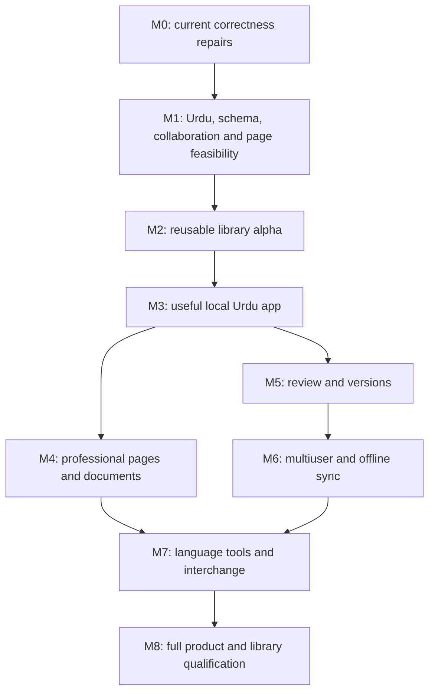

# Urdu document product roadmap v1.0

17 October 2026. Owner-requested replan. Status: PLANNED; no implementation or platform gate is newly passed. Main mission: an Urdu-first document application with Google Docs–level capabilities, powered by a reusable open-source Compose Multiplatform WYSIWYG editor library.

## 1. Decision and authority

Continue the existing editor foundation and verified repairs. Do not restart the engine or fork an entire competing editor merely because this roadmap broadens the application. Reuse established shaping, export, infrastructure and appropriately licensed components. The library and application are distinct products; the desktop prototype is a validation harness.

This roadmap owns product sequencing. `docs/project/FEATURE-CATALOG.md` owns the traceable feature inventory. `docs/project/URDU-ACCEPTANCE.md` owns Urdu quality gates. `docs/plans/v5.2/v5.2-integration-amendment.md` owns new library/application integration constraints. `docs/plans/v5.2/plan-v5.2.md` and `docs/plans/v5.2/editor-v5.2-standalone.md` consolidate the library plan. If an old scope exclusion conflicts with the new application ambition, distinguish an earlier library milestone from the final product; do not silently delete the feature.

Original v5.0.0 and v5.1 artifacts remain historical, hash-verifiable baselines. v5.2 preserves their applicable local-editing contracts but adds early design gates for collaborative history, review, page semantics and document packaging. It does not declare those unsolved algorithms complete. Current Antigravity recovery/lifecycle work continues untouched.

## 2. Scope and defaults

The complete product includes professional Urdu authoring, rich documents, paged/pageless editing, printable output, organization and offline work, collaboration/sharing, comments and suggested edits, named versions/restore, interchange, accessibility and extensions. Appendix-like capabilities such as citations, equations, footnotes, drawings/charts, document tabs, dictation and integration chips are tracked in the catalogue rather than forgotten.

Planning defaults: Urdu-first UI and templates, mixed-script content allowed, native Compose surfaces for Android/iOS/Desktop, the existing semantic-DOM Web design subject to qualification, local editing available without an account, cloud synchronization an application service, and separate optional library modules. The first reproducible integration environment is Windows Desktop because it already exists; Android qualification is the next device lane, with iOS/Web feasibility checked early rather than postponed until release.

Platform-specific staged releases are permitted and must be labeled. There is no approved reduction to Desktop-only or English-first scope. Exact UI design, app name, business model, hosting/data-region policy, service providers, project license and package coordinates are decisions not made by this replan.

“Every Google Docs feature” is the product ambition, not an exhaustive verified claim about a changing service. The catalogue provides a dated initial inventory, including provider-dependent features. Missing capabilities discovered later must be added and sequenced, not treated as out of scope by omission. Workflow equivalence is the target; copying Google's UI, trademarks, services or proprietary implementation is not required.

## 3. Product boundaries

| Layer | Responsibilities | Boundary |
|---|---|---|
| Reusable core/session | Canonical content, identity, structural commands, anchors, IME overlay, selection, transactions, local history, extension contracts | No account, database vendor, network stack or application chrome |
| Platform surfaces/adapters | Compose/DOM integration, pointer/keyboard/touch, native input, clipboard and editable accessibility | No independent document history |
| Layout/output modules | Typography profiles, continuous/paged geometry, export/print adapters, document-to-fragment maps | No mutation merely to reflow or print |
| Optional review/sync integration | Typed authored changes, annotation/review projections, replication/history interfaces | No second editable authority and no presumed remote-undo correctness |
| Urdu services | Qualified fonts/layout presets, language tools, dictionaries and diagnostic suggestions | Automatic analysis never silently rewrites canonical Urdu text |
| Application/workspace | Library consumers, accounts, folders/search, tabs, sharing, collaboration transport, comment threads, versions, notifications, providers | Uses public commands, receipts and resource interfaces |
| Examples and tests | Minimal external consumers and native qualification apps | No feature exists only inside the demo shell |

The open-source commitment applies to the library. The application can use a separately chosen distribution/license model. Release requires explicit license and dependency/font rights review; this roadmap grants no new license.

## 4. What changes now

- Retain the current transaction owner, native input/committed-overlay separation, Unicode and formatting rules, stable IDs and exact local history tests.
- Add an early collaboration/review experiment before stable API and persistent format commitments. Local root-snapshot Undo must not later be reused unchanged for collaborative Undo.
- Design document sections/tabs, rich cell identity, page settings, footnote references and review anchors before treating the current flat prototype or `.astra` format as the production schema.
- Keep pagination a required module; prove a single editable page-plan/PDF slice before expanding it.
- Use Urdu fixtures in every applicable phase. A Latin-only demonstration does not close a gate.
- Design application workspace, persistence and service boundaries now; implement them in dependency order rather than mixing backend code into input repair.

## 5. Milestones and acceptance gates

Each milestone produces runnable artifacts, exact commands, revision/font/resource identities and a feature-ID disposition. A passing plan review is not a passing implementation gate. Dates are not estimated before the capability experiments reveal the cost.

This diagram shows principal dependencies, not a prohibition on independent work. For example, basic templates can ship at M3 and advanced language services can develop once their command contracts exist; shared Urdu/native tests remain mandatory throughout.

| Milestone | Deliverables | Dependencies and exit criteria |
|---|---|---|
| M0 — Stabilize current foundation | Complete current host replacement/watchdog/lifecycle work; preserve partial-commit and attributed history regressions; record native qualification separately | Existing prototype. All deterministic regressions pass; no known silent data loss in covered paths. Native-unrun status remains explicit. No redesign or unrelated feature work. |
| M1 — Resolve integration risks | C0 collaboration/review experiment; GP0 editable pagination/output feasibility; U0 Urdu corpus/font profile; minimal Android/iOS/Web input/AT spikes; schema decision records | M0's stable contracts, not a finished application. Resolve choices that constrain core interfaces. No public 1.0 API/schema freeze until C0 and schema decisions are accepted; no paged release before GP0. Missing hardware blocks that platform's qualification, not independent model work. |
| M2 — Extract reusable library alpha | KMP modules, minimal external consumers, production schema/persistence migration scaffold, persistent storage and maps, qualified desktop continuous surface | M0 + accepted M1 schema/API decisions. G1–G4 and relevant G0/G5 work; U1/U2 fixtures. Core code has no sample-app dependence. Publish only explicitly labeled capabilities after license decision. |
| M3 — Useful local Urdu application | Workspace CRUD/search/trash, local autosave/recovery, formatting, structure, images/links, rich clipboard, find/replace, word count, outline, keyboard/touch/accessibility UX | M2. Exact save/reopen/Undo and crash-recovery tests, external consumer build, Urdu usability review. An actual writer can create and recover a substantial document. Cloud not required. |
| M4 — Professional document/page editing | Rich cells and rectangular selection; page/section settings, headers/footers, page numbers, keep/widow rules, footnote/citation/equation model integration, PDF/print | M1 GP0 + relevant M2/M3 structure/layout. GP1–GP3 and U3/U4. Page preview/output agree for pinned profile; no hidden truncation or raster-only substitution for semantic PDF. Merged/split cells require their model gate before inclusion. |
| M5 — Review and persistent versions | Comment threads, replies/resolve/reopen, anchored changes, suggestions including structure/format, review views, named versions, compare and restore | M1 C0 contracts + M3 persistence. R0: accept/reject is exact and authorized; anchors survive or explicitly orphan; snapshots and resources restore without losing current work. Test on Urdu and paged documents. |
| M6 — Multiuser and offline synchronization | Accounts/auth, server-enforced sharing roles, presence, simultaneous editing, offline queue/reconnect, review synchronization, per-user Undo | C0 selected algorithm and M5 semantics. C1: convergent delivery corpus, permission/revocation checks, reconnect/crash/duplicate handling, concurrent structure and composition tests; no lost peer edits. No general “cloud saved” label before durable acknowledgement. |
| M7 — Language and interoperability breadth | Qualified Urdu spelling/grammar assistance, dictionary controls, explicit normalization/transliteration tools, dictation, DOCX/ODT and supported-format interchange, templates and tracked advanced catalogue work | Relevant M3–M6 contracts. U5/I0: original text preservation, licensed datasets, reported conversion losses, DOCX review/structure fixtures, provider failures handled. Advanced feature development may overlap earlier milestones once dependencies pass. |
| M8 — Full product qualification and library 1.0 | Complete catalogue disposition, target/platform matrix, security/AT/performance/durability runs, docs/packages/samples, installer/release process | GL, applicable G0–G8, GP0–GP3, U0–U5, C0/C1, R0 and I0. Any missing required feature is disclosed; a partial release cannot be called full parity. Provider/open decisions require owner disposition, never automatic deletion. |

No release may silently loosen raw input fidelity, Urdu correctness or history guarantees to hit a schedule. Mature features can ship incrementally without advertising completion of later milestones.

## 6. Critical path and bounded experiments

### C0 — Collaboration and review before API freeze

Create a standalone experiment with two replicas and one authoritative document schema, not a second production editor. Compare a compatible existing replication engine with a server-ordered operation approach only as needed to choose one; do not invent a new distributed algorithm for novelty. Pick the winner using executable compatibility, portability, licensing and complexity evidence, and record its exact dependency/version. Algorithm/provider selection is OPEN until this experiment concludes.

Use fixed, independently specified traces: concurrent Urdu insert/delete; same-boundary insert ordering; opposite edits around a structural split/join; move versus delete; formatting versus replacement; comment anchor deletion; competing suggestion accept/reject; offline edit after access revocation; user A Undo preserving B's contribution; duplicate/reordered delivery; reconnect after snapshot compaction; remote changes before/inside/after a local composing island. Include multi-paragraph cells and a header/footer flow. Run 20 deterministic seeds with at least 100,000 total generated valid operations plus named traces; count alone is not proof.

Acceptance: replicas converge in canonical content/attributes/structure/IDs and review state; schema is valid after every publication; local Undo does not restore an old whole-document root over peer changes; unauthorized changes do not become accepted server state; cancellation/partial commitment never loses accepted text. Record exact semantics for every conflict, not “last write wins” without field/ordering definitions. If no candidate passes, keep the library experimental and reopen only the affected interfaces.

### GP0 — One Urdu page/output vertical slice

Use at least three pages containing mixed Urdu/English, a long Nastaliq paragraph, diacritics, an image, a rich table continuing across pages and a header/page-number field. Demonstrate typing, selection and synthetic plus available native composition around a page boundary, then generate searchable PDF using the same page plan. Pin fonts/resources and inspect extracted text and geometry. Include a font/resource arrival and a paragraph reflow. Choose the export/shaping integration from this evidence, not a library feature list. A rejected backend does not authorize removing page editing.

### S0 — Schema compatibility before storage/API stabilization

Specify and validate mappings for body/section/tab flows, header/footer variants, footnote references, rectangular/merged cells, persistent annotation/review anchors and opaque supported extension payloads. The old local schema remains the baseline until an explicit versioned migration is selected. `.astra` v1–v3 are prototype formats, not a promise that production content will be limited to their model. Test old-load/new-save, rejected unsupported migrations and resource retention before advertising interchange.

## 7. Immediate next work, in order

1. Antigravity finishes its current mounted-host replacement/failure-path task. Codex audits the resulting diffs and exact regressions. Do not interrupt that work to implement this whole roadmap.
2. Prepare U0 fixtures/font manifest and the S0/C0 experiment inputs in isolated validation modules; no production API commitment yet.
3. Execute C0 and the bounded GP0 slice with named failure/stop conditions. These are the next architectural decisions, not another open-ended plan debate.
4. Extract the qualified library core and an external consumer (M2). Port existing regressions before changing storage.
5. Deliver the local Urdu app milestone (M3), then integrate the remaining milestones along the dependency graph.

The old prototype's flat storage is acceptable evidence scaffolding, not permission to promise million-unit capacity. Existing G8 thresholds remain targets; application latency and cloud acknowledgement measurements must be reported separately.

## 8. Decisions still open, with deadlines

| Decision | Default/constraint | Must settle before |
|---|---|---|
| Library license and package identity | Open-source, embeddable; preserve third-party notices; no application-license inference | First public package release |
| Urdu font profiles | Licensed reproducible primary Nastaliq and fallback fonts; no guessed embedding permission | U0 / GP0 |
| Replication and collaborative Undo algorithm | Established reusable engine preferred if compatible; single authority/projection boundary required | C0 / public API freeze |
| Review representation | First-class authored operations and retained deleted content, not decorative colors | R0 implementation; experimental representation in C0 |
| Schema migrations including merged cells | Stable IDs and explicit versioning; existing cell flows preserved | S0 / production persistence freeze |
| PDF and print backend | Shared qualified page plan and searchable text; no hidden independent repagination | GP0 |
| Hosting, authentication, storage and data region | Vendor-neutral service interfaces, local work supported; no assumed account/provider | M6 implementation/deployment |
| Urdu linguistic datasets/services | Evaluation and redistribution rights required; optional user-invoked external processing | U5 / M7 |
| Proprietary ecosystem equivalents and AI providers | Tracked in catalogue; optional integrations must not be core editing dependencies | Their feature design gates / parity claims |

## 9. Evidence and governance

Use `docs/project/FEATURE-CATALOG.md` IDs in issues/commits/reports. Status vocabulary: PLANNED, IMPLEMENTED_UNQUALIFIED, QUALIFIED_ON_TARGET, BLOCKED_EXPERIMENT, OWNER_DECISION. Record target/version for qualification; never one global PASS for four platforms.

The prior v5 tests, current desktop tests and reuse research remain evidence with their original scope. This replan does not rerun or upgrade their claims. New milestones are NOT RUN. Maintain a current change log rather than rewriting historical failures. A product scope change is allowed only by the owner; an implementation alternative may be selected by agents when it preserves the accepted outcomes and is documented/tested.

The feature catalogue draws on current official Google help for pages, tabs, offline work, suggestions, versions, citations, chips and accessibility. Those are reference workflows, not a requirement to copy Google-specific services or an assertion of an exhaustive comparison. Review the catalogue at each product release.
